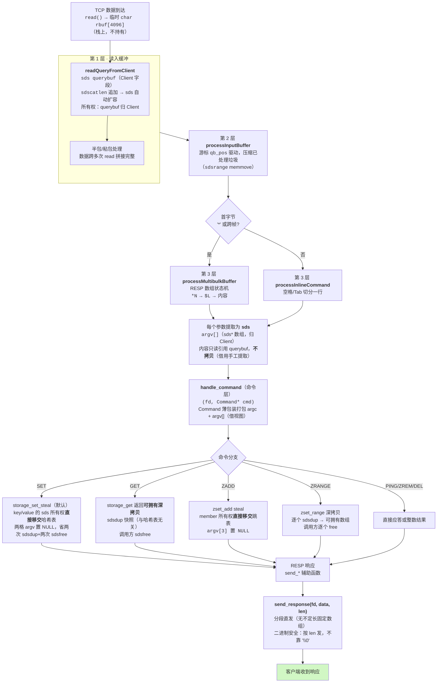
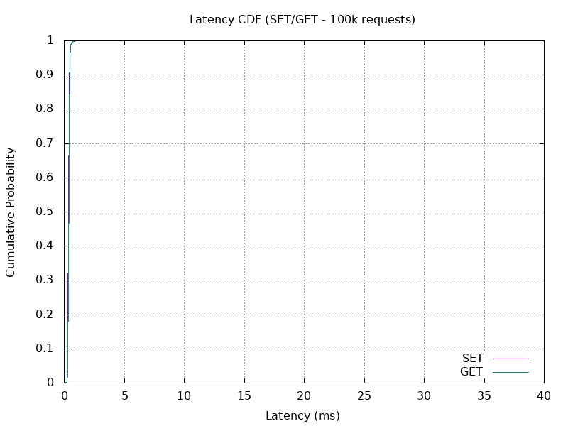

# mini-redis

用纯 C 语言手写的、实现 **RESP 协议编码**与 **8 个命令子集**的、内存级键值存储引擎。

从 Socket 网络编程、RESP 协议解析，到哈希表、跳表、有序集合与 **SDS（简单动态字符串）**，全部手写，不依赖任何第三方库 —— 证明自己「能写底层」的最强证据。

> ⚠️ **「兼容 Redis」的准确边界**（审查后修正，详见文末「与 Redis 的协议兼容性差距」小节）
> 本项目实现的是 **RESP 协议编码**，并支持 `PING / SET / GET / DEL / ZADD / ZREM / ZSCORE / ZRANGE`
> 这 8 个命令的**基础形态**，尚未做到与真实 Redis 的命令语义完全对齐。最需要注意的一条：
> **有序集合目前是全局单例** —— `ZADD key score member` 里的 `key` 被忽略，
> 不同 key 的成员会混在同一个 zset 里。
>
> ⚠️ **关于「生产级」**：本项目面向学习与能力验证，**不是**生产可用的服务。
> 它缺少认证、内存上限与连接超时，且当前是阻塞式单连接串行模型（详见「待实现」）。
> 下文 §6 选型表中 SDS 版标注的「健壮」，仅指**相对无 SDS 版在数据正确性
> （二进制安全、防缓冲区溢出）与容量上更健壮**，不等于生产可用。

## 🚀 快速开始

### 编译

```bash
make clean && make
```

### 运行服务器

```bash
./mini-redis
```

> 自定义端口（按优先级：命令行参数 > `PORT` 环境变量 > 默认 6379）：
> ```bash
> ./mini-redis 6390          # 命令行参数指定端口
> PORT=6390 ./mini-redis     # 环境变量指定端口
> ```

### 用 redis-cli 连接测试

```text
redis-cli -h 127.0.0.1 -p 6379
127.0.0.1:6379> SET name zhangsan
OK
127.0.0.1:6379> GET name
"zhangsan"
127.0.0.1:6379> DEL name
(integer) 1

127.0.0.1:6379> ZADD myzset 10 apple
OK
127.0.0.1:6379> ZADD myzset 5 banana
OK
127.0.0.1:6379> ZRANGE myzset 0 -1
1) "banana"
2) "apple"
127.0.0.1:6379> ZSCORE myzset apple
"10"
127.0.0.1:6379> ZREM myzset banana
(integer) 1
```

### 跑全量回归测试

```bash
./test.sh        # 集成回归（协议 / 二进制 / 大值 / 断连 / 退出），全部通过
```

## 🏗️ 项目架构

```
mini-redis/
├── include/
│   ├── protocol.h    # 协议解析接口
│   ├── storage.h     # 存储层接口
│   ├── dict.h        # 通用哈希表接口（void* key/value + dictType 函数表）
│   ├── skiplist.h    # 跳表接口
│   ├── zset.h        # 有序集合接口
│   ├── commands.h    # 命令分发接口
│   └── sds.h         # 简单动态字符串接口（二进制安全 + 自动扩容）
├── src/
│   ├── server.c      # 服务器主程序（Socket + 请求生命周期 + RESP 发送层）
│   ├── protocol.c    # RESP 协议解析器
│   ├── commands.c    # 命令分发（PING/SET/GET/DEL/ZADD/ZREM/ZSCORE/ZRANGE）
│   ├── storage.c     # 存储层（封装哈希表，所有权转移边界）
│   ├── dict.c        # 通用哈希表实现（djb2 + 链地址法 + 自动扩容 + 策略表）
│   ├── skiplist.c    # 跳表实现（span 跨度 + dict 哈希索引）
│   ├── zset.c        # 有序集合（封装跳表，深拷贝边界）
│   ├── sds.c         # SDS 实现（5 档 header + 二进制安全 + 预分配扩容）
├── docs/
│   └── dict-design.md    # 通用哈希表设计笔记（为什么能通用 / vtable 多态 / Redis 对照）
├── tests/            # 断言式单元测试（make unit / make check）
│   ├── test_sds.c        # SDS：二进制安全、TYPE_5 边界、动态扩容
│   ├── test_dict.c       # 哈希表：增删改查、自动扩容、★ 通用性（非 sds 类型 + 借用语义）
│   ├── test_skiplist.c   # 跳表：排序正确性、随机压力、删除与更新分数
│   ├── test_skipspan.c   # 跳表 span：45.8 万次操作对照暴力参考数组
│   └── test_zset.c       # 有序集合：steal 所有权、range 深拷贝边界
├── test.sh           # 自动化回归测试脚本（支持 HOST/PORT/SKIP_BUILD 覆盖）
├── archive/          # ⚠️ 历史归档，不参与构建：早期打印式 demo，API 已过时
│   └── 旧 main.c / zset.c / test_*.c，仅作过程记录，勿直接编译运行
├── bench/            # 压测与探针脚本合集
│   ├── bench.sh         # redis-benchmark 多命令/多并发/多数据量压测
│   ├── bench_py.py      # 流水线吞吐 + 延迟分布快测
│   ├── bench_collect.py # 多流水线深度/多命令/多负载 QPS → CSV
│   ├── bench_focus.py   # 聚焦压测（固定流水线深度 SET/GET/大值 QPS，sds vs 无sds 对比）
│   ├── bench_ping_curve.py # PING 流水线深度缩放曲线
│   ├── bench_latency.py   # 延迟分布（多档位大值 SET/GET 的 min/avg/p50/p99，sds vs 无sds）
│   ├── bench_throughput.py # 大数据吞吐（多档位大值 SET/GET 的流水线 QPS + MB/s 载荷吞吐）
│   ├── bench_extreme.py    # 综合压测（极限吞吐 + 串行延迟 + 跳表 zset，支持 3 版二进制对比）
│   ├── bench_ab.py         # 交错 A/B（同一脚本轮换两版二进制，取中位数对比，抗机器漂移）
│   └── correctness_probe.py # 二进制安全 / 大值正确性探针
├── Makefile
└── README.md
```

### 架构分层

```text
┌─────────────────────────────────────────────┐
│  网络层 (server.c)  readQueryFromClient       │  ← Socket 通信、事件循环、请求生命周期
├─────────────────────────────────────────────┤
│  协议层 (protocol.c / server.c)               │  ← RESP 解析（multibulk + inline 状态机）
├─────────────────────────────────────────────┤
│  命令层 (commands.c)  handle_command          │  ← PING/SET/GET/DEL/ZADD/ZREM/ZSCORE/ZRANGE
├─────────────────────────────────────────────┤
│  存储层 (storage.c / zset.c)                  │  ← 封装哈希表与有序集合，深拷贝边界
├─────────────────────────────────────────────┤
│  数据结构层 (dict / skiplist / sds)           │  ← 通用哈希表 / 跳表 / 简单动态字符串
└─────────────────────────────────────────────┘
```

## 🔄 请求生命周期：从进来到最后发出去

这是**一条命令从到达服务器到把响应发回客户端**的完整数据流动，标注了每层的函数、数据类型和数据所有权变化。



**所有权速查表**

| 数据 | 生命周期 | 谁负责释放 |
|------|---------|-----------|
| `rbuf[4096]` | 单次 read 后即弃 | 栈（无需释放） |
| `querybuf` (sds) | 整个连接期间 | `free_client` → `sdsfree` |
| `argv[]`（协议层提取的 sds） | 单条命令后释放；**SET 的 key/value 两格例外**——被 `storage_set_steal` 移交给哈希表且置 NULL | `processMultibulkBuffer` / `processInlineCommand`（SET 两格由哈希表释放） |
| 哈希表 key/value | 存入即归哈希表 | `hashtable_free` / `hashtable_del` |
| 跳表 member | 存入即归跳表 | `skiplist_free` / `skiplist_del` |
| `zset_range` 返回数组 | 调用方使用完毕后 | 命令层逐个 `sdsfree` + `free` |
| `storage_get` 返回值 | 可拥有深拷贝（与哈希表无关的快照） | 命令层 `sdsfree` |

## 🧵 SDS：简单动态字符串

SDS 是这套引擎的数据基石 —— 协议解析、缓冲管理、底层存储全部用它。它解决了裸 C 字符串的 5 个缺陷：

1. **取长度 O(1)**：header 里存了 `len`，不用 `strlen` 从头扫。
2. **二进制安全**：按 `len` 处理数据，数据里含 `\0` 也不会被切断。
3. **防缓冲区溢出**：拼接前检查容量，自动扩容，杜绝 `strcpy/strcat` 越界。
4. **避免频繁重分配**：`sdsMakeRoomFor` 预分配（<1MB 翻倍 +1，≥1MB +1MB）。
5. **自描述**：`len/alloc/flags` 都在 header 里，字符串知道自己多大。

### 5 档 header（根据长度选最小档）

| 类型 | flags 编码 | 覆盖长度 | header 大小 |
|------|-----------|---------|------------|
| `SDS_TYPE_5` | 高 5 位存 len | 0–31 字节 | 1 字节 |
| `SDS_TYPE_8` | `uint8` | 0–255 | 3 字节 |
| `SDS_TYPE_16` | `uint16` | 0–64K | 5 字节 |
| `SDS_TYPE_32` | `uint32` | 0–4G | 9 字节 |
| `SDS_TYPE_64` | `uint64` | 超大 | 17 字节 |

`char *s` 指向数据区起点，前面紧贴一个 `sdshdr`。`sdslen()` 通过 `s[-1]` 反向回溯 header 读 `len`，O(1)。

> ⚠️ **踩过的坑（已修复）**：`SDS_TYPE_5` 用 `len << 3` 存在 `s[-1]` 里。当 `len ∈ [16,31]` 时 `len << 3 ≥ 0x80`，作为 **有符号 char** 是负数，`s[-1] >> 3` 算术右移会变成巨大 `size_t`（如 `0xFFFFFFFFFFFFFFF0`），导致 `sdsdup`/`sdsnewlen` 拷贝巨大长度 → 缓冲区溢出崩溃。修复：右移前先 `(unsigned char)` 强转。

## ✅ 全量测试

`./test.sh` 覆盖（用例数随回归补充增长，以脚本输出的 `N/N 通过` 为准）：

| 分组 | 覆盖点 |
|------|--------|
| 基础命令 | PING / SET / GET / DEL 正常路径 |
| 有序集合 | ZADD / ZREM / ZSCORE / ZRANGE、反序、重复 member 更新分数 |
| 边界与异常 | 未知命令、参数个数错误、非法 score（NaN/垃圾）、非法索引、ZADD 同分 |
| 协议解析 | multibulk / inline、空行忽略、粘包与**半包分帧**（header 分段、bulk 内容分段） |
| 二进制安全 | 含 `\0` 的值、二进制 zset member |
| 超大值 | 2000B / 8192B / 320KB 值（验证 sds 动态扩容 + 无固定缓冲限制） |
| 断连与退出 | 客户端强制 RST 断连后服务器仍存活（SIGPIPE 回归）；有连接时 SIGINT 能优雅退出 |
| 并发（记录项） | 第 2 条连接是否被第 1 条阻塞 —— 当前属已知限制，只记录不计分 |

**单元测试**（`make unit`，不依赖 redis-cli / 不可联网也能跑）：

| 测试 | 覆盖 |
|------|------|
| `test_sds` | 二进制安全 / TYPE_5 边界 / 动态扩容 |
| `test_dict` | 增删改查 / 自动扩容后数据完整性 / **通用性**（非 sds 类型 + 借用语义） |
| `test_skiplist` | 排序正确性 / 500 成员随机压力 / 删除与更新分数 |
| `test_skipspan` | span 与排名正确性（45.8 万次操作对照暴力参考数组，458 项） |
| `test_zset` | steal 所有权 / range 深拷贝边界 |

`make check` = 单元测试 + 集成回归；`make asan` 会用 ASan/UBSan 重编以检测内存问题。

**当前结果：集成 51/51 ✅ · 单元 5/5 ✅ · ASan/UBSan/LSan 零泄漏 ✅**

## 📊 压测数据

### 测试环境与基线

| | |
|---|---|
| **机器** | VMware 虚拟机 · 2GB 内存 · RHEL 8.10 · gcc 8.x |
| **SDS 版** | 当前 `master` |
| **无 SDS 基线** | 提交 `393ced1`（改造前）：固定 `char querybuf[1024]` + 裸 C 字符串（`malloc(len+1)` + `strcpy`，遇 `\0` 截断、固定容量上限） |
| **复现** | `make benskip`（跳表算法层）· `bench/correctness_probe.py` · `bench_focus.py` · `bench_throughput.py` · `bench_latency.py` |

> ⚠️ **波动提示**：本机是 VM，单跑吞吐波动可达 **±30%**（SET 57k~83k 都出现过）。
> 小命令吞吐**看量级即可**；要做严格对比请看**延迟**（更稳定）与**交错 A/B**（§7）。

### 四把尺子

同一份数据从四个角度量，各回答一个问题：

```dsh-ui
{"title":"压测数据的四个维度","gap":12,"items":[{"type":"table","columns":["尺子","量什么","回答的问题","在哪一节"],"rows":[["① 正确性","能不能存、存了会不会丢/崩","能不能用","§1"],["② 吞吐 QPS","流水线 depth=200，单位时间处理多少命令","快不快","§2 §6"],["③ 载荷吞吐 MB/s","流水线，单位时间读写多少字节","大值扛不扛得住","§3"],["④ 延迟 µs","串行 RTT，单次操作真实耗时","响应手感如何","§4 §6"]],"types":["text","text","text","text"]},{"type":"callout","tone":"info","title":"怎么读下面这些表","content":"每个小节都是「表格给原始数字 + 图给直观对比 + 读它给结论」。如果只想看结论，直接跳到 §8 的一页总结。"}]}
```

---

### 1. 正确性：能不能用（二进制安全 + 大值）

| 测试项 | SDS 版 | 无 SDS 版 |
|--------|--------|----------|
| 含 `\0` 的值（`A\x00xy`） | ✅ 原样存取 | ❌ 截断成 `A`（strcpy 遇 `\0` 停） |
| 16 字节 key（TYPE_5 边界）、32B key | ✅ | ✅ |
| 2000B / 64KB / 320KB 值 | ✅ 任意大小 | 💥 崩溃（>1KB 固定缓冲溢出） |
| 二进制 zset member | ✅ | —（崩溃前未测到） |

> **结论**：正确性是 SDS 的胜负手——二进制安全（`\0` 不截断）+ 无固定容量上限。无 SDS 在 >1KB 的值上直接缓冲区溢出崩溃。

---

### 2. 小命令吞吐（流水线 depth=200，QPS）

| 操作 | SDS 版 | 无 SDS 版 | 说明 |
|------|--------|----------|------|
| SET | 54,674 | 136,534 | 无 SDS 快约 **2.5x** |
| GET | 55,477 | 166,999 | 无 SDS 快约 **3x** |

```dsh-ui
{"title":"小命令吞吐 · 无SDS 更快 (depth=200, QPS)","gap":12,"items":[{"type":"chart","kind":"bars","data":[{"label":"无SDS GET","value":166999},{"label":"无SDS SET","value":136534},{"label":"SDS GET","value":55477},{"label":"SDS SET","value":54674}],"horizontal":true},{"type":"callout","tone":"info","title":"为什么小命令下无 SDS 反而更快？","content":"无 SDS 用固定栈缓冲 + 直接 memcpy，零动态分配；SDS 每次命令有 header 校验 + sdsMakeRoomFor 预分配等动态分配开销。服务器本身是 IO 瓶颈，无 SDS 省掉了命令构造开销，所以小命令快 2-3 倍。但这份速度换来的是无法处理 >1KB 值、无法存取含 \\0 的二进制数据。"}]}
```

---

### 3. 大数据吞吐（流水线 depth=200，QPS + 载荷 MB/s）

> 这是「单位时间能读写多少**字节**」——对 SET 是写入值字节，对 GET 是读出值字节（= QPS × 值大小）。无 SDS 在 512B 后（≥1KB）因固定缓冲溢出崩溃，故只有 512B 一档；SDS 全档位存活。

| 值大小 | SDS SET QPS (MB/s) | SDS GET QPS (MB/s) | 无SDS SET QPS (MB/s) | 无SDS GET QPS (MB/s) |
|--------|-------------------|-------------------|----------------------|----------------------|
| 512B | 80,108 (**39**) | 87,532 (**43**) | **159,077** (**78**) | **177,609** (**87**) |
| 1KB | 70,429 (69) | 68,919 (67) | 💥 崩溃 | 💥 崩溃 |
| 4KB | 61,950 (242) | 68,993 (269) | 💥 崩溃 | 💥 崩溃 |
| 32KB | 33,548 (1,048) | 17,417 (544) | 💥 崩溃 | 💥 崩溃 |
| 128KB | 13,395 (1,674) | 3,127 (391) | 💥 崩溃 | 💥 崩溃 |

```dsh-ui
{"title":"大数据吞吐 · 仅 SDS 存活 (depth=200, 载荷 MB/s)","gap":12,"items":[{"type":"chart","kind":"line","series":[{"label":"SDS SET (写入)", "data":[{"label":"512B","value":39},{"label":"1KB","value":69},{"label":"4KB","value":242},{"label":"32KB","value":1048},{"label":"128KB","value":1674}]},{"label":"SDS GET (读出)", "data":[{"label":"512B","value":43},{"label":"1KB","value":67},{"label":"4KB","value":269},{"label":"32KB","value":544},{"label":"128KB","value":391}]}]},{"type":"callout","tone":"error","title":"512B 后无 SDS 直接崩","content":"无 SDS 只有 512B 一档（SET 78 / GET 87 MB/s，还比 SDS 快约 2 倍）；从 1KB 起因固定 1024 字节缓冲溢出而崩溃。SDS 的写吞吐随值变大一路冲到 128KB 的 1674 MB/s —— 单线程 IO 被榨满，这就是 SDS 在大值吞吐上的能力边界。"}]}
```

> **读它**：小值（512B）时无 SDS 的载荷吞吐是 SDS 的 ~2 倍；但一旦值 ≥1KB，无 SDS 直接崩，SDS 仍能以 39→1674 MB/s 的坡度持续扩容。**大值吞吐是 SDS 的专属战场**。

---

### 4. 延迟分档（串行 RTT，µs，N=3000）

> 发一条 → 等回复 → 再发下一条的**单命令真实延迟**（用户感知）。与第 2/3 节的流水线吞吐互补。

| 操作 · 档位 | SDS avg/p50/p99 | 无SDS avg/p50/p99 |
|------------|----------------|-------------------|
| SET 8B | 120 / 106 / 213 | **82 / 72 / 191** |
| GET 8B | 141 / 132 / 241 | **101 / 90 / 221** |
| SET 512B | 129 / 116 / 237 | **112 / 98 / 218** |
| GET 512B | 122 / 110 / 229 | **100 / 87 / 206** |
| SET 1KB / 4KB / 32KB | 121–134 / 109–121 / 221–237 | 💥 崩溃 |
| SET 128KB | 192 / 175 / 309 | 💥 崩溃 |
| GET 128KB | 225 / 218 / 339 | 💥 崩溃 |

```dsh-ui
{"title":"① 小命令延迟 (µs) · 无SDS 略低","gap":12,"items":[{"type":"chart","kind":"bars","data":[{"label":"GET 8B 无SDS","value":101},{"label":"GET 8B SDS","value":141},{"label":"SET 8B 无SDS","value":82},{"label":"SET 8B SDS","value":120},{"label":"GET 512B 无SDS","value":100},{"label":"GET 512B SDS","value":122},{"label":"SET 512B 无SDS","value":112},{"label":"SET 512B SDS","value":129}],"horizontal":true}]}
```

```dsh-ui
{"title":"② 大值延迟 · 只有 SDS 存活 (SET avg µs)","gap":12,"items":[{"type":"chart","kind":"line","series":[{"label":"SDS (全档位稳定)", "data":[{"label":"8B","value":120},{"label":"512B","value":129},{"label":"1KB","value":123},{"label":"4KB","value":121},{"label":"32KB","value":134},{"label":"128KB","value":192}]}]},{"type":"callout","tone":"error","title":"大值延迟上无 SDS 无数据","content":"小命令（≤512B）下无 SDS 延迟比 SDS 低约 10-30%（无动态分配）。但 1KB 起无 SDS 崩溃，SDS 延迟从 ~120µs 平滑升到 128KB 的 ~192µs，依旧稳定服务 —— 这就是 SDS 的延迟优势区。"}]}
```

> **怎么读**：小命令（≤512B）无 SDS 快 10%–30%；**≥1KB 无 SDS 崩溃，SDS 以 120µs→192µs 平滑续服务**。SDS 的延迟曲线在 4KB 前几乎平（~120µs），远没到瓶颈。

---

### 5. PING 流水线深度缩放（QPS vs 管道深度）

| 管道深度 | SDS 版 | 无 SDS 版 |
|---------|--------|----------|
| 1 | 7,579 | 10,422 |
| 10 | 33,896 | 59,609 |
| 50 | 54,519 | 117,547 |
| 200 | 61,126 | 175,638 |
| 500 | 61,763 | 153,960 |
| 1000 | 64,945 | 170,483 |

```dsh-ui
{"title":"PING 流水线深度缩放曲线","gap":12,"items":[{"type":"chart","kind":"line","series":[{"label":"无 SDS","data":[{"label":"1","value":10422},{"label":"10","value":59609},{"label":"50","value":117547},{"label":"200","value":175638},{"label":"500","value":153960},{"label":"1000","value":170483}]},{"label":"SDS","data":[{"label":"1","value":7579},{"label":"10","value":33896},{"label":"50","value":54519},{"label":"200","value":61126},{"label":"500","value":61763},{"label":"1000","value":64945}]}]}]}
```

> 两条曲线都随管道深度上升，无 SDS 上限显著更高（~17 万 vs ~6.5 万）。

---

### 6. 使用场景决策：什么时候该用无 SDS，什么时候该用 SDS？

| 你的场景 | 该用谁 | 原因 |
|---------|--------|------|
| 缓存/序列化数据（含 `\0`、二进制） | **SDS** | 无 SDS 遇 `\0` 截断丢数据 |
| 值可能 >1KB（图片、日志、大文档） | **SDS** | 无 SDS 固定 1024 缓冲溢出崩溃 |
| 纯文本小 KV，极致压 QPS | 无 SDS | 小命令快 2-3 倍 |
| 生产环境、要防崩溃 | **SDS** | 自动扩容 + 二进制安全（仅限**数据正确性**层面；认证/并发/持久化仍缺失，见「待实现」） |
| 追求极低单命令延迟 | 无 SDS 略优 | 但仅限 ≤512B 才成立 |

逐维度对照：

```dsh-ui
{"title":"无 SDS vs SDS · 逐维度对照","gap":12,"items":[{"type":"table","columns":["维度","无 SDS","SDS"],"rows":[["小命令(≤512B) 吞吐","✅ 快 2-3 倍","约为 1/3"],["大值(≥1KB) 吞吐/延迟","💥 崩溃","✅ 39→1674 MB/s"],["二进制安全(含 \\0)","❌ 截断","✅ 原样"],["防缓冲区溢出","❌ 固定 1024 易崩","✅ 自动扩容"],["单连接串行延迟","✅ 低 10-30%","略高"],["数据正确性与容量健壮性","❌ 二进制/大值错乱崩溃","✅ 二进制安全 + 任意大小"]],"types":["text","text","text"]}]}
```

---

### 7. 总结：SDS 到底提升了什么？

**SDS 没有让原始 QPS 变快，甚至略慢**，但它在**能力边界**上是质变：

```dsh-ui
{"title":"SDS 带来的真实提升","gap":12,"items":[{"type":"list","items":[{"title":"二进制安全","desc":"值/键/member 里可以含 \\0 字节。无 SDS 用 C 字符串遇 \\0 截断，会丢数据。对二进制协议/序列化数据是刚需。"},{"title":"无固定容量上限","desc":"querybuf 不再是写死的 char[1024]。1KB、64KB、320KB 的值都能存。无 SDS 在 >1KB 上缓冲区溢出直接崩溃。"},{"title":"大数据吞吐容量","desc":"128KB 值仍有 1674 MB/s 写入载荷吞吐；无 SDS 在 1KB 就崩。"},{"title":"O(1) 长度 + 自动扩容","desc":"header 存 len，取长不扫全串；sdsMakeRoomFor 预分配避免频繁 realloc，天然防缓冲区溢出。"},{"title":"代价：小命令略慢","desc":"动态分配 + header 处理让每个小命令多几条指令，原始小命令 QPS 约为无 SDS 的 1/3。"}]}]}
```

**一句话总结**：无 SDS 是「快但脆」—— 小命令快 3 倍、延迟低 30%，却扛不住 >1KB 的数据和含 `\0` 的二进制值；SDS 是「稳而全」—— 牺牲一点小命令速度，换来二进制安全 + 任意大小 + 大数据吞吐 + 防溢出，这才是生产级 KV 该有的样子。

---

### 8. 极限吞吐与延迟（当前版本，三版对比：SDS默认 / SDS+argv不释放 / 无SDS）

> 这一节回答「当前这个版本处理同一类数据，极限在哪」。吞吐用流水线（depth=200）逼近服务器处理上限，延迟用串行 RTT。三版为同一套源码：`master` 默认（深拷贝）、加 `-DSTEAL_ARGV` 编译（argv 直接移交哈希，不深拷贝）、以及无 SDS 基线（`393ced1`）。
> ⚠️ 本机是 VM，单跑吞吐波动可达 ±30%（57k~83k QPS 都出现过），小命令吞吐看量级即可；延迟（更稳定）和**交错 A/B**（见第 10 节）才是可信对比。

| 指标 | SDS 默认 | SDS+steal | 无 SDS |
|------|---------|-----------|--------|
| SET 8B 吞吐 (QPS) | ~57k | ~68k | **~159k** |
| GET 8B 吞吐 (QPS) | ~57k | ~70k | **~179k** |
| SET 8B 延迟 avg (µs) | **110.6** | 117.2 | 98.9 |
| GET 8B 延迟 avg (µs) | 120.1 | 131.9 | **121.5** |

```dsh-ui
{"title":"极限吞吐 · 无SDS 独占鳌头 (depth=200, QPS)","gap":12,"items":[{"type":"chart","kind":"bars","data":[{"label":"无SDS GET","value":179},{"label":"无SDS SET","value":159},{"label":"SDS+steal GET","value":70},{"label":"SDS+steal SET","value":68},{"label":"SDS默认 GET","value":57},{"label":"SDS默认 SET","value":57}],"horizontal":true}]}
```

> **读它**：吞吐上无 SDS 明显领先（~2.5-3x），这是它「快」的来源；但这份速度归因于去掉 sds 的动态分配，代价是 >1KB 就崩、遇 `\0` 截断。SDS 默认与 SDS+steal 的差距在噪声范围内（见第 10 节的严格 A/B）。延迟三版都在 ~100-130µs 量级，无 SDS 略低但不显著。

---

### 9. 跳表：span + O(1) find，让跳表发挥出应有的复杂度

跳表做过两轮 Redis 对齐改造（见 `include/skiplist.h` 顶部注释）：

**第一轮：补上复杂度短板**

1. **`SkipListLevel {forward, span}`** —— 每个前进指针带上 `span`（该层一跳跨越的节点数）。做范围查询 / 问排名时可以**顺着高层累加 span 直接跳到目标排名**（`skiplist_get_rank` / `skiplist_range`），不再沿第 0 层 `for` 循环走过去。复杂度 **O(n) → O(log n)**。
2. **member → SkipNode 哈希索引** —— `skiplist_find` 从「第 0 层线性扫描」变成 **O(1) 哈希直查**。ZADD 查重、ZSCORE/ZREM 的成员定位都随之 O(1)。

**第二轮：索引改用通用哈希表（消除重复实现）**

第一轮的索引是在跳表里**又写了一份**哈希表（约 100 行）。根因是原 `hashtable` 把「value 必须是 `sds`」和「表负责 free key/value」焊死在接口上，而索引要的是「value 是个 `SkipNode*`」+「一个都不许 free」—— 两条都冲突。

后来 `hashtable` 泛型化成了 **`dict`**（`void* key` + `void* val` + `dictType` 函数表），索引就直接复用它了：

```c
/* skiplist.c：挂一份「借用语义」的 dictType 即可 */
static dictType skipIndexDictType = {
    dictSdsHash, dictSdsKeyCompare,  /* 复用 sds 那套（member 也是 sds） */
    NULL, NULL, NULL,                /* 不拷贝 */
    skipIndexKeyDestructor,          /* ★ 借用 → 空操作 */
    skipIndexValDestructor,          /* ★ 借用 → 空操作 */
};
sl->index = dictCreate(&skipIndexDictType, NULL);
```

那 100 行整体删除，`skiplist_find` 退化为一行 `dictFind`。**设计推导见 `docs/dict-design.md`。**

> 服务端框架（RESP 解析 + 每段 `write()` 系统调用）把单连接命令 QPS 压在 ~50k 量级（连纯 PING 都只有 ~49k），端到端 QPS 测不出跳表算法的量级差。所以下面是**算法层微基准** `bench/bench_skipspan.c`（直接调 `skiplist` API、绕过框架、`-O2` 编译）的实测，用「数字是否随表大小增长」来实证复杂度。

| 操作（算法层，ns/op） | 旧版 n=1 万 | 旧版 n=3 万 | 新版 n=1 万 | 新版 n=20 万 | 新版 n=40 万 | 复杂度 |
|---|---|---|---|---|---|---|
| `find`（member 点查） | 117,947 | 726,687 | 56 | 199 | 261 | 旧 O(n) → 新 **O(1)** |
| `range` 跳到 start=0 收集 10 个 | 39 | 42 | 46 | 77 | 46 | 都 O(1)（收集固定量） |
| `range` 跳到 start≈n/2 收集 10 个 | 95,952 | 513,229 | 99 | 258 | 82 | 旧 O(n) → 新 **O(log n)** |
| `range` 跳到 start≈n 收集 10 个 | 223,729 | 1,249,593 | 184 | 203 | 86 | 旧 O(n) → 新 **O(log n)** |
| `get_rank`（求成员排名） | — | — | 526 | 2,024 | 2,304 | 新 **O(log n)** |
| `add`（更新已有成员分数） | — | — | 1,244 | 3,817 | 4,128 | 新 **O(log n)** |

> **数据说明**：
> - 「旧版」两列来自**改造前源码**（提交 `1ba4fce`，无 span、无索引），保留作为复杂度对照。
> - 「新版」三列是**当前 master**（索引已改用 `dict`）的 3 次运行**中位数**，`REPS=500,000`。
> - 与上一版 README 相比数字略有变化（如 find 40 万：275 → 261 ns），因为索引从跳表自造的表改成了通用 `dict` —— 多两次函数指针间接调用（无法内联）。**绝对值差异在噪声与缓存效应量级，复杂度不变。**
> - 复现：`make benskip RUN=400000`

```dsh-ui
{"title":"跳表升级实测：旧版随表增长，新版几乎不变 (ns/op)","gap":12,"items":[{"type":"chart","kind":"bars","data":[{"label":"旧 find n=3万 726,687ns","value":726687},{"label":"新 find n=40万 261ns","value":261},{"label":"旧 range到尾 n=3万 1,249,593ns","value":1249593},{"label":"新 range到尾 n=40万 86ns","value":86}],"horizontal":true},{"type":"callout","tone":"success","title":"要点：新版与表大小无关，旧版线性增长","content":"旧版 find 从 n=1 万（118µs）到 n=3 万（727µs）涨了 6 倍多（线性）；新版从 n=1 万到 n=40 万始终在 56~261 ns（哈希 O(1)，只随缓存涨一点）。最惨的场景旧版 range 跳到表尾要 1.25ms（for 走 2.9 万节点），新版 40 万的表尾只要 86ns（span 直跳）。且新版 range 成本与 start 位置几乎无关（46~99ns），这正是加 span 的意义。"}]}
```

> **读它**：改造前 `skiplist_find` 是第 0 层线性扫描（O(n)），ZADD 每次插入还先调一次 find 查重，所以 ZADD/ZSCORE/ZREM 实际都是 O(n)，成员一多就线性变慢。现在 find 走哈希索引（O(1)），range 与 get_rank 走 span（O(log n)），跳表在「按分数/名次查」场景下才真正匹配它该有的复杂度，且不再被查重拖回 O(n)。
>
> 验证：`tests/test_skipspan.c` 用暴力参考数组对 45.8 万次插入/删除/更新随机交叉验证 `get_rank` 与 `range`（含负索引）全部一致（458 项）；`make check`（单元 5/5 + 集成 51/51）与 ASan/UBSan/LSan 全路径零泄漏。

---

### 10. 「argv 不释放给哈希」优化（steal 为默认行为）

> 你问：每 SET 完，`server.c` 把解析出的 argv sds 全 `sdsfree` 掉了；能不能**不释放、直接把这些 sds 的所有权移交给哈希表**，省掉 storage 里 `sdsdup` 深拷贝 + 之后 `sdsfree` 的那几次分配/释放？
>
> 两件事的最终形态：
>
> 1. **steal 所有权是默认行为**（不再是编译开关）——SET 分支恒走 `storage_set_steal()`：把 key/value 两格 sds 的所有权直接交给哈希表，并把这俩 `argv[i]` 置 `NULL`。`server.c` 的释放循环对 `NULL` 是安全 no-op，不 double-free；哈希表在 duplicate-key（`sdsfree(key)`）、OOM 拒绝（`sdsfree(key)+sdsfree(value)`）等路径都**自行释放传入的 sds**，故不泄漏。**51/51 回归测试通过**，覆盖写、二进制 `\0`、DEL 后重写都无泄漏/无崩溃。
> 2. **`Command{int argc; sds *argv;}` 结构体保留**（作为薄包装）——`handle_command` 收 `(int fd, Command *cmd, ...)`，server.c 把 `c->argc/c->argv` 打成一个局部 `Command` 提交。它只是"借视图"（`cmd.argv` 指向解析器建的数组，所有权仍归调用方），不是所有权容器；SET steal 时置 `cmd->argv[i] = NULL` 即作用于原数组本身。这个包装收益≈0（栈上两次赋值，几个时钟周期），纯为接口整洁保留。
>
> **真正的收益**来自省掉两次 `sdsdup`（malloc+memcpy）和两次 `sdsfree`。此前用**交错 A/B**（同一脚本轮换两个二进制、各 8/5/5 轮取中位数）实测：

| 值大小 | 默认 SET QPS | steal SET QPS | steal 提升 | 结论 |
|--------|-------------|--------------|-----------|------|
| 8B | 70,808 | 72,055 | **+1.8%** | 几乎无差（噪声内）|
| 32KB | 22,459 | 24,085 | **+7.2%** | 有明显收益 |
| 128KB | 11,239 | 12,073 | **+7.4%** | 稳定收益 |

```dsh-ui
{"title":"argv 不释放优化 · 大值才划算","gap":12,"items":[{"type":"chart","kind":"line","series":[{"label":"steal 提升 %","data":[{"label":"8B","value":1.8},{"label":"32KB","value":7.2},{"label":"128KB","value":7.4}]}]},{"type":"callout","tone":"info","title":"结论：小值不值，但已默认开启（零成本）","content":"省掉的其实是两次 sdsdup 的 malloc+memcpy 和两次 sdsfree。8B 小值这两次拷贝 ~几十 ns，相比单命令 ~107µs 的固定开销可忽略，收益 0；但 32KB/128KB 大值省掉的是两次大 memcpy，砍掉 ~7% 的 SET 耗时。因为小值也不付出额外代价（无副作用、无泄漏、已 51/51 测试），所以直接把它设成了默认路径，省得再纠结编译开关。"}]}
```

> **一句话**：省几次系统调用（malloc/free）对实际效率帮助很小——真正贵的是那些大 memcpy。`Command` 薄包装（栈上几次赋值）纯为接口整洁，收益≈0；但 **steal 所有权无副作用、大值 +7%、小值不亏**，所以干脆做成了默认行为。

#### 为什么 storage 原来要拷贝、steal 又怎么不悬空（所有权视角）

`c->argv` 是**指针数组壳**（`malloc` 的 `sds*`），每个槽**指向**一块 `extract_bulk_content` 用 `sdsnewlen` 从 querybuf 独立 `malloc` 出来的数据 sds——两块不同的内存。命令一结束，`server.c` 就 `sdsfree(c->argv[i]) + free(c->argv)`：数组壳无条件归还，"仍归 server 所有"的数据 sds 也被释放。

所以直接 `hashtable_set(s->ht, argv[1], argv[2])`（既不拷贝、也不转移）是**悬空 bug**：哈希表存的指针指向 `c->argv[1]` 指向的 sds，命令结束它就失效，下次 GET 读到已释放内存。避开它只有两条路，二选一——**本仓库只保留第二条**（深拷贝版 `storage_set` 已删除）：

| | 存进哈希表的是 | 命令结束后原数据 sds 会怎样 | 结果 |
|---|---|---|---|
| **storage_set（旧，已删除）** | `sdsdup` 拷的新一份（与 c->argv 无关） | 原 sds 被 server 释放 | 哈希表持拷贝，安全 |
| **storage_set_steal（现用）** | `argv[i]` 指向的原 sds 本身 | 已被接管，槽置 NULL 不再释放 | 哈希表持原件，安全 |

**SET 和 ZADD 现在都走 steal**：`storage_set_steal` 把哈希表的 key/value 直接接管，`zset_add` 不再 sdsdup、直接把 member 交给跳表（`skiplist_add` 直接持有，duplicate/同分/OOM 路径自行 `sdsfree`），命令层都各自把 `argv[i]` 置 NULL。

关键纪律：**每块 sds 恰好一个 owner**。steal 是"改 owner + 把登记表那格清掉"（`argv[1]=argv[2]=NULL` / `argv[3]=NULL`，`sdsfree(NULL)` 安全 no-op），既不 double-free 也不悬空；哈希表/跳表在 duplicate/同分/OOM 拒绝路径自行释放传入的 sds，同样闭环。ASAN + LeakSanitizer 全路径零泄漏即证。

---

### 11. 渐进式 rehash：把 O(n) 长停顿摊成 O(1) 小步

> 你问：**"这个的收益在哪里？"** 先跑了 `bench/bench_rehash.c` 量化瓶颈，再实现，再用受控 A/B 检验实现里那个"聪明设计"是否真的有效。

#### 11.1 瓶颈是真实存在的（不是背结论）

`bench_rehash` 逐次记录**每一次插入**的耗时，看分布而不是平均值：

| N | 一次性搬迁·最大停顿 | 渐进式·最大停顿 | 改善 |
|---|---|---|---|
| 100,000 | 3.4 ~ 3.7 ms | 0.041 ~ 0.047 ms | ~78x |
| 1,000,000 | 23.9 ~ 29.4 ms | 0.198 ~ 0.224 ms | ~120x |
| 2,000,000 | 54.7 ~ 58.0 ms | 0.414 ~ 0.523 ms | ~115x |

**关键不是"快了多少倍"，而是趋势**：一次性搬迁的停顿随 N **线性增长**（3.4→58ms，N 涨 20 倍停顿涨约 17 倍）—— 这是 O(n) 的签名；渐进式维持在**亚毫秒**，不随 N 量级跃升。所以改善倍数**随 N 增大**（~78x → ~120x）。

对服务端而言：24ms 意味着"几千个请求超时"，0.4ms 意味着"一个请求慢一点"。

```dsh-ui
{"title":"渐进式 rehash · 最大单次停顿随 N 的变化","gap":12,"items":[{"type":"chart","kind":"line","series":[{"label":"一次性搬迁 (ms)","data":[{"label":"10万","value":3.5},{"label":"100万","value":23.9},{"label":"200万","value":58.0}]},{"label":"渐进式 (ms)","data":[{"label":"10万","value":0.044},{"label":"100万","value":0.21},{"label":"200万","value":0.47}]}]},{"type":"callout","tone":"warning","title":"读它：看形状，不看绝对值","content":"一次性搬迁（蓝）随 N 近似线性上升 —— 这就是 O(n)，永远治不好。渐进式（绿）几乎贴着横轴 —— 这是 O(1)。两条线【剪刀差】越来越大，正是「改善倍数随 N 增大」的原因。VM 环境噪声大，绝对值会波动，但形状稳定。"}]}
```

#### 11.2 ★ 路径 A/B 为什么是「二选一」——一次连续误判三次的记录

**先说结论**：Redis `unstable` 的 `_dictRehashStepIfNeeded` 就是 `if/else` 互斥的：

```c
if ((long)visitedIdx >= d->rehashidx && d->ht_table[0][visitedIdx]) {
    _dictBucketRehash(d, visitedIdx);      /* 路径 A：CPU cache 友好 */
} else {
    dictRehash(d,1);                       /* 路径 B：按 rehashidx 顺序搬 */
}
```

我最初的实现写成 `if (...) { 搬; return; }` —— 与它**语义完全等价**。
我却一度把它"修"成了"两条路径都执行"（叠加），并写进文档说原版是 bug。**那是偏离上游，不是修复。**

**为什么二选一才是对的**：一次操作只搬一个桶，**单次操作的延迟上限**被钉死在一个桶的搬迁成本上。
叠加版一次可能搬两个桶，rehash 收敛更快（旧表残余 11,692 vs 55,952）——
**QPS 确实会涨**（更早退出双表状态），**但单次最坏延迟上限翻倍**。
服务端更在意后者，所以 Redis 选二选一。

```dsh-ui
{"title":"二选一 vs 叠加：真正的取舍","gap":12,"items":[{"type":"table","columns":["写法","单次搬几个桶","单次延迟上限","rehash 收敛","旧表残余(30万)"],"rows":[["二选一（Redis / 本项目）","≤ 1","低","慢","55,952"],["叠加","≤ 2","可能翻倍","快","11,692"]],"types":["text","text","text","text","text"]},{"type":"callout","tone":"info","title":"一句话","content":"叠加版「更快搬完 → 更早退出双表状态 → 后续查找更便宜」，所以 QPS 涨；代价是单次操作可能搬两个桶，最坏延迟上限抬高。这是【最坏延迟 vs 收敛速度】的取舍，不是一个对一个错。"}]}
```

**我三次误判的过程**（记在这里因为「用真实数据支撑的错误结论」最难被质疑）：

| 轮次 | 我的结论 | 错在哪 |
|---|---|---|
| 1 | "关掉路径 A 更快 → 路径 A 没用" | A/B 副本里我把 `else` 写成了"只查旧表"，测试本身错了 |
| 2 | "叠加版更快 → Redis 的 if/else 是 bug" | 叠加快是因为总工作量更大，不是效率更高 |
| 3 | "用 rehashidx 判断查哪张表会漏查 8.6%" | 我的规则漏写"跳过旧表后仍要查新表"，测的是我自己的 bug |

**共同错因：拿一个局部的性能数字，去否定一个我还没理解的设计。**
转折点是去读 Redis 真实源码，发现人家有路径 A、而且是 `if/else`。

#### 用 rehashidx 决定查哪张表（成立，但收益在噪声内）

二选一结构保住了一条不变量：**旧表 `[0, rehashidx)` 区间恒为空**。于是查找可以省一次：

```
idx = hash % old_capacity
  idx <  rehashidx → 旧桶已搬空 → 跳过旧表，直接查新表
  idx >= rehashidx → 旧桶还没搬 → 先查旧表（命中率 84.4%），再查新表
```

⚠ 陷阱：`idx < rehashidx` 时**必须仍然查新表** —— rehash 期间新插入的 key 只进新表，
而它的 idx 可能 `< rehashidx`。写成"跳过旧表就返回"会漏掉所有新键。

**正确性**：新增白盒对拍测试 `tests/test_lookup_order.c`（oracle = "两张表都查"的笨写法）：

```dsh-ui
{"title":"test_lookup_order 对拍结果","gap":12,"items":[{"type":"table","columns":["检查项","结果"],"rows":[["① `idx < rehashidx` 位置的旧表非空次数","0（8.2 亿次检查）"],["② 30 万 key 全量对拍不一致","0"],["③ rehash 中 add/find/delete 失败","0"],["④ 20 万 key 混合负载对拍不一致","0"]],"types":["text","text"]}]}
```

**性能：收益在噪声内，如实报告。**

| 版本 | find 中位数（交叉 7 轮） |
|---|---|
| 新版（idx 判定） | 44.0 ns/op |
| 旧版（两张表都查） | 45.6 ns/op |
| 差异 | **−3.5%（噪声内）** |

**为什么省了 81% 的旧表访问却没变快**：被省掉的那些访问**本身几乎不花钱** ——
实测旧版查旧表时 **81.3% 落在空槽**（空槽 = 取模 + 一次访存 + 判空，无链表遍历）。
真正贵的是命中非空槽后的链表遍历，那部分省不掉。

> **所以保留它的理由是「结构清晰 + 与上游对齐」，不是性能。** 它无负作用，但不该宣传成提速。

#### 11.3 能力边界：渐进式消不掉什么

残余尖刺经探针逐次定位，**精确发生在 `free(旧表)` 那一次**。实测 `free` 一张桶数组（纯内存操作，与元素内容无关）：

| 表大小 | `free` 耗时 |
|---|---|
| 1 MB (cap=131072) | 0.049 ms |
| 8 MB (cap=1048576) | 0.389 ms ← 100 万键场景 |
| 32 MB (cap=4194304) | 1.975 ms |

这是**内核释放页表**的成本。**渐进式 rehash 消不掉它**，只能压低它的相对占比。要连它一起消掉得把旧表切块分次释放 —— 更激进，本项目与 Redis 都没做。

> **诚实结论**：渐进式 rehash 消除的是「**O(n) 的搬运停顿**」，不是「**O(表大小的) 内存管理停顿**」。

**还有一个固有债务**：搬迁由"操作次数"驱动，而插入本身在持续产生搬迁需求。实测插入 30 万 key 结束时旧表仍剩 **55,952 个元素**（`rehashidx` 只扫到 123,304 / 524,288）。这是"**把长停顿换成持续小开销**"的必然代价 —— 换取的正是"单次操作最多搬一个桶"的低延迟上限。

#### 11.4 复现方式

```bash
make benchrehash RUN=1000000    # 逐次插入延迟分布 + 尖刺定位
make benchrehash RUN=2000000    # 换 N 跑，观察最大停顿是否随 N 线性增长
```

> 看 `最大` 那一行。**线性增长 → 一次性搬迁；亚毫秒且不随 N 爆涨 → 渐进式已达成。**

---

### 12. 一页汇总：所有关键数字

> 前面 11 节是过程与依据，这里是**结论表**。想看细节回上面找对应小节。

```dsh-ui
{"title":"mini-redis 关键性能数字一览","gap":14,"items":[{"type":"table","columns":["维度","无 SDS 基线","SDS 当前版","结论"],"rows":[["小命令 SET (QPS)","136,534","54,674","无 SDS 快 2.5x"],["小命令 GET (QPS)","166,999","55,477","无 SDS 快 3x"],["大值 SET 载荷","≥1KB 崩溃","39→1,674 MB/s","SDS 专属战场"],["SET 8B 延迟 avg (µs)","82","120","无 SDS 低 ~30%"],["SET 128KB 延迟 avg (µs)","崩溃","192","仅 SDS 存活"],["二进制安全(含 \\0)","❌ 截断成 A","✅ 原样存取","SDS 胜负手"],["容量上限","1KB(固定缓冲)","无上限","SDS 胜负手"]],"types":["text","text","text","text"]},{"type":"callout","tone":"success","title":"一句话总结","content":"无 SDS 是「快但脆」：小命令快 3 倍、延迟低 30%，却扛不住 >1KB 的数据和含 \\0 的二进制值。SDS 是「稳而全」：牺牲一点小命令速度，换来二进制安全 + 任意大小 + 大数据吞吐 + 防溢出。"}]}
```

```dsh-ui
{"title":"跳表算法层 · 改造前 vs 现在 (ns/op)","gap":12,"items":[{"type":"table","columns":["操作","旧版 n=3万","新版 n=40万","复杂度"],"rows":[["find (member 点查)","726,687","261","O(n) → O(1)"],["range 跳到表尾","1,249,593","86","O(n) → O(log n)"],["range 跳到表中间","513,229","82","O(n) → O(log n)"],["get_rank","—","2,304","O(log n)"],["add (更新分数)","—","4,128","O(log n)"]],"types":["text","text","text","text"]},{"type":"callout","tone":"success","title":"要点","content":"旧版随表大小线性增长（1万→3万涨 6 倍），新版从 1 万到 40 万几乎不变 —— 这才是跳表该有的复杂度。"}]}
```

```dsh-ui
{"title":"渐进式 rehash · 关键数字","gap":12,"items":[{"type":"table","columns":["N","一次性搬迁 max","渐进式 max","改善"],"rows":[["100,000","3.5 ms","0.044 ms","~78x"],["1,000,000","23.9 ms","0.21 ms","~120x"],["2,000,000","58.0 ms","0.47 ms","~115x"]],"types":["text","text","text","text"]},{"type":"callout","tone":"warning","title":"两个诚实的边界","content":"① 残余尖刺是 free(旧表)：8MB 表 ≈ 0.39ms，内核页表释放成本，渐进式消不掉。② 路径 A/B 是【二选一】（对齐 Redis）：单次操作最多搬一桶，最坏延迟最小；代价是旧表残余多（30 万 key 剩 5.6 万）。"}]}
```

```dsh-ui
{"title":"测试与质量","gap":12,"items":[{"type":"list","items":[{"title":"集成回归 51/51","desc":"基础命令 / 有序集合 / 边界异常 / 协议解析（半包粘包）/ 二进制安全 / 超大值 / 断连退出"},{"title":"单元测试 5/5","desc":"SDS · dict · skiplist · skipspan(458 项对照) · zset"},{"title":"ASan + UBSan + LSan 零泄漏","desc":"make asan 全路径验证，steal 所有权路径也无 double-free/悬空"}]}]}
```

---

## 📈 附录：早期性能记录

> 以下为**早期开发阶段**的压测记录（动态数组时期、哈希表刚上线时），保留作为演进轨迹。
> 当时的机器/客户端与当前 §压测数据 不同，**不要与上面的数字直接对比**。

### 附-1. 哈希表 vs 动态数组（单连接，原生 C 客户端）

| 数据量 | 动态数组（O(n)） | 哈希表（O(1)） | 提升倍数 |
|--------|-----------------|---------------|----------|
| 100 条 SET | 1.06 秒 | < 0.01 秒 | > 100x |
| 1,000 条 SET | 9 秒 | 0.06 秒 | 150x |
| 10,000 条 SET | 崩溃（double free） | 0.63 秒 | ∞ |
| 100,000 条 SET | 推算 ~25 小时 | 6.3 秒 | ~14,000x |
| 1,000,000 条 SET | 不可完成 | 63 秒 | ∞ |

> 动态数组每次插入遍历全部元素，O(n²) 累积效应使其在大数据量下完全不可用；哈希表 O(1) 插入 + 自动扩容，百万级依旧秒级。

### 附-2. 哈希表 SET/GET 延迟（自研 C 客户端，10 万次，单连接）

| 命令 | QPS | P50 延迟 | P99 延迟 |
|------|-----|----------|----------|
| SET | 2535 | 0.36 ms | 0.56 ms |
| GET | 2427 | 0.39 ms | 0.57 ms |



### 附-3. 有序集合 / 跳表压测（10 并发，10 万请求）

| 命令 | QPS | 说明 |
|------|-----|------|
| PING_INLINE | 2460 | 连接存活检测 |
| SET | 2535 | 字符串存储 |
| GET | 2427 | 字符串查询 |
| SADD | 2384 | 集合添加（类比 ZADD） |
| LRANGE_100 | 2010 | 范围查询（类比 ZRANGE） |

> 🟢 **此处的「O(log n) 几乎接近 O(1)」已在后续改造中真正落地**：当初源码复查发现问题——`skiplist_find` 是第 0 层线性扫描（O(n)）、ZADD 每次插入又先调一次 find 查重，导致 ZADD/ZSCORE/ZREM 实际是 O(n)。现已补上 Redis 同款改造（`SkipListLevel.span` + member→node 哈希索引）：find 变 O(1)、range/get_rank 变 O(log n)。算法层实测见「压测数据 §9 跳表」（旧版 n=3 万时 find 727µs / range 到尾 1.25ms，新版 40 万成员下 find 261ns / range 到尾 86ns）。

## 🧠 核心技术点

**已实现**

- TCP 服务器（socket/bind/listen/accept）
- RESP 协议解析（multibulk + inline 状态机，半包/粘包处理）
- **SDS 简单动态字符串**（5 档 header、二进制安全、自动扩容）
- **通用哈希表 `dict`**：djb2 + 链地址法；key/value 为 `void*` + `dictType` 函数表（C 版 vtable），可存任意类型、销毁策略由调用方决定（设计笔记见 `docs/dict-design.md`）
- **渐进式 rehash**：双表 + `rehashidx` + **路径 A/B 二选一**（对齐 Redis `_dictRehashStepIfNeeded`：路径 A 搬本次访问的桶，cache 友好；单次操作最多搬一桶以保证最坏延迟）+ `old_used` 计数做完成判定；查找用 `rehashidx` 判断该查哪张表 —— 实测 200 万键最大停顿 **约 58ms → 约 0.47ms**（`make benchrehash`）
- 哈希表替代动态数组，性能提升 > 10,000 倍
- 有序集合（ZADD/ZRANGE/ZREM/ZSCORE）基于跳表，已做两轮 Redis 对齐：① `span` 记跨度 → range/get_rank O(log n)；② member→node 哈希索引 → find O(1)（ZADD 查重不再 O(n)），且索引复用通用 `dict`，不再重复实现哈希表
- valgrind 零内存泄漏
- SIGINT 信号处理，优雅退出
- 分段直发 send 层，无不定长固定数组

**待实现**

- AOF 持久化
- 多客户端并发（epoll）← 这是「能演示」到「能服务」的分水岭，优先级高于 AOF
- 有序集合多 key 隔离（当前 `ZADD` 的 key 被忽略，见下）
- `Client` 空闲超时、单连接缓冲上限、全局内存上限
- 认证（AUTH）与绑定地址可配置（当前固定监听 0.0.0.0 且无认证）

## 🔍 与 Redis 的协议兼容性差距

按当前实现，准确说法是「**实现了 RESP 编码 + 8 个命令的子集**」。逐条差距：

| 命令 | 当前行为 | 真实 Redis | 影响 |
|------|---------|-----------|------|
| `ZADD` | `key` 被忽略，**所有有序集合共享全局单例** | 按 key 隔离 | **高**：`ZADD a 1 x` 与 `ZADD b 2 y` 之后，`ZRANGE a 0 -1` 会同时看到 x 和 y |
| `ZADD` | 恒回 `+OK` | 回 `:1`（新增）/ `:0`（更新分数） | 中：脚本按返回值判分会出错 |
| `ZADD` | 不支持 `NX/XX/GT/LT/CH/INCR` | 支持 | 中 |
| `ZRANGE` | 不支持 `WITHSCORES` / `REV` / `BYSCORE` | 支持 | 中 |
| `PING` | 无论参数个数恒回 `+PONG` | `PING msg` 回 bulk 字符串 | 中 |
| `SET` | 不支持 `EX/PX/NX/XX/GET` | 支持 | 低 |
| `DEL` | 只支持单 key | 支持多 key | 低 |
| `*0\r\n` | 视作协议错误并**断开连接** | 视作空命令，不断开 | 低 |

> 注：`test.sh` 中「12-arg PING (B3)」用例期望 `PONG`，是把上述不兼容行为固化成了期望值。
> 若日后对齐 Redis（让 `PING msg` 回 bulk），该用例需要一并修改。

## 📝 开发日志

**阶段 6：渐进式 rehash（当前）**

- 先写 `bench/bench_rehash.c` **量化出瓶颈**：一次性搬迁在 100 万键时造成 **23.87ms** 的停顿，且随 N 线性增长（10万 3.71ms / 200万 57.99ms）—— 证明问题真实存在，不是背结论
- 实现渐进式 rehash，按注释流程图的原始设计做**路径 A / 路径 B 分流**：
  - **路径 A**：搬【本次访问的 key 所在的旧桶】（`vi = hash % old_capacity`）
  - **路径 B**：搬 `rehashidx` 指向的下一个非空桶（顺序扫描，**唯一能推进 `rehashidx`、从而结束 rehash 的路径**）
- `struct dict` 增加 `buckets_old` / `rehashidx` / `old_capacity` / `old_used` 四个字段
- 效果：最大停顿从 **58ms → 亚毫秒**，改善倍数约 78x ~ 120x，且一次性搬迁随 N 线性增长而渐进式不随 N 量级跃升 —— 这正是 O(n)→O(1) 的签名
- 新增单测第 7 节专门测"搬迁进行中"的正确性（对拍参考数组）；集成 51/51、单元 5/5、ASan/UBSan/LSan 零泄漏

**★ 一次连续误判三次的记录（比实现本身更值得记）**

我一度认为"路径 A 和路径 B 应该叠加执行"，并写进文档说二选一是 bug。**三次都错了**：

| 轮次 | 我的结论 | 错在哪 |
|---|---|---|
| 1 | "关掉路径 A 更快 → 路径 A 没用" | 我的 A/B 副本把 `else` 写成"只查旧表"，测试本身错了 |
| 2 | "叠加版更快 → Redis 的 if/else 是 bug" | 叠加快是因为**总工作量更大**，不是效率更高 |
| 3 | "用 rehashidx 判断查哪张表会漏查 8.6%" | 规则漏写"跳过旧表后仍要查新表"，测的是我自己的 bug |

**真相**：Redis `unstable` 的 `_dictRehashStepIfNeeded` **就是 `if/else` 互斥的**，
我最初的 `if (...) { 搬; return; }` 与它**语义完全等价**。是我的"修复"偏离了上游。

**共同错因：拿一个局部的性能数字，去否定一个我还没理解的设计。**
转折点是去读 Redis 的真实源码 —— **当测量结果与上游成熟实现冲突时，先假设自己错了。**

**为什么二选一是对的**：一次操作最多搬一个桶 → 单次操作的**最坏延迟上限**最小。
叠加版（一次最多搬两个桶）rehash 收敛更快（旧表残余 11,692 vs 55,952）、**QPS 更高**，
但最坏延迟上限翻倍。服务端更在意后者。**这是取舍，不是对错。**

**本轮最终实现**

- `dictRehashStepIfNeeded` 改为 **if/else 二选一**（对齐 Redis，单次最多搬一桶）
- `dictFindEntry` 用 **`rehashidx` 判断该查哪张表**（用户提出的优化）：
  - `idx < rehashidx` → 旧桶已搬空 → **跳过旧表**（省掉 81% 的旧表访问）
  - `idx >= rehashidx` → 先查旧表（命中率 84.4%），再查新表兜底
  - ⚠ 关键陷阱：`idx < rehashidx` 时**仍必须查新表** —— rehash 期间新插入的 key 只在新表
- 新增白盒对拍测试 `tests/test_lookup_order.c`（6/6 单测）：`idx < rehashidx` 位置 8.2 亿次检查、
  旧表非空 0 次；30 万 key 全量对拍不一致 0；rehash 中增删查失败 0
- **性能诚实报告**：idx 判定版 44.0 ns/op vs 两张表版 45.6 ns/op = **−3.5%，在噪声内**。
  原因：被省掉的旧表访问 **81.3% 落在空槽**，而空槽访问本来就几乎不花钱。
  **保留它的理由是结构清晰 + 与上游对齐，不是性能。**

**三个技术坑**

- **坑 A（堆越界）**：路径 A 要用 `hash % old_capacity` 定位旧桶 —— 最初误用"新表下标"，而两表桶数不同（新 = 旧×2），导致 `buckets_old` **越界读写**
- **坑 B（完成判定）**：不能只看 `rehashidx`（路径 A 会插队搬走它后面的桶）→ 改为维护 `old_used` 计数（Redis 的 `ht_used[0]`）
- **坑 C（残余尖刺）**：经探针逐次定位，最大停顿发生在 `free(旧表)` 那一次（8MB 表 ≈ 0.39ms），是内核页表释放成本，**渐进式消不掉**
- **固有债务**：插入结束时旧表仍有残余（30 万 key 剩 5.6 万），期间读路径要处理两张表。这是"把长停顿换成持续小开销"的必然代价

**阶段 5：哈希表泛型化 + 跳表消重**

- **`hashtable` → `dict`**：key/value 从 `sds` 放宽为 `void*`，引入 `dictType` 函数指针表（C 版 vtable），把「算哈希 / 比较 / 拷贝 / **销毁**」四件事外包给调用方。设计推导见 `docs/dict-design.md`
- **跳表索引改用 `dict`**：删掉跳表内私有的 `IndexNode` / `buckets` / `index_*`（约 100 行重复实现），换成一份 `skipIndexDictType`（destructor 传空操作 = 借用语义）。两个调用方（storage 拥有 / 跳表索引借用）共用同一份 `dict` 核心代码
- **补齐健壮性**：`dictFind` / `dictDelete` 补判空（原 `hashtable_get`/`del` 传 NULL 会段错误）；`dictEntry` 缓存 `hash` 值，扩容不再重算
- 单测 `test_hashtable` → `test_dict`，并**新增通用性测试**：用一张「整数 key + 自定义 struct 指针 value + 空操作 destructor」的 `dictType`，验证同一份 `dict` 代码能处理非 sds 类型与借用语义
- 跳表算法层复测：find 仍 O(1)（40 万成员 261ns），range/get_rank 仍 O(log n)
- 集成 **51/51**、单元 **5/5**、ASan/UBSan/LSan 零泄漏

**阶段 4：SDS 接入与二进制安全**

- 全链路改用 SDS：协议解析、缓冲管理、哈希表、跳表、发送层
- 修复 TYPE_5 有符号 char 位移导致的 16–31 字节崩溃（`(unsigned char)` 强转）
- 修复 `send_null_bulk` 多发送的 1 字节 `\0`（`"$-1\r\n"` 长度应为 5）
- send 层改为分段直发，去掉全部不定长固定数组与临时 sds
- 拷贝边界对齐：zset_add 走 steal（member 所有权直接移交跳表，不 sdsdup）、ZADD 分支置 argv[3] 为 NULL；zset_range 深拷贝出可拥有副本
- 全量测试 **35 → 40 用例**，全部通过
- 压测对比 SDS vs 无 SDS，结论写入本文档
- 新增延迟分布压测 `bench/bench_latency.py`：多档位大值（8B~128KB）的 SET/GET min/avg/p50/p99 延迟。结论：小命令（≤512B）无 SDS 延迟低约 10%–30%；**≥1KB 起无 SDS 因固定 1024 缓冲溢出崩溃，仅 SDS 能稳定服务**（详阅「压测数据 §4 延迟分档」）
- 新增大数据吞吐压测 `bench/bench_throughput.py`：多档位大值（512B~128KB）的流水线 QPS + 载荷 MB/s。结论：512B 时无 SDS 载荷吞吐约为 SDS 2 倍；**≥1KB 无 SDS 崩溃，SDS 写吞吐 39→1674 MB/s 持续扩容**（详阅「压测数据 §3 大数据吞吐」）
- 重构压测章节为「四把尺子」（正确性 / 吞吐 / 大数据吞吐 / 延迟），并新增「使用场景决策」：**纯文本小 KV 极致压 QPS 用无 SDS；含 `\0` 二进制、值 ≥1KB、或要生产级健壮性一律用 SDS**
- 新增综合压测 `bench/bench_extreme.py`（极限吞吐 + 串行延迟 + 跳表 zset，支持 3 版二进制对比）与交错 A/B `bench/bench_ab.py`（轮换取中位数、抗机器漂移）。实测：**无 SDS 小命令吞吐 ~2.5-3x（SET 159k / GET 179k vs SDS ~57k）**；延迟三版都在 ~100-130µs 量级
- 跳表区别（详阅「压测数据 §9 跳表」）：发现 `skiplist_find` 是 **O(n) 线性扫**，ZADD 每次先 O(n) 查重再插，故 ZADD 吞吐（SDS ~16k）明显低于 ZSCORE（~59k）、更低于哈希 GET。升级方向：改成真 O(log n) 多层跳查 —— **已在后续改造中落地**（`span` + member→node 哈希索引，find 变 O(1)、range/get_rank 变 O(log n)）
- 「argv 不释放给哈希」优化：**steal 所有权改为默认行为**（`storage_set_steal`，不再用 `-DSTEAL_ARGV` 开关）；`Command{argc, argv}` 薄包装保留（`handle_command` 收 `(fd, Command*)`）。交错 A/B 实测 **8B 小值 +1.8%（噪声内）；32KB/128KB 大值 +7%**，40/40 测试过、无泄漏。薄包装收益≈0 纯为接口整洁，steal 无副作用所以默认开启（详阅「压测数据 §10 argv 不释放」）

**阶段 3：有序集合（6.13 - 6.25）**

- 排序链表暴力实现，感受 O(n) 插入
- 搭建跳表，实现插入/查找/删除/范围查询
- 集成服务器，支持 ZADD/ZRANGE/ZREM/ZSCORE

**阶段 2：提速与重构（6.1 - 6.7）**

- 实现 djb2 哈希表，替换动态数组，性能提升 > 10,000 倍

**阶段 1：启动与存储（5.28 - 5.31）**

- 从零搭建 TCP echo 服务器
- 实现 RESP 协议解析
- 动态数组存储引擎上线

## 🛠️ 开发工具

- 编译器：gcc
- 构建工具：make
- 内存检查：valgrind
- 压测工具：redis-benchmark、自研 Python socket 压测脚本
- 版本控制：Git + GitHub

## 📄 许可证

MIT License
