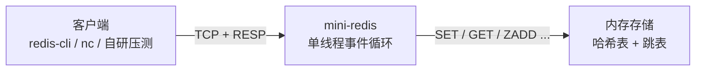
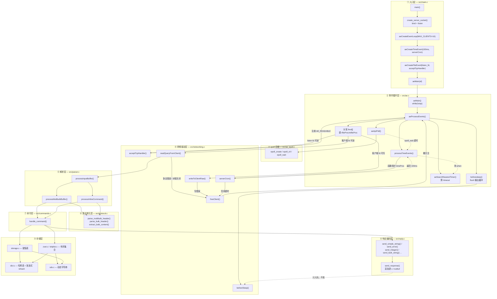
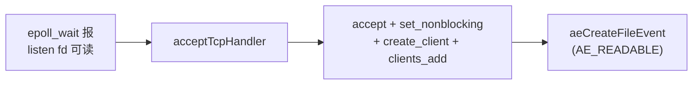
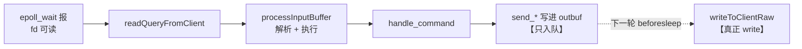
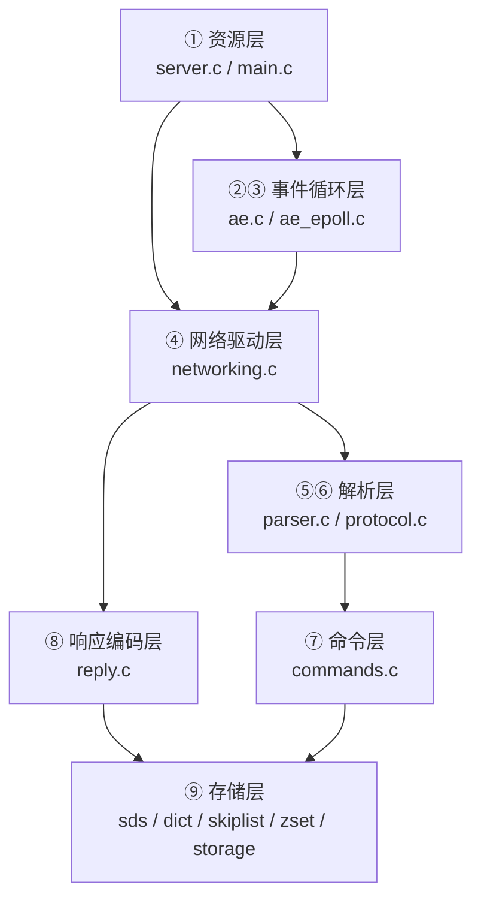
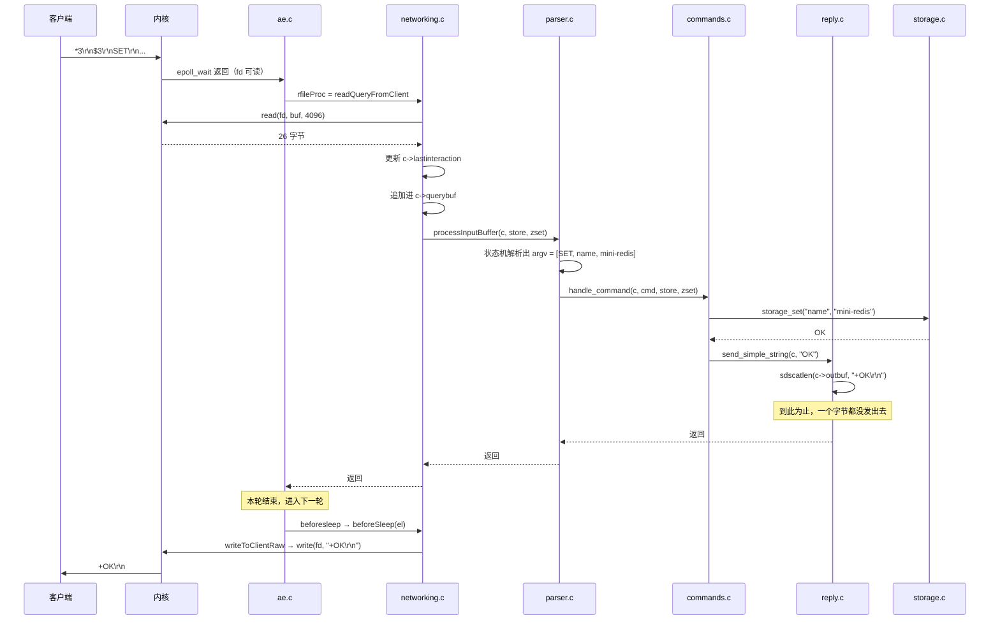
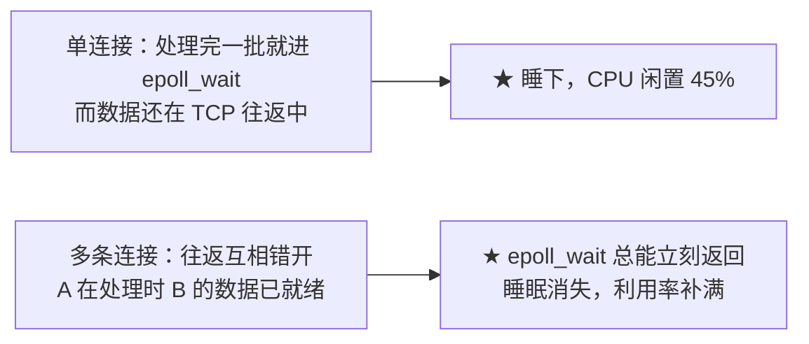

# mini-redis

纯 C 手写的内存键值存储引擎：**RESP 协议编码 + 8 个命令 + epoll 事件循环 + 定时器**。
从 socket、协议解析到哈希表、跳表、SDS，全部手写，**零第三方依赖**。



| | |
|---|---|
| **语言 / 依赖** | C99 · 无第三方库 · Linux（epoll） |
| **网络模型** | 单线程 epoll 事件循环 + 非阻塞 IO + 输出缓冲 |
| **协议** | RESP（数组协议）+ inline 命令（兼容 nc/curl） |
| **命令** | `PING` `SET` `GET` `DEL` `ZADD` `ZREM` `ZSCORE` `ZRANGE` |
| **代码量** | `src/` 3936 行 · `include/` 1384 行 |
| **验证** | 集成 54/54 · 单元 6/6 · ASan/UBSan/LSan 零泄漏 · 零告警 |

> ⚠️ **定位：学习与能力验证项目，不是生产可用服务。**
> 缺认证、内存上限、持久化；有序集合是**全局单例**（`ZADD` 的 key 被忽略）。
> 详见 [§7 与 Redis 的差距](#7-与-redis-的差距)。

---

## 目录

- [1. 快速开始](#1-快速开始)
- [2. 完整代码调用图](#2-完整代码调用图)
- [3. 项目结构](#3-项目结构)
- [4. 请求生命周期](#4-请求生命周期)
- [5. 测试与验证](#5-测试与验证)
- [6. 性能数据](#6-性能数据)
- [7. 与 Redis 的差距](#7-与-redis-的差距)
- [8. 配套文档](#8-配套文档)
- [9. 开发日志](#9-开发日志)
- [10. 开发工具](#10-开发工具)

---

## 1. 快速开始

### 编译与运行

```bash
make                      # 生成 mini-redis
./mini-redis              # 默认监听 0.0.0.0:6379
./mini-redis 6380         # 指定端口（优先级：命令行 > PORT 环境变量 > 6379）
```

| 环境变量 | 默认 | 作用 |
|---|---|---|
| `PORT` | 6379 | 监听端口（命令行参数优先级更高） |
| `CLIENT_TIMEOUT` | 0（不超时） | 客户端空闲多少秒后被断开 |

### 用 redis-cli 连接

```bash
$ redis-cli -p 6379
127.0.0.1:6379> PING
PONG
127.0.0.1:6379> SET name mini-redis
OK
127.0.0.1:6379> GET name
"mini-redis"
127.0.0.1:6379> ZADD board 100 alice
OK
127.0.0.1:6379> ZRANGE board 0 -1
1) "alice"
```

### 常用 make 目标

| 命令 | 作用 | 耗时 |
|---|---|---|
| `make` | 编译 | ~5 s |
| `make test` | 编译 + 集成回归（54 项） | ~1 min |
| `make unit` | 单元测试（6 个套件） | ~1 min |
| `make check` | = `unit` + `test` | ~2 min |
| `make asan` | 用 ASan/UBSan 重编（内存与 UB 检测） | ~10 s |
| `make prodtest` | 生产环境模拟测试（4 组） | ~10 min |
| `make prodtestquick` | 同上，缩短规模 | ~2 min |
| `make abtest` | 准备 A/B 对比环境（阻塞版 vs epoll 版） | ~10 s |
| `make benchrehash` | 渐进式 rehash 微基准 | ~1 min |
| `make benskip` | 跳表 span 微基准 | ~1 min |
| `make clean` | 清理构建产物 | — |

---

## 2. 完整代码调用图

**这是理解本项目最快的一张图。** 每条边都是一次真实调用，
每个方框都标注了它所在的文件和职责。



### 图例

| 标记 | 含义 |
|---|---|
| **实线箭头** | 一次函数调用 |
| **虚线箭头** | 通过函数指针回调（`rfileProc` / `wfileProc` / `timeProc`），或返回值回传 |
| **① ~ ⑨** | 分层编号，数字越大越靠近业务；依赖方向单向（大编号 → 小编号） |

### 三条关键链路






> ★ **链路 2 是理解本项目的关键**：`send_*` 只把数据**追加进 outbuf 就返回**，
> 真正 `write` 发生在**下一轮循环的 `beforesleep`**。
> 这是「非阻塞 + 输出缓冲」与「阻塞直发」最本质的区别 ——
> 好处是攒批（一条 `+OK` 从 3 次 `write` 降到 1 次）且永不阻塞，
> 代价是「数据已就绪但未发出」这个状态要由我们自己维护。

---

## 3. 项目结构

```
mini-redis/
├── src/                    3936 行
│   ├── main.c              进程入口：建 socket、建事件循环、注册回调、进 aeMain
│   │
│   ├── ae.c          ★     事件循环骨架（移植自 Redis unstable）
│   ├── ae_epoll.c    ★     epoll 后端：唯一的 epoll_* 调用点
│   │
│   ├── networking.c  ★     网络驱动层：所有事件回调 + 全局状态 g_server
│   ├── server.c            连接生命周期 + 服务器 socket
│   ├── reply.c             响应编码（永不 write，只入队 outbuf）
│   ├── parser.c            三层协议解析
│   ├── protocol.c          单语法单元解析
│   │
│   ├── commands.c          命令分发（8 个命令）
│   ├── storage.c           键值存储接口
│   ├── dict.c              哈希表 + 渐进式 rehash
│   ├── skiplist.c          跳表（带 span）
│   ├── zset.c              有序集合
│   ├── sds.c               动态字符串
│   └── anet.c              socket 选项封装
│
├── include/                1384 行
│   ├── ae.h                ★ 事件循环接口（含定时器）
│   ├── server.h            ★ Client / Server 结构体
│   ├── util.h              BACKLOG / set_nonblocking
│   └── 其余为各模块头文件
│
├── tests/                  6 个单元测试套件
├── bench/                  压测工具（Python + C）
├── docs/                   配套设计文档（中文文件名）
├── test.sh                 集成回归（54 项）
└── Makefile
```

### 分层与依赖方向



> ★ **依赖是单向的**：`parser.c` 和 `reply.c` 里**零 socket 调用、零 ae 调用**，
> 可用下面这条命令验证（已排除注释行）：
>
> ```bash
> grep -nE "\b(read|write|accept|close|epoll_[a-z]+|ae[A-Z])\s*\(" src/parser.c src/reply.c \
>   | grep -vE "^\S+:[0-9]+:\s*(\*|//|/\*)"
> # 预期：无输出
> ```
>
> 这样「改协议解析规则」不必重编网络层，「换网络模型」也不必碰解析层。

---

## 4. 请求生命周期

以一条 `SET name mini-redis` 为例：



### 四个常被问到的细节

| 问题 | 答案 |
|---|---|
| 为什么 `send_*` 不直接 `write`？ | 非阻塞 `write` 遇 `EAGAIN` 只能发出去一部分；剩余数据不存起来就是**发送半包**。 |
| 一次 `read` 只读 4096 字节，大命令怎么办？ | epoll 用**水平触发（LT）**：没读完内核会继续通知，回调会再次被调。 |
| 客户端发一半（半包）会怎样？ | 状态机把进度存在 `c->qb_pos` / `multibulklen` / `bulklen` 里，下次从断点续解。 |
| 一个客户端发很多命令会占满 CPU 吗？ | 会 —— `processInputBuffer` 的 `while` 循环**没有限流**，属已知局限（Redis 有限制）。 |

---

## 5. 测试与验证

### 5.1 全量回归

```bash
make check        # 单元 + 集成
make asan         # 内存检测
```

| 测试 | 数量 | 内容 |
|---|---|---|
| **集成回归**（`test.sh`） | **54/54 ✅** | 连接 / 基本命令 / 错误处理 / 有序集合 / 边界 / 参数上限 / 二进制安全 / 大值 / 断连 / 并发 / 优雅退出 |
| **单元测试**（`tests/`） | **6/6 ✅** | `test_sds` `test_dict` `test_skiplist` `test_zset` `test_skipspan` `test_lookup_order` |
| **ASan / UBSan / LSan** | **零泄漏 ✅** | AddressSanitizer + UndefinedBehaviorSanitizer + LeakSanitizer |
| **编译告警** | **0** | `-Wall -Wextra` |

### 5.2 生产环境模拟测试

```bash
make abtest          # 准备 A/B 环境（阻塞版从 git 历史导出后编译）
make prodtest        # 或 make prodtestquick
```

**A（阻塞版）** = 提交 `c49f44c`（改造前：`accept` 一个就陷进读循环）
**B（epoll 版）** = 当前工作区

> ★ A 从 git 历史导出而**不在工作区留副本** —— 留副本就要同步维护两份代码，
> 而 A 的全部价值只是「作为对照被测量一次」。

#### A 组 · 正确性：17/17 ✅

| 测试项 | 结果 |
|---|---|
| 基础命令（PING / SET / GET / DEL / 未知命令 / nil） | ✅ 6/6 |
| 二进制安全（含 `\0`、含 `\r\n`、`0xFF`、1KB 随机、320KB） | ✅ 5/5 |
| inline 命令（nc/curl 风格） | ✅ |
| **粘包**：一次发 4 条命令 | ✅ 4 条全部正确响应 |
| **半包**：逐字节发送（间隔 1ms） | ✅ 仍能正确解析 |
| 超限参数个数（`*2000`）被拒绝 | ✅ `-ERR protocol error` |
| **并发一致性**：50 条连接共享同一份存储 | ✅ 可交叉读取 |

#### B 组 · 健壮性：8/8 ✅

| 攻击/异常场景 | 结果 |
|---|---|
| 20 次 RST 强断（不读回复就关闭） | ✅ 存活（SIGPIPE 回归） |
| 发送垃圾字节 `\x00\x01\x02\xff` × 100 | ✅ 不崩溃 |
| 超长无终止符输入（累计 3.2 MB） | ✅ 被 `MAX_QUERYBUF` 限制，不 OOM |
| 声明 512 MB 的 bulk 但不发数据（slowloris 式） | ✅ 其他连接不受阻塞 |
| **慢客户端隔离**：A 只写不读，另 50 条连接 | ✅ 50/50 正常 |
| 突发 200 次连断 | ✅ 无 fd 泄漏 |
| 空闲超时（`CLIENT_TIMEOUT=2`） | ✅ 空闲被踢，活跃 8/8 不受影响 |
| 并发 800 连接同时保持 | ✅ 抽样 50/50 响应 |

---

## 6. 性能数据

**环境**：12 核 · 15.9 GB · WSL2 · 内核 6.18.40.1 · 每点 3 次取中位数
**客户端**：`bench/loadgen.c`（C 多进程，无 GIL 限制）

> ⚠️ **为什么必须用 C 客户端**：Python 多线程受 GIL 限制，并发 ≥4 时
> **客户端自己**成为瓶颈，曲线失真（实测症状：并发 2 比并发 4 还快）。
> ★ 测量工具不能成为瓶颈，否则测的是工具而不是被测对象。

### 6.0 先读这里：五组数字量的是不同的东西

直接比大小会看着矛盾（11,827 vs 931,533 vs 2,506,833），
因为它们**测的不是同一件事**：

| 小节 | 测什么 | 单位 | 瓶颈在 |
|---|---|---|---|
| 6.1 | 1 条连接，调「连发多少条」 | 命令/秒 | depth 小→延迟；depth 大→单核 CPU |
| 6.2 | N 条连接，depth 固定 100 | 命令/秒 | 4 连接后→单核 CPU |
| 6.3 | 1 条连接，发一条等一条 | 微秒/次 | 网络往返，**不是**服务器算力 |
| 6.4 | 写 320 KB 的大 value | 字节/秒 | 内存带宽 |
| 6.5 | 阻塞版 vs epoll 版 | 倍率 | —— |

> ★ 一句话：**6.1 问「单核最快能多快」，6.2 问「几条连接能喂饱它」，
> 6.3 问「用户感受到多快」，6.5 问「为什么必须换」。**

### 6.1 单连接：流水线深度的作用

调「一次连发多少条再统一收回复」，把 TCP 往返的等待时间用起来：

| depth | QPS | 单条耗时 | 相比上一档 |
|---|---|---|---|
| 1 | 11,827 | 84.6 µs | — |
| 10 | 112,373 | 8.9 µs | 9.5× |
| 100 | 976,300 | 1.02 µs | 8.7× |
| 500 | **2,506,833** | 0.40 µs | **2.6×** ← 收益递减 |

> ★ **depth=1 的 84.6 µs 与 6.3 的 p50（83.9 µs）是同一个数** —— 互相印证。
> depth=1 时服务器只干了约 1 µs 的活，其余 98% 都在等网络，CPU 闲着。
> 加大 depth 就是填满这段等待，到 depth=500 时等待已可忽略 →
> **250 万就是这颗单核的算力上限。**
>
> ★ **收益递减点很关键**：100→500 只涨 2.6 倍（depth 涨 5 倍）。
> 说明 depth=100 时瓶颈已从「延迟」变成「算力」—— 这正是 6.2 选 depth=100 的依据。

### 6.2 多连接：要几条才能喂饱单核

depth 固定 **100**（依据见 6.1），只增加连接数：

| 并发 | QPS | 相对 1 连接 | 增涨 |
|---|---|---|---|
| 1 | 931,533 | 1.00× | — |
| 2 | 1,711,233 | 1.84× | **+36 点（利用率）** |
| 4 | 1,867,400 | 2.00× | +3 点 |
| 8 | 1,866,366 | 2.00× | −0.3 点 |
| 16 | 1,918,100 | 2.06× | —— |

**结论：4 条连接就够了，之后加多少都不涨。** 机制（用
`/proc/<pid>/stat` 的 CPU 记账 + `/proc/<pid>/status` 的上下文切换数实测）：

| 并发 | CPU 利用率 | `epoll_wait` 每秒睡眠 |
|---|---|---|
| 1 | 55.6% | **10,766 次** |
| 2 | 91.9% | 1,482 次 |
| 4 | **95.0%** | **3 次** |
| 8 | 94.7% | 0 次 |



> ★ **为什么是 4 而不是 2**：那 45% 的空洞不是均匀补上的 ——
> 1→2 补掉大头（+36 点），2→4 补掉零头（+3 点），4 之后无差别。
> **「4」是边际收益跌破噪声的经验位置，不是公式算出的临界点。**
>
> ★ **封顶 95% 而非 100%**：每轮都要重新进 `epoll_wait`，加上调度与内存拷贝。
> （深挖这个成本的实验记录见 §6.6）
>
> ★ **命令越重，这个数越小**：命令重 → 单连接利用率高 → 离饱和更近。

| value 大小 | 单连接利用率 | 饱和点 |
|---|---|---|
| 14 B（PING） | 55.6% | 4 条 |
| 320 KB | 70.6% | 4 条 |
| 1 MB | 83.6% | **2 条** |
| 8 MB | 93.3% | **1~2 条** |

> 趋势成立但**比直觉平缓**：命令重了 60 万倍，饱和点只从 4 降到 2。
> 极限情况——若单连接就把 CPU 拉满（≈100%），这个数就是 **1**。
>
> ⚠️ 所以「4」是**「需要多少并发才能喂满单核」的量级**，
> 不是「这台机器只能接 4 条连接」。

### 6.3 延迟（串行 RTT，N=3000）

发一条、等回复、再发下一条 —— 这是**用户能感知到的体感延迟**：

| 分位 | 延迟 |
|---|---|
| 平均 | 97.9 µs |
| p50 | **83.9 µs** |
| p90 | 146.6 µs |
| p99 | **211.3 µs** |

> ★ p99 / p50 = **2.5×**，长尾不严重。
>
> ★ 这 83.9 µs 里服务器只占极小部分：按 6.1 的 depth=500（单条 0.40 µs）算只有 **0.5%**；
> 即使按 6.2 的饱和值（单条 1.07 µs）算也只有 **约 1.3%**，其余全是往返与调度。
> **要看服务器算力看 6.1，要看用户体验看 6.3。**

### 6.4 大值吞吐

| 场景 | 结果 |
|---|---|
| 320 KB 值串行写入 | **795 MB/s** |

> 这条测的是协议层与缓冲层的搬运效率（解析 → 存进 sds → 序列化回复），
> 用来确认大 value 不会出现数量级塌方。

### 6.5 A/B：为什么必须换 epoll

`bench/setup_ab.sh` 把阶段 1 的阻塞版从 git 历史 `c49f44c` 导出并现场编译到
`/tmp/ab/blocking`，当前代码编到 `/tmp/ab/epoll`。**是真的两套可执行文件交替运行，
不是模拟阻塞。**

四个子测试逐层递进：**① ② 是「有没有」，③ 是「差多少」，④ 是「输在哪」。**

**① 静默客户端能否卡死服务器**（连接 A 不发数据，看连接 B 能否被服务）

| | 第 2 条连接能否服务 | 耗时 |
|---|---|---|
| 阻塞版 | ❌ **否** | 2004 ms（超时） |
| epoll 版 | ✅ 是 | 1 ms |

> 阻塞版 `accept` 后陷进那个连接的 `read`，对方不发数据就永久阻塞 → **整个服务器停摆**。

**② 10 条并发连接中被服务的条数**（3 次取最好）

| | 被服务 |
|---|---|
| 阻塞版 | **1/10** |
| epoll 版 | **10/10** |

> 取最好的一次上报 —— 这是对阻塞版最有利的取值，即便如此也只有 1/10。

**③ 吞吐**

| 场景 | 阻塞版 | epoll 版 | 倍率 |
|---|---|---|---|
| 并发 1 · depth=100 | 56,466 | **1,047,966** | **18.6×** |
| 并发 4 · depth=100 | 53,366 | **2,018,666** | **37.8×** |

> 阻塞版**并发 4 比并发 1 还略低** —— 它的吞吐全部来自「单连接流水线」，加连接毫无收益。
> ★ 别读成「阻塞版很慢」：它单连接也能跑约 5 万 QPS，真正的问题在 ④。

**④ 公平性 —— 这才是「瓶颈」的准确画像**

8 条连接各跑 2 秒，看**每条各自完成了多少请求**（读分布形状，不读绝对值）：

| | 各连接完成数（降序） | 被公平服务 | 离散度 CV |
|---|---|---|---|
| 阻塞版 | `[119600, 100, 100, 100, 100, 100, 100, 100]` | **1/8** | **2.63** |
| epoll 版 | `[114800, 113300, 112100, 109900, ...]` | **8/8** | **0.02** |

> ★ **离散度相差 130 倍**，比总 QPS 锋利得多。
> 阻塞版的模式：**1 条连接跑满 12 万次，另外 7 条各完成 100 次后彻底卡死**
> （那 100 次是建连后第一批来得及发出去的）。
>
> **为什么总 QPS 会掩盖它**：那条幸运连接把总吞吐撑到 5 万，看着「只是慢十几倍」，
> 真相是**它一次只能服务一个人**。
>
> ⚠️ 这里用 Python 多线程（受 GIL 限制），所以**只能读分布形状，不能读绝对值**。

**结论**

| 阻塞版的瓶颈 | 表现 |
|---|---|
| 不是「慢」 | 单连接吞吐其实可观（约 5 万 QPS） |
| 而是「一次只能服务一个连接」 | 8 条并发里只有 1 条在跑 |
| 更糟的是「会被一个客户端卡死」 | 一条不发言的连接让服务完全不可用 |

> ★ 本项目这类服务的本质是「同时等很多个连接，但每个连接大部分时间没事干」。
> 阻塞式 `accept` + `read` **在结构上无法表达「同时等多个」** ——
> 不是慢几倍，而是这个能力根本不存在。

### 6.6 深挖：write 到底花多少时间

「4 条连接封顶 95%」引出一个问题：**那 5% 是什么？**
用独立工具 `bench/bench_syscall.c`（不经过 mini-redis）测出环境基线：

| 测量项 | 中位数 |
|---|---|
| `write` 5 字节 → loopback | **5,285 ns** |
| `write` 50 / 500 / 4096 字节 | 5,314 / 4,794 / 5,002 ns |
| `read` 64 字节 | 1,146 ns |
| `epoll_wait` 超时=0 | 740 ns |
| `getpid`（syscall 地板价） | 635 ns |

> ★ **write 的耗时与数据量无关**（5 字节 vs 4096 字节几乎一样）——
> 说明是**每次调用的固定成本**，不是拷贝成本。
> 5.3 µs 偏高（原生 Linux 通常 1~3 µs），是 **WSL2 要穿越 Hyper-V 边界**的代价。

**服务器实测与基线对比**：

| 场景 | 单次 write | 相对基线 |
|---|---|---|
| 环境基线（裸程序） | 5,285 ns | 1.0× |
| 服务器·客户端读得慢 | 5,407 ns | **1.02×** |
| 服务器·客户端全速读 | 13,248 ns | 2.5× |
| 服务器·高并发压测 | 33,693 ns | 6.4× |

**为什么会有差异——不是数据量，是「调用上下文」：**

| write 前的工作量 | ① 冷 write | ② 紧接着的 write | 冷/热 |
|---|---|---|---|
| 无 | 4,066 ns | 4,067 ns | 1.00× |
| 空转 2000 次 | 5,185 ns | 3,355 ns | 1.55× |
| 空转 20000 次 | 21,860 ns | 6,507 ns | **3.36×** |

> ★ **同一个 write，前后紧挨着做两次，差 3.4 倍。**
> 多出来的 15.4 µs 不是处理数据，而是**让 write 看到它需要的内核状态**；
> 第二次不用重做所以便宜。空转 0 时冷热一致 —— 没有前置工作就没有这个代价。
>
> ★ 服务器每轮的 write 都是**冷的**（前面刚做完 epoll_wait → read → 解析 → 执行），
> 而基线程序紧循环只做 write，环境一直是热的。
> **这才是 95% 封顶的真正来源**，也是并发越高 write 越慢的原因
> （每轮干的事越多，把 write 的状态冲得越冷）。
>


### 6.7 一页汇总

| 维度 | 结果 | 来自 | 回答什么问题 |
|---|---|---|---|
| 单连接峰值 | **2,506,833 QPS** | 6.1 | 这颗单核最快能多快 |
| 喂饱单核所需连接数 | **约 4 条** | 6.2 | 几条连接能用满 CPU |
| 并发峰值 | **约 1,900,000 QPS** | 6.2 | 加连接能否继续堆 |
| 串行延迟 | p50 **83.9 µs** · p99 **211.3 µs** | 6.3 | 单条命令的体感延迟 |
| 大值吞吐 | **795 MB/s** | 6.4 | 大数据搬运会不会塌方 |
| epoll vs 阻塞（吞吐） | **18.6× ~ 37.8×** | 6.5③ | 差距有多大 |
| epoll vs 阻塞（并发能力） | **1/10 → 10/10** | 6.5② | 并发能力有没有 |
| epoll vs 阻塞（公平性 CV） | **2.63 → 0.02** | 6.5④ | 到底输在哪 |

> ★ **读法**：前三行是「epoll 版有多快」，后三行是「为什么必须换」。
>
> ★ **三个数看着矛盾但都对**：
> · 250 万（6.1）与 190 万（6.2）是**同一颗单核的两种测法** ——
>   一个从「单连接压到最深」逼近，一个从「多连接堆到最满」逼近；
>   6.2 略低只是因为 depth 停在 100。
> · 83.9 µs（6.3）与 250 万 QPS 也不矛盾 ——
>   前者是发一条等一条的体感延迟，后者是流水线灌满后的极限。
> · 「4 条」是**需要多少并发才能喂满单核**的量级，**不是机器的连接数上限**。

## 7. 与 Redis 的差距

准确说法是「**实现了 RESP 编码 + 8 个命令的子集**」。

### 7.1 命令语义差距

| 命令 | 本项目 | 真实 Redis | 影响 |
|---|---|---|---|
| `ZADD` | `key` 被忽略，**所有有序集合共享全局单例** | 按 key 隔离 | **高**：`ZADD a 1 x` 后再 `ZADD b 2 y`，`ZRANGE a 0 -1` 会同时看到 x 和 y |
| `ZADD` | 恒回 `+OK` | `:1`（新增）/ `:0`（更新） | 中 |
| `ZADD` | 不支持 `NX/XX/GT/LT/CH/INCR` | 支持 | 中 |
| `ZRANGE` | 不支持 `WITHSCORES/REV/BYSCORE` | 支持 | 中 |
| `PING` | 恒回 `+PONG` | `PING msg` 回 bulk | 中 |
| `SET` | 不支持 `EX/PX/NX/XX/GET` | 支持 | 低 |
| `DEL` | 只支持单 key | 支持多 key | 低 |
| `*0\r\n` | 视作协议错误并**断开连接** | 视作空命令 | 低 |

> 注：`test.sh` 中「12-arg PING (B3)」用例期望 `PONG`，
> 是把上述不兼容行为固化成了期望值。若日后对齐 Redis，该用例需一并修改。

### 7.2 服务能力差距

| 能力 | 本项目 | Redis |
|---|---|---|
| 网络模型 | 单线程 epoll | 单线程 epoll + 多 IO 线程 |
| 认证 | ❌ 无 | ACL / requirepass |
| 内存上限 | ❌ 无 | maxmemory + 淘汰策略 |
| 持久化 | ❌ 无 | RDB / AOF |
| 数据库分库 | ❌ 单库 | 16 个 db |
| 单次命令数限流 | ❌ 无 | 有 |
| 客户端空闲超时 | ✅ 有（轮询，需 `CLIENT_TIMEOUT` 开启） | 有 |

---

## 8. 配套文档

按知识点命名（`docs/` 目录）：

| 文档 | 回答什么问题 |
|---|---|
| [轮询.md](docs/轮询.md) | 服务器怎么发现「某个客户端已经太久没说话了」？为什么用轮询而不是每连接一个定时器？ |
| [epoll机制.md](docs/epoll机制.md) | 一个线程怎么同时等 10000 个连接？影子掩码为什么必须有？ |
| [字典设计.md](docs/字典设计.md) | `dict` 为什么用 `void*` + `dictType`？渐进式 rehash 的路径 A/B 怎么分工？ |
| [跳表设计.md](docs/跳表设计.md) | 有序数据既要按分数排序、又要按成员名 O(1) 查到，一个结构怎么同时做到？ |
| [数据结构选型.md](docs/数据结构选型.md) | 面对一个操作，怎么决定用哪种数据结构？ |
| [字节流处理.md](docs/字节流处理.md) | 固定缓冲 vs SDS + 游标：粘包与半包怎么解决？ |

---

## 9. 开发日志

### 阶段 1-4：从阻塞到 epoll 事件循环

| 阶段 | 内容 | 关键产出 |
|---|---|---|
| **1** | `ae.h` / `ae.c` / `ae_epoll.c` 事件循环骨架 | 空跑验证 ae 层正确性 |
| **2** | 接入事件循环，新建 `networking.c` | 可同时服务多连接（阶段 0 做不到） |
| **3** | 输出缓冲 `outbuf` + 非阻塞发送 | 慢客户端不再拖累他人 |
| **4** | 时间事件（定时器）+ `serverCron` 轮询式空闲超时 | `epoll_wait` 不再无限睡眠 |

**阶段 3 的核心变化**：

| | 改造前 | 改造后 |
|---|---|---|
| `send_response` | `while` 循环 `write`，阻塞到发完 | `sdscatlen` 进 `outbuf`，立即返回 |
| 「还没发出去」的状态 | 由**内核**发送缓冲区暗中承担 | 由**我们自己的** `outbuf` 显式持有 |
| 一条 `+OK` 的系统调用 | 3 次 `write` | 1 次 `write` |
| 对端读得慢时 | 整个服务器停摆 | 只影响该连接 |

**阶段 4 的两个设计决定**：

- 定时器用**无序双向链表 + O(n) 扫描**（同 Redis）——
  前提是**定时器数量不随连接数增长**，本项目只有 `serverCron` 一个。
- 客户端空闲超时用**轮询**而不是「每连接一个定时器」——
  后者在 10000 连接时会产生 10000 个定时器节点，
  而 `aeSearchNearestTimer` / `processTimeEvents` **每轮都要跑**。

### 阶段 5：解耦（`server.c` 一分为四）

原 `server.c` 526 行里挤了三种「变化原因完全不同」的职责：

| 文件 | 职责 | 变化原因 |
|---|---|---|
| `parser.c` | 三层解析器 | 协议规则变了 |
| `reply.c` | 响应编码 | RESP 输出格式变了 |
| `networking.c` | 网络驱动 | 网络模型变了 |
| `server.c` | socket + 连接生命周期 | fd 资源管理 |

同时斩断的隐式依赖：

- `freeClient(c)` → `freeClient(el, c)`：撤关注要的 `el`，所有调用点手头就有
- `writeToClientRaw` / `beforeSleep` 不再读 `g_server.el`
- **删除 `Server.el` 字段** —— 改完后它变成「只写不读」的死状态
- `BACKLOG` / `set_nonblocking` 三份定义 → `include/util.h` 一份

### 阶段 6：渐进式 rehash

先写 `bench/bench_rehash.c` **量化出瓶颈**：一次性搬迁在 100 万键时造成 **23.87 ms** 停顿，
且随 N 线性增长（10 万 3.71 ms / 200 万 57.99 ms）—— 证明问题真实存在，不是背结论。

实现渐进式 rehash 后：最大停顿从 **58 ms → 亚毫秒**（约 78×~120×），
且不再随 N 量级跃升 —— 这正是 O(n)→O(1) 的签名。

### ★ 三个值得记的教训

#### 教训一：测量工具不能成为瓶颈

写生产测试时，用 Python 多线程压测得到一条荒谬的曲线：
**并发 2 比并发 4 还快**。

查证后发现：Python 的 GIL 让多线程实际串行执行，
并发 ≥4 时**客户端自己**成了瓶颈。
改用 C 多进程客户端后曲线正常（1→2→4 递增，4 连接后饱和）。

> **当测量结果违背常识时，先怀疑测量本身。**

#### 教训二：拿局部性能数字否定还没理解的设计

调渐进式 rehash 时，我一度认为「路径 A 和路径 B 应该叠加执行」，
并写进文档说二选一是 bug。**连续三次都错了**：

| 轮次 | 结论 | 错在哪 |
|---|---|---|
| 1 | 「关掉路径 A 更快 → 路径 A 没用」 | 我的 A/B 副本把 `else` 写成「只查旧表」，测试本身错了 |
| 2 | 「叠加版更快 → Redis 的 `if/else` 是 bug」 | 叠加快是因为**总工作量更大**，不是效率更高 |
| 3 | 「用 `rehashidx` 判断查哪张表会漏查 8.6%」 | 规则漏写「跳过旧表后仍要查新表」，测的是我自己的 bug |

**真相**：Redis `unstable` 的 `_dictRehashStepIfNeeded` **就是 `if/else` 互斥的**，
我最初的写法与它**语义完全等价**。是我的「修复」偏离了上游。

> **共同错因：拿一个局部的性能数字，去否定一个我还没理解的设计。**
> **当测量结果与上游成熟实现冲突时，先假设自己错了。**

#### 教训三：分批游标不能持有对象地址

`serverCron` 的分批扫描最初用 `static Client *cursor` 记住「上次扫到哪个节点」。
那个节点可能在下一次 `serverCron` 之前被 `freeClient` 释放 → 游标成野指针。

ASan 抓到的现场：

```
ERROR: AddressSanitizer: heap-use-after-free
    #0 serverCron          src/networking.c:486
    #1 processTimeEvents   src/ae.c:339
  freed by: freeClient
```

**修复**：改用**时间分片** —— 只检查「空闲时长落在本片区间」的客户端，
轮转状态是一个整数（`cronloops % slices`），不持有任何对象地址。

> **教训：分批游标要存「可重算的标量」（下标/时间），不要存「对象地址」。**
> 地址的生命周期不受你控制。

---

## 10. 开发工具

| 工具 | 用途 |
|---|---|
| gcc | 编译（`-Wall -Wextra -O2 -g`） |
| make | 构建 |
| ASan / UBSan / LSan | 内存与未定义行为检测（`make asan`） |
| `bench/loadgen.c` | C 多进程压测客户端 |
| Python 脚本 | 协议级测试与延迟测量 |
| Git | 版本控制 |
