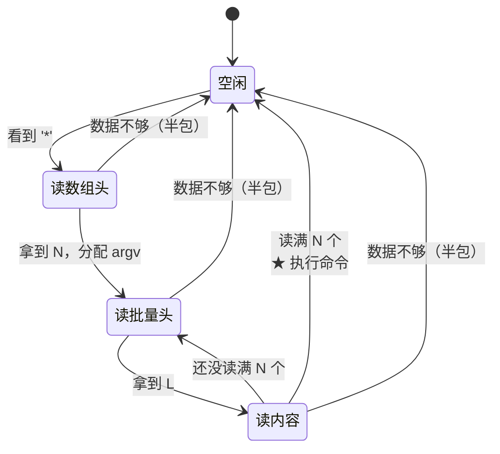
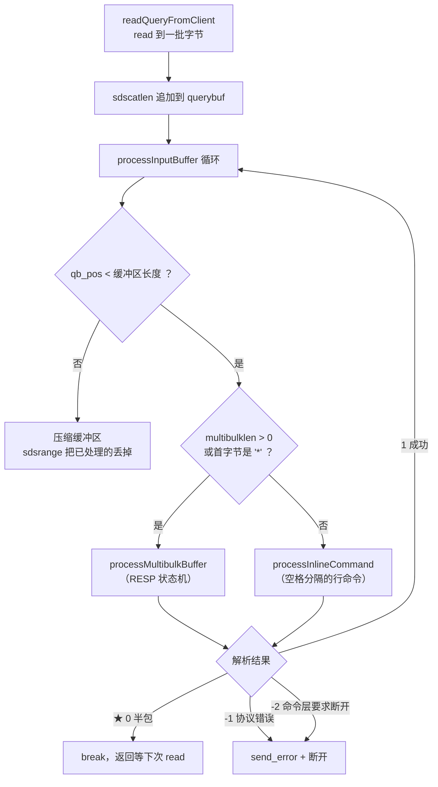
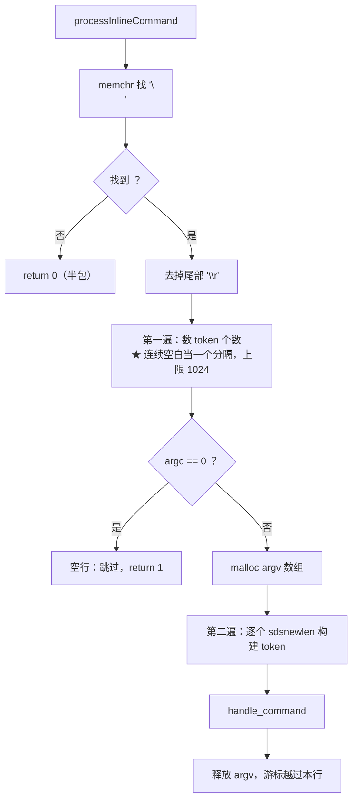

# RESP 解析状态机

> 本文回答一个问题：**一条命令跨多次 `read` 到达（半包），怎么知道上次解析到哪了？**
>
> 答案是**把状态存在连接对象里**，而不是存在解析函数里 ——「存档续关」。
> 本文讲知识点与状态机流程图。

---

## 一、RESP 协议的格式

RESP（REdis Serialization Protocol）是**文本协议 + 长度前缀**。

客户端发一条 `SET k v`，实际字节是：

```text
*3\r\n$3\r\nSET\r\n$1\r\nk\r\n$1\r\nv\r\n
│        │          │        │
│        │          │        └── $1\r\n v \r\n      ← 参数 "v"
│        │          └─────────── $1\r\n k \r\n      ← 参数 "k"
│        └────────────────────── $3\r\n SET \r\n    ← 参数 "SET"
└─────────────────────────────── *3\r\n             ← 一共 3 个参数
```

| 符号 | 含义 |
|---|---|
| `*N\r\n` | 后面有 N 个参数（**数组头**） |
| `$L\r\n` | 后面有 L 字节的内容（**批量字符串头**） |
| `\r\n` | 每个单元的结束符 |

> ★ **为什么用长度前缀**：TCP 是字节流没有消息边界（见 `docs/socket网络编程.md`）。
> `$L\r\n` 里的 L 明确告诉解析器「后面 L 字节是内容」——
> 于是**内容里出现 `\r\n` 也不会混淆**，天然二进制安全。

---

## 二、核心思想：状态存在连接里，不在函数里

**解析函数本身无状态**，所有中间状态都存在 `Client` 里：

```c
typedef struct Client {
    sds querybuf;          /* 累积收到的字节流 */
    size_t qb_pos;         /* ★ 解析游标：已经处理到哪了 */
    int multibulklen;      /* ★ 还剩几个参数没解析（0 = 不在解析中） */
    long bulklen;          /* ★ 当前参数还要读多少字节（-1 = 等下个头） */
    sds *argv;             /* 已解析出的参数 */
    int argc;              /* 已解析出几个 */
    ...
} Client;
```

| 字段 | 作用 |
|---|---|
| `querybuf` | 收到就追加，**只增不减**（直到解析完才压缩） |
| `qb_pos` | 「我已经解析到这里了」 |
| `multibulklen` | 「这条命令还差几个参数」 |
| `bulklen` | 「当前这个参数还要读多少字节」 |

> ★ **关键**：这些字段在函数返回后**依然存在**。
> 下次 `read` 到新数据再调用同一个函数，它从 `qb_pos` 处**接着解析**。
> 这就是半包能正确工作的原因 —— **存档续关**。

---

## 三、状态机

### 3.1 三个状态



| 状态 | 看什么 | 存在哪个字段 |
|---|---|---|
| 空闲 | 等着看第一个字节是不是 `*` | `multibulklen == 0` |
| 读数组头 | 解析 `*N\r\n` | 结果存 `multibulklen` |
| 读批量头 | 解析 `$L\r\n` | 结果存 `bulklen` |
| 读内容 | 取 L 字节 + 校验尾部 `\r\n` | 结果进 `argv` |

### 3.2 「数据不够」回到空闲，但不是丢失进度



> ★ **半包时字段原样保留**：`multibulklen` / `bulklen` / `qb_pos` 都不重置，
> 所以下次进来知道「我上次读到第几个参数、这个参数还差几字节」。

---

## 四、为什么不能「只看首字节」分流

这是本项目最容易踩的坑：

```c
/* 看起来合理，实际是 bug： */
if (*p == '*')  processMultibulkBuffer(...);
else            processInlineCommand(...);      /* ✗ */
```

**问题**：一条 RESP 命令跨多次 `read` 时，第二次进来的字节是 `$3\r\nSET\r\n`，
首字节是 `$` —— 被误判成 inline 行命令，参数被当成「未知命令」。

**正确做法**：

```c
if (c->multibulklen > 0 || *p == '*') {
    rc = processMultibulkBuffer(c, store, zset);   /* 继续状态机 */
} else {
    rc = processInlineCommand(c, store, zset);
}
```

> ★ **`multibulklen > 0` 是「我正在解析一条 RESP 命令」的标志**。
> 只要它非 0，无论当前字节是什么，都必须继续走 RESP 状态机。

---

## 五、半包保护：游标到末尾时不能读

```c
while (c->multibulklen > 0) {
    /* ★ 半包保护：游标已到缓冲区末尾时，绝不能去读 '\0' 终止符 */
    if ((size_t)c->qb_pos >= sdslen(c->querybuf)) return 0;
    ...
}
```

**为什么**：sds 末尾总有一个 `\0`（见 `docs/SDS.md`）。
如果游标已经在末尾还去解析，会读到那个 `\0` —— 然后被当成**协议错误**，
把一条本来合法的半包命令**误判为错误并断开连接**。

> ★ TCP 不保证一次 `read` 收到完整命令。这个检查是**必须的**。

---

## 六、内容的提取：三个函数的契约

第三层 `protocol.c` 的三个函数，返回值语义**必须记住**：

| 返回值 | 含义 | 调用方动作 |
|---|---|---|
| `1` | 成功 | 继续 |
| `0` | **半包**（数据不够） | `return 0` 等下次 read |
| `-1` | **协议错误** | `return -1` 断开 |

### 6.1 解析数组头 `*N\r\n`

```c
int parse_multibulk_header(const char *p, const char **next, int *argc) {
    if (*p != '*') return -1;
    p++;
    const char *cr = strchr(p, '\r');
    if (!cr) return 0;                    /* 半包：还没看到 \r */
    if (*(cr + 1) != '\n') return 0;      /* 半包：\r 有了但 \n 还没到 */

    int n = 0;
    for (const char *q = p; q < cr; q++) {
        if (*q < '0' || *q > '9') return -1;
        if (n > 1024) return -1;          /* ★ 先判上限再乘，防 int 溢出 */
        n = n * 10 + (*q - '0');
    }
    if (n <= 0 || n > 1024) return -1;
    ...
}
```

> ★ **`\r` 有了但 `\n` 还没到**也算半包 —— 这是最容易漏的一种半包。
>
> ★ **`if (n > 1024) return -1;` 必须在 `n = n*10 + ...` 之前**：
> 先判断再乘，保证 `n*10+9 ≤ 10249` 不会溢出。

### 6.2 解析批量头 `$L\r\n`

同上，但上限是 512 MB：

```c
if (l > 512L * 1024 * 1024) return -1;    /* 提前退出，防 long 溢出 */
```

### 6.3 提取内容

```c
int extract_bulk_content(const char *p, long len, sds *out,
                         const char **next, const char *buf_end) {
    if (p + len + 2 > buf_end) return 0;                  /* ★ 半包 */
    if (p[len] != '\r' || p[len+1] != '\n') return -1;    /* ★ 格式错 */
    *out = sdsnewlen(p, (size_t)len);                     /* 二进制安全 */
    if (!*out) return -1;
    *next = p + len + 2;
    return 1;
}
```

> ★ **`p + len + 2 > buf_end` 是半包判断**：连内容带结尾 `\r\n` 一起检查，
> 不能只检查内容（否则尾部 `\r\n` 没到就会被误判为格式错误）。
>
> ★ **用 `sdsnewlen` 而不是 `sdsnew`**：内容可能含 `\0`，
> 必须按长度构造，不能靠 `strlen`。

---

## 七、缓冲区压缩 —— 防止无限增长

解析完的命令数据不能一直留着，否则 `querybuf` 会一直涨：

```c
if (c->qb_pos > 0) {
    sdsrange(c->querybuf, (long)c->qb_pos, -1);   /* 未处理数据移到头部 */
    c->qb_pos = 0;
}
```

```text
压缩前：[已处理已处理已处理|未处理未处理]
                      ↑ qb_pos
                      ↓ sdsrange(querybuf, qb_pos, -1)
压缩后：[未处理未处理]                          qb_pos = 0
```

> ★ `sdsrange` 只做 **`memmove` + 改 `len`**，不重新分配（见 `docs/SDS.md`），
> 所以这个压缩很便宜。
>
> ★ **必须在处理完所有完整命令之后**才做 —— 中途做会打乱 `qb_pos` 的语义。

---

## 八、inline 分支 —— 兼容 nc / curl

不是所有客户端都发 RESP。用 `nc` 连上来手敲 `SET k v` 是**空格分隔的行**：



> ★ **两遍扫描**：第一遍数个数（要分配多大的数组），第二遍才真正切分。
> 因为 `malloc` 需要先知道元素个数。
>
> ★ **空行直接跳过不报错** —— Redis 也忽略空行（`nc` 里回车就是在发空行）。

---

## 九、一分钟速查

| 问题 | 答案 |
|---|---|
| RESP 怎么划分消息边界 | 长度前缀（`*N\r\n` + `$L\r\n`） |
| 状态存在哪 | **`Client` 里**，不在解析函数里（存档续关） |
| 三个关键状态字段 | `qb_pos`（游标）、`multibulklen`（还差几个参数）、`bulklen`（还要几字节） |
| 半包时要注意什么 | 字段原样保留，且**不能读缓冲区末尾的 `\0`** |
| 为什么不能只看首字节分流 | 半包时第二个 `read` 的首字节是 `$`，会被误判成 inline |
| 三个函数的返回值 | `1` 成功 / `0` 半包 / `-1` 协议错误 |
| `\r` 有但 `\n` 没到算什么 | **半包**（容易漏） |
| 怎么防整数溢出 | **先判上限再乘 10** |
| 内容为什么用 `sdsnewlen` | 可能含 `\0`，必须按长度构造 |
| 缓冲区怎么不无限涨 | 解析完用 `sdsrange` 把已处理的移走 |
| 支持非 RESP 客户端吗 | 支持，inline 分支（空格分隔，兼容 nc/curl） |
| 相关代码 | `src/parser.c`、`src/protocol.c`、`include/protocol.h`、`docs/字节流处理.md` |
