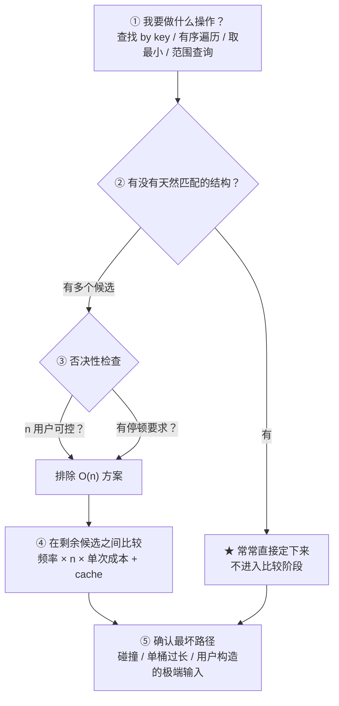
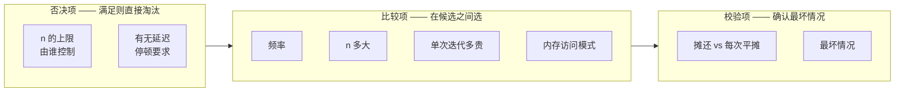

# 数据结构选型笔记

> 本文回答一个问题：**面对一个操作，怎么决定用哪种数据结构。**
>
> 起因是 epoll 事件循环改造前的讨论。当时反复出现同一个困惑：
> 「为什么这里用数组不用哈希表」「为什么 Redis 的定时器用 O(n) 链表也接受」
> 「为什么 Redis 不做跳表定时器」。
>
> 结论是：这些问题**不能只靠「复杂度」回答**。O 记号只是真实成本的一部分抽象，
> 它丢掉了常数、频率、上限来源、cache 行为、最坏情况和延迟要求。
> 本文把完整的判断过程写下来。

---

## 〇、一张图看本质

**先看这张。** 选型的顺序不是「列一堆数据结构然后比复杂度」，
而是**先由操作特征筛出唯一候选，再用复杂度清单否决和比较**：



> **读它**：关键在 ② 这一步。**大多数情况下它就把选项砍到一个了** ——
> 比如「fd 是整数」直接决定了 events 用数组，
> 「member 是字符串」直接排除了数组。
> 真正需要「比复杂度」的是 ④，而那只发生在有多个竞争对手的场景。

### 本文用到的六个真实案例

全部来自本项目（含两处与 Redis 的对照），后面逐条分析：

| # | 场景 | 选择 | 一句话理由 |
|---|---|---|---|
| 1 | `storage` 的 key→value 查找 | `dict`（哈希表） | n 用户可控，绝不留 O(n) |
| 2 | 跳表的 `member→SkipNode` 索引 | 复用 `dict` | 同一张表的第二个用途 |
| 3 | `epoll` 的 `fd→事件` 映射 | **数组**（下标即 fd） | fd 天然是整数下标 |
| 4 | Redis 的定时器 | 无序双向链表 | 只有 1~2 个，什么都不用优化 |
| 5 | 客户端空闲超时清理 | **轮询**（非定时器） | 精度要求低，1 个定时器扫全部 |
| 6 | 渐进式 rehash 的搬迁粒度 | 每次一个桶 | 关注**最坏单次耗时**，非平均 |

---

## 一、核心判断框架

### 1.1 五个筛选层次

按**筛选顺序**排列，不是平铺的 checklist：



| 层次 | 因素 | 用途 |
|---|---|---|
| **否决** | ① n 的上限由谁控制 | 用户可控 → 直接排除 O(n)，无需计算 |
| **否决** | ② 有没有延迟/停顿要求 | 有 → 排除会造成突刺的方案 |
| **比较** | ③ 多久做一次（频率） | 乘性因子 |
| **比较** | ④ n 有多大 | 绝对量级 |
| **比较** | ⑤ 单次迭代多贵（常数） | 几条指令 vs 系统调用 |
| **比较** | ⑥ 内存访问模式 | cache 命中可差几十倍 |
| **校验** | ⑦ 摊还 vs 每次平摊 | 单次峰值 ≠ 长期平均 |
| **校验** | ⑧ 最坏情况 | 平均值会骗人 |

### 1.2 最简版：三个问题定方案

如果只记三条：

| # | 问题 | 答错的后果 |
|---|---|---|
| 1 | 这个 n 是**用户能撑大**的吗 | 是 → 必须 O(1)/O(log n)，无例外 |
| 2 | 它**多久跑一次** | 频繁 → 常数因子变重要；稀疏 → O(n) 也可接受 |
| 3 | 有没有**延迟/停顿**要求 | 有 → 关注最坏单次，不只是平均 |

**本项目 80% 的选择由这三条推出**：

- `storage` 数组 O(n) → 用户可控 + 每次命令 → **必须换 dict** ✅
- `clientsCron` O(n) → 你控制 + 每 100ms → **可接受** ✅
- 一次性 rehash → 停顿不可接受 → **必须渐进式** ✅

### 1.3 为什么 O 记号不够

O 记号只抽象了「n 的量级」这一个维度，丢掉了：

```
真实成本 ≈ (频率) × (n) × (单次迭代成本) × (cache 惩罚) × (最坏情况放大)
             ↑         ↑        ↑                    ↑              ↑
           O 记号     O 记号   丢了                 丢了           丢了
          看不见
```

> **所以「这是 O(n)」本身什么结论都得不出来。**
> O(n) 可能比 O(1) 还快 —— 如果 n 很小、调用很少、常数极低。

---

## 二、否决项 ①：n 的上限由谁控制

**这是最强的一条，能一刀砍掉大部分选项。**

| n 的来源 | 上限 | 能留 O(n) 吗 |
|---|---|---|
| **用户输入决定**（key 数量、命令参数长度） | 无上限，用户想塞多少塞多少 | ❌ **绝对不能** |
| **配置决定**（`maxclients`、`setsize`） | 你配的，可控 | ✅ 可以 |
| **代码结构决定**（定时器数、桶数） | 你写的，恒定 | ✅ 可以 |

### 为什么这条是安全与性能的交界

**用户能撑大的数据结构，任何 O(n) 操作都会变成拒绝服务漏洞。**

本项目里用户能撑大的 n：

| 用户行为 | 撑大什么 | 如果留 O(n) 会怎样 |
|---|---|---|
| 存大量 key | `storage` 的 key 数 | 每次 GET 遍历全部 key → 完全不可用 |
| SET 超长 key | 字符串长度 | 若做 O(n) 的 key 比较，可构造大量长 key 攻击 |
| 发超长命令 | `querybuf` 长度 | 若解析是 O(n²) 即被击穿 |
| 构造哈希碰撞的 key | 单个桶的链长 | 平均 O(1) 退化成最坏 O(n) |

> **判断标准**：这个 n 的**增长权**在谁手上。
> 在你手上就安全，在用户手上就必须优化。

> ⚠️ **连带的坑**：`dict` 用的是链地址法（`dictEntry.next`），
> 理论上存在哈希碰撞攻击面。Redis 用**随机哈希种子**缓解 ——
> 让攻击者无法离线构造碰撞。本项目暂未处理，见第五节。

---

## 三、否决项 ②：延迟/停顿要求

### 3.1 不同场景优化目标不同

| 场景 | 优化目标 | 关心什么 |
|---|---|---|
| 批处理（编译器、数据分析） | **总吞吐** | 最大停顿无所谓 |
| **在线服务**（Redis、本项目） | **最大延迟** | 一次停顿就卡住所有客户端 |
| 实时系统（音视频、控制） | **最坏情况有硬上限** | 必须可证明 |

**本项目属于第二类**，而且更极端：**事件循环是单线程的** ——
任何一次操作停顿 58ms，这 58ms 内**所有客户端**都得不到响应。

> **所以：最大单次耗时 = 最大服务延迟。**
> 这就是渐进式 rehash 对本项目是**必需**而非可选优化的原因。

### 3.2 摊还复杂度看不见这个差别

| | 一次性 rehash | 渐进式 rehash |
|---|---|---|
| 平均每次插入 | O(1)（摊还） | O(1)（摊还） |
| **最坏某一次插入** | **O(n)** —— 要搬 n 个 entry | **O(1)** —— 每次最多搬一个桶 |
| 总工作量 | 一样 | 一样 |
| **区别** | **最大停顿** | **最大停顿被摊平了** |

实测（见 `README.md` §11）：`N=200万` 时最大停顿从 `≈58ms` 降到 `≈0.47ms`。

> **渐进式 rehash 没有让程序「更快」** —— 总工作量一点没变。
> 它只是把「一次 58ms 的停顿」变成「两百万次 0.47ms」。
> **摊还复杂度分析完全看不见这个差别。**
> 只有引入「延迟要求」这个维度才解释得通它为什么有价值。

---

## 四、六个案例的完整分析

### 案例 1：`storage` 的 key→value —— 必须 dict

**第 0~1 步（操作 → 天然结构）**

- 操作：给定字符串 key，查/写/删对应的 value
- key 是 `sds`（字符串），**没法当数组下标** → 数组被排除
- 候选：哈希表

**第 2 步（否决）**

| 检查 | 结果 |
|---|---|
| n 用户可控？ | ✅ **是**（用户想存多少 key 就存多少）→ 绝不能 O(n) |
| 有停顿要求？ | ✅ 是（单线程服务）→ 扩容不能一次性搬 |

**第 4 步（比较）**：候选只剩哈希表，无需比较。

**结论**：`dict`。而且为了第 2 条否决项，扩容必须做成**渐进式**。

> 改造前的实现是「一个数组存 (key, value) 对，每次按 key 遍历查找」——
> `storage.h` 第 6 行留着当时的注释：
> `// 动态数组存储结构变哈希表，时间复杂度从O（n）变o（1）`。
>
> **注意它比“慢”更严重**：n 随业务数据无限增长。
> 存 10 万条数据，每次 GET 遍历 10 万次 —— 这不是“常数大”，是彻底不可用。

### 案例 2：跳表的 member→SkipNode 索引 —— 复用 dict

**第 0~1 步**

- 操作：给定 `member`（字符串），O(1) 找到对应的 `SkipNode*`
- member 是字符串 → 排除数组
- 候选：哈希表

**第 2~4 步**：与案例 1 同样的结构需求，**直接复用同一份 `dict` 代码**。

> **这一案例的价值在于它暴露了「通用性」问题**：
> 原哈希表把 key/value 写死成 `sds`、销毁写死成 `sdsfree` ——
> 只能服务 `storage`。跳表索引需要**借用**（不拥有）`member`（它归跳表所有），
> 销毁应该是**空操作**。
>
> 解法是把「销毁权」外包给 `dictType`：两张策略表前两行完全一样，
> **唯一区别在第三行（谁负责销毁）**。详见 `docs/dict-design.md`。

### 案例 3：`epoll` 的 fd→事件 —— 数组，且不进入比较

**第 0~1 步（关键）**

- 操作：给定 `fd`，拿到它的事件处理器
- **fd 是内核分配的小整数，且倾向于密集递增**（0/1/2 被标准流占用，之后 3、4、5…）
- → **fd 天然就是一个合法的数组下标** → 直接定下数组

```c
events[fd]    // 地址 = base + fd × sizeof(aeFileEvent)
```

**这一步根本没有产生候选集合** —— 不需要比较哈希表和数组。

> **这就是「第 1 步常常把选项砍到一个」的典型例子。**
>
> 对比：如果硬要用哈希表做 `fd→事件`，你需要**额外做工作**
> 把 fd 变成索引（算哈希、取模、处理冲突、可能 rehash）——
> 为了得到一个**本来就已经有的东西**。
>
> **是否用某个数据结构的正确判断方式是**：不是比复杂度，
> 而是问「这个工具解决的问题，我本来有吗」。

**为什么 O(1) 是免费的**：数组元素等距（类型固定 → 同样大小）→
地址能算 → 不用遍历 → O(1)。

> ⚠️ 注意与「溢出」无关。「类型固定」的作用是让元素**等距**，
> 从而能用 `base + i × size` 算地址；它不防溢出。
> 数组访问的风险是**越界**（用了超出范围的下标），
> 这也正是 `aeCreateFileEvent` 必须写 `if (fd >= setsize) return AE_ERR;` 的原因。

**三维对比**：

| | 数组 `events[fd]` | 哈希表 `fd→event` |
|---|---|---|
| 平均查询 | O(1) | O(1)（**也是 O(1)**） |
| 最坏查询 | O(1)，永不变 | O(n)（全部撞同一桶） |
| 常数因子 | 乘法 + 加法 + 1 次读 | 哈希 + 取模 + 可能遍历桶链 |
| 是否比较 key | ❌ 不需要 | ✅ 需要 |
| 是否有 rehash | ❌ 无 | ✅ 有（本项目刚实现了渐进式） |
| **内存访问模式** | **连续 → cache 友好** | **entry 散在堆上 → 指针追逐** |

> **复杂度相同的情况下，实际性能差别来自内存访问模式。**
> 这和 `dictBucketRehash` 被特意拆成「缓存友好的搬桶」是同一个主题。

### 案例 4：Redis 的定时器 —— 链表，因为 n 只有 1~2

**第 0~1 步（看起来该用跳表）**

- 操作：找出**最近该触发**的定时器（取 `when` 最小值）
- 「取最小」→ 有序结构天然匹配 → **跳表看起来更好**

**第 2 步（否决 —— 这一步反杀了第 1 步）**

| 检查 | 结果 |
|---|---|
| n 多大？ | **1~2 个**（`serverCron` 一个 + 少数临时定时器） |
| 频率？ | 每轮事件循环一次 |
| **n=2 时 O(n) 是多少** | **跑 2 次循环，和 O(1) 没区别** |

**结论**：O(n) 遍历完全够用，**不需要**跳表。

> **Redis 自己在源码注释里写了这个判断**（`usUntilEarliestTimer` 上方）：
>
> ```
> Note that's O(N) since time events are unsorted.
> Possible optimizations (not needed by Redis so far, but...):
> 1) Insert the event in order, so that the nearest is just the head.
> 2) Use a skiplist to have this operation as O(1) and insertion as O(log(N)).
> ```
>
> 它明确点出了跳表方案，但补了 `not needed by Redis so far`。
> **这不是偷懒，是正确的工程判断。**

> **★ 本项目的情况不同 —— 但理由不是「要更精确」，见案例 5。**

### 案例 5：客户端空闲超时 —— 轮询，不是定时器

**这一案例纠正了一个常见误解。**

很多人以为「客户端超时清理」= 「每个客户端一个定时器」。**Redis 不是这么做的。**

| | 方案 A：每客户端一个定时器 | 方案 B：**轮询**（Redis 做法） |
|---|---|---|
| 定时器数量 | = 客户端数（10000） | **1 个**（`serverCron`） |
| 怎么知道谁超时 | 定时器到期 → 知道该断谁 | **遍历所有客户端，比较 `lastinteraction`** |
| 数据结构需求 | **需要有序结构（跳表）** | 不需要 |
| 谁记录超时信息 | 定时器里 | `Client` 里加一个 `lastinteraction` 字段 |
| 检查开销 | O(log n) 插入/删除 | **O(n) 遍历，但每 100ms 才一次** |
| 精度 | 精确到毫秒 | 最多延迟 100ms |
| 实现复杂度 | 高 | 低 |

**Redis 的实际做法**：

```c
// server.c clientsCron()
int iterations = numclients / server.hz;   // ★ 每轮只检查一部分
if (iterations < 5) iterations = 5;
while (listNext(&li) && iterations--) {
    client *c = listNodeValue(ln);
    if (nowsec - c->lastinteraction > server.maxidletime)
        freeClient(c);
}
```

**★ 注意 `iterations = numclients / hz` —— 这是「分摊」**：
10000 个客户端、`hz=10` → 每轮只检查 1000 个。
**单轮成本从 O(10000) 降到 O(1000)，总工作量不变。**

> **这和渐进式 rehash 完全同构**：
> 不是「哈希表变小了」，而是「把一次搬迁摊成每次搬一个桶」。

**为什么这个 O(n) 可接受**：

| 因素 | 说明 |
|---|---|
| ① 频率低 | 每 100ms 一次 |
| ② 分摊 | 每轮只查 n/hz 个 |
| ③ 单次代价极小 | 一次减法 + 比较，几条 CPU 指令 |
| ④ 循环体几乎总是什么都不做 | 99% 客户端不超时 |
| ⑤ **n 的上限可控** | 由 `maxclients` 决定（**这条最关键**） |

**★ 一个轮询独有的好处**：它天然处理「漏掉的情况」。
若某次 `serverCron` 因主线程忙而延迟 500ms：

- 轮询 → 只是「晚检查了 500ms」，超时依旧会被发现
- 精确定时器 → 这一刻该处理的 10000 个定时器**全挤在一起爆发**，更糟

> **所以轮询不只是「简单」，它在「被延迟」这件事上更健壮。**

**本项目结论**：**优先做方案 B（轮询）** —— 对齐 Redis、精度够（几十秒级超时，
100ms 误差无意义）、实现简单。跳表定时器留作可选增强或在文档里写分析。

**什么时候才值得用大量精确定时器**：

| 场景 | 定时器数量 | 需要精确吗 | 适合有序结构吗 |
|---|---|---|---|
| 客户端空闲超时 | = 客户端数（但用轮询即可） | ❌ 不需要 | ❌ |
| 命令级超时（`SET k v EX 3`） | = 有超时的 key 数 | ✅ 需要 | ⚠️ Redis 用惰性删除+定期抽样 |
| **延迟任务队列** | = 待执行任务数 | ✅ 需要 | ✅ **很适合** |
| 连接握手超时 | = 半连接数 | ✅ 需要（秒级） | ✅ 可以 |
| 速率限制窗口 | = 被限制的 key 数 | ✅ 需要 | ✅ 适合 |

> **规律：需要大量定时器【且】需要精确度，两个条件同时满足才值得用有序结构。**
> 客户端空闲超时只满足前者。

### 案例 6：渐进式 rehash —— 关注最坏单次

**第 0~1 步**：操作是「扩容时重新分布 n 个 key」，天然结构就是遍历。

**第 2 步（否决）**：

| 检查 | 结果 |
|---|---|
| 有停顿要求？ | ✅ 是（单线程事件循环）→ **一次性搬迁被否决** |

**结论**：必须把搬迁**摊到每次操作**。

**实测数据**（`make benchrehash RUN=1000000`）：

| N | 一次性扩容最大停顿 | 渐进式 | 倍数 |
|---|---|---|---|
| 100k | 0.041~0.047ms | — | ~78x |
| 1M | 0.198~0.224ms | — | ~120x |
| 2M | ≈58ms | ≈0.47ms | **~115x** |

> **注意这个案例没有「n 用户可控」的问题** —— 它满足否决项 ①（n 是 key 数，
> 用户可控，所以确实需要优化），但真正的驱动因素是**否决项 ②**。

---

## 五、方法论的教训

### 5.1 判断优化的标准不是「理论上能不能更快」

**Redis 不做跳表定时器是对的；本项目做轮询不对标跳表也是对的** ——
因为**第一 ≠ 唯一**，判断依据是「我的 n 有多大、多频繁、有什么约束」。

同样的结构决策，在不同 n 量级下结论可以完全相反：

| 场景 | n | 结论 |
|---|---|---|
| Redis 定时器 | 1~2 | 链表 O(n) 足够 ✅ |
| 客户端超时（若用方案 A） | = 客户端数 | 才值得考虑有序结构 |
| 本项目 `storage` | 用户可控 | 必须 O(1) ✅ |

### 5.2 复杂度分析要带上常数和频率才有意义

本项目里三处「看起来该优化但实际不用」的例子：

- **路径 A/B 的差异**（`docs/dict-design.md` §七）：真实测量是噪声（−3.5%）
- **定时器 O(n) vs O(log n)**：n=2 时差 2 次循环，无意义
- **`events[fd]` 数组 vs 哈希表**：都是 O(1)，差别只在常数和 cache

> **O(n) 不代表慢，O(1) 不代表快。**

### 5.3 一个曾经犯过的错（记录在此以免重犯）

讨论中曾把「客户端超时清理」与「每个客户端一个定时器」**绑定在一起**，
据此推出「本项目的 n 大所以该用跳表」。

**这是错的**：那只在方案 A 下成立，而 **Redis 用的是方案 B（轮询）**，
根本不需要有序结构。

> **教训**：不能把「一种实现选择」当成「必然」。
> 陈述理由前先确认**前提是否唯一** —— 如果一个需求有多种实现路径，
> 就不能基于其中一条推出「必须用 X」。

---

## 六、速查表

### 6.1 本项目全部结构决策

| 数据结构 | 操作特征 | 为什么 | n 上限来源 | 频率 |
|---|---|---|---|---|
| `dict`（storage） | 按字符串 key 查/写/删 | 字符串不能当数组下标；n 用户可控 | **用户** | 每次命令 |
| `dict`（跳表索引） | 按 member 查 `SkipNode*` | 同上，复用同一份代码 | 用户 | 每次查询 |
| 数组（`events[fd]`） | 按整数 fd 取事件处理器 | **fd 天然是合法下标** | 配置（`setsize`） | 每次事件 |
| 双向链表（定时器） | 取最近到期的 | **n 只有 1~2，无需优化** | 代码结构 | 每轮事件循环 |
| 轮询（超时清理） | 定期检查所有客户端 | n 可控 + 频率低 + 精度要求低 | 配置（`maxclients`） | 每 100ms |
| 跳表（zset） | 按 score 排序、范围查询、求排名 | 需要**有序** + 范围 + rank | 用户 | 每次查询 |
| 渐进式 rehash | 扩容重分布 | **关注最坏单次耗时** | 用户（key 数） | 每次操作 |

### 6.2 决策清单（照着问一遍）

1. **我要做什么操作？** 查找 / 有序遍历 / 取最小 / 范围查询 / 求排名
2. **有没有天然匹配的结构？** —— *这一步常常直接定下来*
3. **n 的上限由谁控制？** —— 用户可控 → 排除 O(n)
4. **有没有延迟/停顿要求？** —— 有 → 排除会突刺的方案
5. **多久跑一次？n 多大？** —— 频率 × n = 主要成本
6. **单次迭代多贵？内存是连续还是随机？** —— 常数因子
7. **是摊还还是每次平摊？** —— 单次峰值
8. **最坏情况能不能被触发？** —— 碰撞 / 单桶过长 / 用户构造的极端输入

### 6.3 文档写作建议

对每个数据结构决定写三行：

- **操作特征**是什么
- **为什么这个结构匹配**（或为什么别的被排除）
- **n 的上限由谁控制、频率多少**

> 这三行写出来，就是「为什么这样设计」的完整论证 ——
> 比只说「用了哈希表所以 O(1)」有价值得多。

---

## 附：与 Redis 源码的对照

| 主题 | Redis 做法 | 本项目 | 差异原因 |
|---|---|---|---|
| 事件循环 fd→事件 | 数组 `events[fd]` | 同 | 一致 |
| 定时器结构 | 无序双向链表 O(n) | 同（当前方案） | 一致 |
| 客户端超时清理 | 轮询（`clientsCron`） | 计划同 | 一致 |
| key→value | `dict` + 渐进式 rehash | 同 | 一致 |
| 哈希碰撞攻击 | **随机哈希种子** | ⚠️ **未处理** | 待办 |
| `events[]` 分配 | 惰性增长（`unstable` 新增） | 待定 | 本项目规模小，可直接分配 |

> ⚠️ **两个已知差异**：
> 1. `dict` 未使用随机哈希种子，理论上存在碰撞攻击面；
> 2. `events[]` 一次性分配 vs 惰性增长 —— 后者是为「配置了百万 `maxclients`
>    但实际连接少」准备的，本项目规模下浪费可忽略。

---

## 相关文档

- `docs/dict-design.md` —— 通用哈希表的完整设计推导（含渐进式 rehash）
- `README.md` §11 —— 渐进式 rehash 的实测数据
- `include/anet.h` / `src/anet.c` —— socket 层配置

---

## 附二：一次测试脚本造成的「假 bug」（记录以免重犯）

阶段 2（epoll 改造）完成后，用 50 个并发客户端压测，出现
`ok=21~49/50` 的巨大波动，一度以为事件循环有 bug。

**排查过程**：

| 步骤 | 观察 | 结论 |
|---|---|---|
| 1 | 服务器日志显示 **50 条全部 accept 成功** | 不是 accept 问题 |
| 2 | 用 stage1（丢弃数据）跑同样模式，**150/150 全对** | 不是 ae 层问题 |
| 3 | 一次性发完所有 PING 再读，**50/50 全对** | 与「逐条 round-trip」有关 |
| 4 | **失败的客户端收到的是 `b'+'`** —— 只有一个字节 | ★ 找到根因 |

> **关于 stage1**：那是改造阶段 1 的独立验证产物（自带 `Stage1Conn`，只跑
> 事件循环、收到数据就丢弃），用来把「ae 层」和「解析/编码层」隔离开。
> 它的历史使命已经完成 —— 上面这张表就是它最重要的产出。
> 该产物已于后续清理中删除（`src/main_stage1.c` + `make stage1`）；
> 结论已固化在此处，不影响复现「不是 ae 层问题」这个判断。

**根因**：`send_simple_string` 是**分 3 次 `write()`** 发送的：

```c
send_response(fd, "+", 1);        // write #1 → 一个 TCP 段
send_response(fd, s, strlen(s));  // write #2 → 另一个段
send_response(fd, "\r\n", 2);     // write #3 → 又一个段
```

客户端只调一次 `recv()` 时，可能只收到第一个段（`+`）。**这是测试脚本的错，不是服务器的错。**

**修正**：测试客户端必须**累读到 `\r\n`**（RESP 回复的边界），而不是假设一次 `recv()` 拿到完整回复。改后 200/200 全对。

**★ 但这个「假 bug」暴露了一个真问题**：分 3 次 write 意味着一条 `+OK` 要 3 次系统调用。
这正是**阶段 3 的 outbuf 要解决的**——把 3 段攒成 1 次 write。

**方法论教训**：测出一个「诡异数字」时，先怀疑自己的测试工具，
再怀疑被测代码。本次如果直接去改事件循环，就会修一个不存在的 bug。

> 这也和此前 rehash 那次误判同构：**测量结果与预期不符时，
> 先确认测量本身是否正确。**
