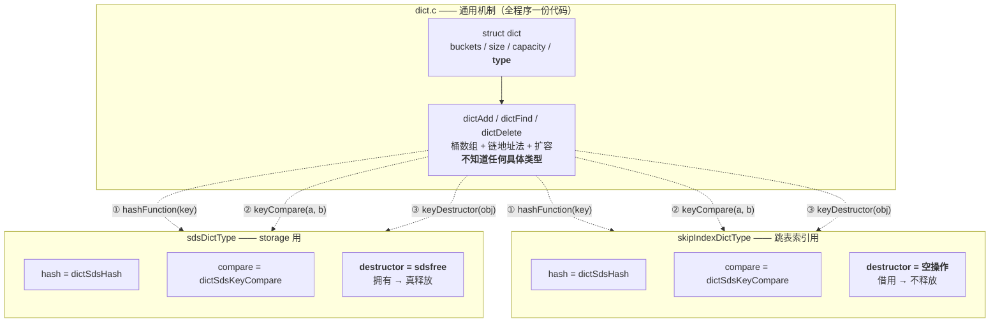
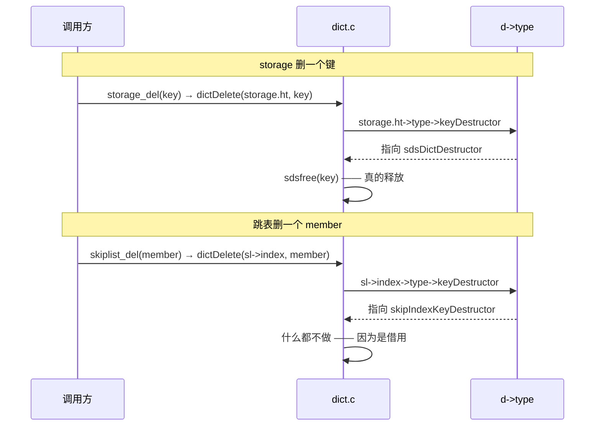
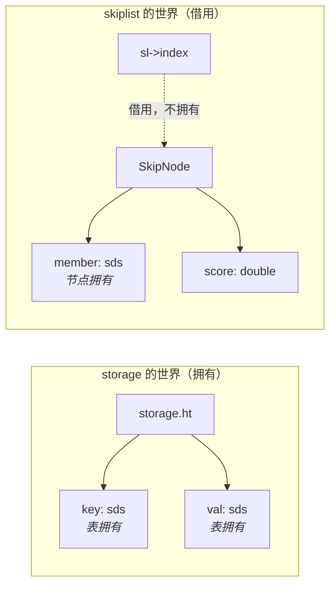
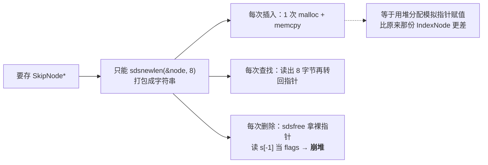
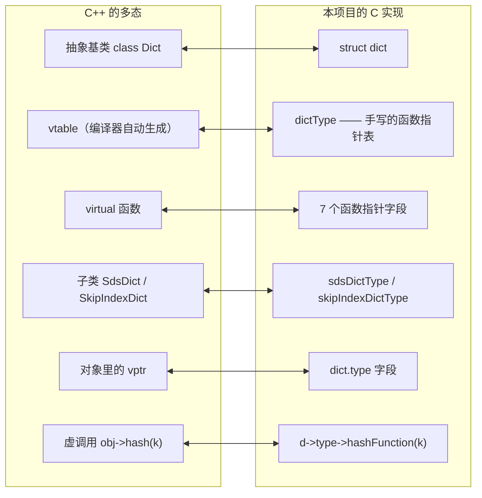
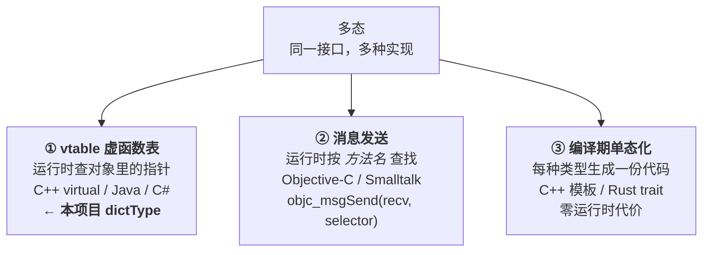

# 通用哈希表（dict）设计笔记

> 本文是 `include/dict.h` 的配套设计文档。
> 头文件只保留【接口 + 使用时必须知道的硬约定】，推导过程与 Redis 对照笔记挪到这里。
>
> 起因是一次重构：跳表为了拿到 O(1) 的 `find`，在跳表内部又写了一份哈希表
> （`IndexNode` / `buckets` / `index_*`，约 100 行）。想消掉这份重复时发现
> 「现有哈希表接不进去」——本文就是回答"为什么接不进去"以及"怎么改才通用"。

---

## 〇、一张图看本质

**先看这张。** 整个设计就是"一个通用机制 + 两份策略表"：



> **读它**：`dict.c` 那一列是**机制**，永远不改；下面两个方框是**策略**，
> 每种数据类型一份。`dict.c` 遇到"不确定的事"就顺着 `d->type` 去问，
> 问到的答案取决于**建表时拿到的是哪份表**。
>
> **最关键的一眼**：两张策略表的前两行完全一样（哈希、比较都用 sds 那套），
> 唯一的区别在第三行 —— **谁负责销毁**。这就是跳表能接进来的全部原因。

### 同一个动作，两条路径

以"删除一个键"为例，`dict.c` 只写一遍代码：



> **读它**：两次调用走的是**同一个 `dictDelete`**。
> 区别只在于传进去的 `d` 不同 → `d->type` 不同 → 调到的函数不同。
> **`dict.c` 全程没有一次 `if`，也不知道跳表和 storage 的存在。**

### 一张表看懂"谁拥有谁"



> **读它**：粗箭头 = 拥有（删除时会释放），虚线 = 借用（删除时什么都不做）。
> 跳表索引里的 key 和 value 都指向**别人拥有的东西** —— 这就是它必须
> 挂"空操作 destructor"的原因。

---

## 一、为什么原来的哈希表不能通用

改造前，哈希表是 **storage 专用**的，接口写死成：

```c
int   hashtable_set(HashTable *ht, sds key, sds value);
char *hashtable_get(HashTable *ht, sds key);
```

它不能被跳表复用，不是"算法不够好"，而是三个决定被焊死在自己身上了 ——
而这三个决定，恰好只有 storage 会同意：

| 决定 | storage 想要的 | 跳表索引想要的 | |
|---|---|---|---|
| key 是什么类型 | `sds`（用户键） | `sds`（member） | 一致 |
| value 是什么类型 | `sds`（用户值） | `SkipNode *`（指针） | **冲突** |
| key/value 归谁所有 | 归我，del 时 `sdsfree` | 借用的，一个都不许 free | **冲突** |

第二、三条是致命的：

- 存 `SkipNode*` 时若硬塞进 `sds`，就得 `sdsnewlen` 一次 malloc + memcpy，
  **把"零成本的指针赋值"换成一次堆分配**；
- `sdsfree` 拿到一个**非 sds 的裸指针**时，会去读 `s[-1]` 当 flags，直接崩堆。

### 硬塞会怎样



> **读它**：类型转换这条路**技术上有解，但代价是亏本**（花两次深拷贝换一次
> 指针赋值），所以"绕过去"没有意义 —— 必须改接口。


### 关键认知：这不是两个问题，是同一件事的两面

「value 声明成 `sds`」就是「表负责 `sdsfree(value)`」的技术手段 ——
因为**只有 sds 才能被 `sdsfree`**（它靠 `s[-1]` 反推 header，见 `sds.h`
「为什么头部必须 packed」）。

所以**放宽类型和交还销毁权，必须同时做**。不存在"只修类型"或"只修所有权"
的一半方案。

> 顺带：硬用 `sds` 接口做类型转换，技术上能跑通，但代价是
> **两次深拷贝（key 要 `sdsdup`、value 要打包）换一次指针赋值**，
> 比原来那份 `IndexNode` 更差。所以"绕过去"没有意义。

---

## 二、解法：把四个问题外包给调用方

引入 `dictType`（函数指针表，C 版虚函数表）：

> **算哈希怎么算、两个 key 怎么算相等、key/value 怎么销毁、什么时候扩容**
> —— 这四个问题的答案，在 `dictCreate` 那一刻由调用方用一张函数表交进来。

于是同一份 `dict` 核心代码不认识 `sds`，也不认识 `SkipNode`，却能同时服务两者：

```text
storage  ──► dictCreate(&sdsDictType)        destructor = sdsfree  → 真释放
skiplist ──► dictCreate(&skipIndexDictType)  destructor = 空操作   → 借用
```

### 判断"这是谁的表"不需要任何 if / enum / 标志位

它发生在 `dictCreate` 那一刻（`d->type = 哪张表`），之后每次 del/free 都是
一次函数指针调用：

```text
                    ┌──────────────────────┐
   storage ────────►│ d->type = sdsDictType│──► destructor = sdsfree  ← 真释放
                    │  (同一个 dict.c 代码) │
   skiplist ───────►│ d->type = skipIndex  │──► destructor = 空操作   ← 不释放
                    └──────────────────────┘
```

这就是多态：**把"分支"数据化成"建表时选了哪份函数表"**。

---

## 二·五、用 OOP 视角再看一遍

如果熟悉面向对象，这套设计的对应关系是**一一对齐**的：



> **读它**：C 没有 `class` / `virtual`，所以**手工把虚函数表写出来**：
> 一个装函数指针的结构体（`dictType`）+ 对象里一个指向它的指针（`d->type`）。
> `d->type->hashFunction(key)` 就是 C 版的虚调用。
>
> Redis 的 `dictType` 命名和这个设计就是照抄这个思路 —— 它本质上是
> 「用 C 写一个可容纳任意数据类型的哈希表」的标准答案。

对应表：

| OOP 概念 | 本项目的对应物 |
|---|---|
| 抽象基类 | `struct dict` |
| 虚函数表（vtable） | `dictType` |
| 虚函数 | 7 个函数指针字段 |
| 具体子类 | `sdsDictType` / `skipIndexDictType` 两个实例 |
| 对象里的 vptr | `dict.type` 字段 |
| 虚调用 `obj->method()` | `d->type->hashFunction(key)` |

### ⚠ 但 vtable 只是多态的**三种实现之一**

别把「多态」和「vtable」画等号 —— vtable 是 C++ 选的手段，不是多态的唯一形态。



| 机制 | 何时决定调用哪个 | 运行时代价 | 代表 |
|---|---|---|---|
| **① vtable** | 运行时（查对象里的指针） | 一次间接调用 | C++ `virtual`、**本项目** |
| **② 消息发送** | 运行时（按**名字**查表） | 更贵：选择器/字符串查找 | Objective-C、Smalltalk |
| **③ 单态化** | **编译期**（静态绑定） | **零**，还能内联 | C++ 模板、Rust trait |

> **读它**：`d->type->hashFunction(key)` 和 C++ 的 `obj->hash(key)` 编译出来
> 是**同一类指令**：先从对象取一个指针，再间接跳转。所以它们的性能特征也一样
> （多一次内存加载 + 一次间接调用，可能分支预测失败）。
>
> 本项目选 ① 而不是 ③，是因为 ③（单态化）要为每种 key 类型生成一份
> `dictAdd` / `dictFind` 代码 —— C 没有模板，只能用宏硬展开，而且
> `storage` 和 `skiplist` 共用同一份 `dict.c` 的收益就没了。

### 多态 ≠ 面向对象

多态比 OOP 出现得更早，也不依赖 `class`：

- **C 的 `qsort`**（1970s）收一个比较函数指针 —— 那就是多态，比 C++ 早十几年
- **本项目**用纯 C 写多态，一行 `class` 也没有
- **Rust 的 trait** 也能多态，但 Rust 连继承都没有

反过来，OOP 的另外两大支柱**跟 vtable 没关系**：

| 支柱 | 底层靠什么 | 与 vtable 的关系 |
|---|---|---|
| **封装** | 访问控制 —— 纯**编译期**检查 | 无关。运行期 `private` 成员就在那儿，指针一算就能读到 |
| **继承** | **内存布局**（基类子对象在派生类对象开头） | 相关：vtable 依赖这个约定 |
| **多态** | vtable / 消息发送 / 单态化 | ★ 就是它 |

> **顺带**：vtable 能工作的前提是「**vptr 必须在对象开头**」——
> 这样 `Base *p = &derived;` 向上转型时指针值不用调整。
> C++ 的多重继承之所以麻烦（指针要偏移、有多个 vptr、`dynamic_cast` 变慢），
> 就是因为一个对象里塞不下两个都在开头的 vptr。
> 本项目的 `struct dict` 只有一个 `type` 字段，不存在这个问题。

### 手写 vtable 的得与失

| | C++ `virtual` | 本项目 `dictType` |
|---|---|---|
| 写法 | 一个关键字 | 一张结构体 + 建表时传地址 |
| 类型安全 | 编译器检查覆写签名 | 人肉保证（签名不匹配只会告警/UB） |
| 能否内联 | `final` / 去虚化后可 | 几乎不能（函数指针难去虚化） |
| 运行时代价 | 一次间接调用 | **完全相同** |
| 灵活性 | 继承层次固定，换子类换**整套**表 | ★ **字段级**替换 |

> **最后一行才是本项目的收获**：C++ 的虚函数是「换子类就换整套实现」，
> 而 `dictType` 可以**只换倒数第二个字段** —— storage 和跳表那两张表
> 前五个字段完全相同，只有 `destructor` 不同。这种字段级的策略组合，
> 用 C++ 的继承反而不好表达（得拆成两个虚函数 + 两个子类）。

---

## 三、`dictType` 的回调契约（会崩的三条）

### (1) `NULL` 表示"不拷贝"与"不销毁"是两件事

- `keyDup == NULL`：`dictAdd` 直接存调用方给的指针（所有权移交）
- `keyDestructor == NULL`：`dictDelete` / `dictRelease` 什么都不做

本项目两个调用方都传 `NULL`，所以 `dict` **从不复制、也从不主动释放** key/value。

### (2) `keyCompare` 的语义是「相等返回 0」

哈希表用它判断"这个桶里是否已经有同一个 key"。

- 返回非 0 却被当成相等 → 更新会覆盖到别人的槽位
- 返回 0 却当成不等 → 同一个 key 存进两条

⚠ `dictAdd` 的"键已存在"判定用的是 `keyCompare`，**不是 `memcmp`** ——
所以 key 的相等语义完全由调用方定义（这正是 `void* key` 的价值）。

### (3) `hashFunction` 必须与 `keyCompare` 口径一致

两个 `keyCompare` 判定相等的 key，`hashFunction` 必须给出同一个哈希值。
否则同一个 key 会落到不同桶，查不到。

sds 版两者都走 `sdslen` + 全字节，天然一致。

### `destructor` 传 `NULL` vs 传空操作函数

- 传 `NULL`：依赖 `dictFreeEntry` 里的判空
- 传空操作函数：语义自解释（"我知道要销毁，但这是借用，故意不做事"）

**本实现两者都支持**：`dictFreeEntry` 会判空，跳表侧则显式传了空操作函数 ——
目的是让"借用"这件事在代码里**看得见**，而不是靠一个 `NULL` 猜。

### `privdata` 是什么

`dictCreate` 时传入的不透明指针，每次回调原样传真回去。

用途：把"共享的上下文"带给策略函数。例如一个 `dictType` 要服务多个 dict，
而每个 dict 的 key 命名空间不同，就可以把差异塞进 `privdata`，
而不必为每个 dict 写一份 `dictType`。

本项目两个调用方都不需要它（都传 `NULL`），但接口保留这个位置 ——
它是 Redis `dictType` 签名的一部分，去掉会让这套接口无法承接真实场景。

---

## 四、为什么 `hash` 值要缓存进节点

Redis 同款。`rehash` / 查找时不重新算哈希，直接读 `he->hash`。

- 把 N 次哈希计算降为 1 次
- 更重要的是：扩容搬迁时保证"搬到的桶"与"当初插入的桶"口径一致
  （即使 `hashFunction` 将来带了随机种子也不会错位）

代价：每个节点多 8 字节（`unsigned long`）。

---

## 五、本轮有意没做的取舍

### (1) `union` 内联存储 —— 没做

Redis 的 `dictEntry` 用 `union { void *val; uint64_t u64; int64_t s64; double d; }`，
收益是**小值（整数 / double）免除额外 malloc**。

本轮 value 就是 `void*`，原因：

- 跳表索引要存的本来就是 `SkipNode*`（指针），天然住在 `union` 的 `val` 格子里，
  **收益为 0**；storage 的 value 是 `sds`（也是指针），收益同样为 0
- 通用性的来源是 `void*` + `dictType` 可传空操作的 destructor，**与 `union` 无关**
- `union` 是**布局**改动，泛型化是**接口契约**改动。两者一起改，
  测试挂了你分不清是哪一层错了

将来真要存整数 key 时再做，届时字段访问写成 `he->v.val`。

### (2) 扩容策略 —— 仍写死在 `dict.c` 里

负载因子 0.75，每次翻倍。

Redis 的 `dictType` 里确实有 rehash 相关钩子，但那些是**内存布局优化**和
**渐进式 rehash 的配套**，与"让 value 能存任意类型 + 销毁权可外包"无关。

### (3) 其余 TODO

- **哈希种子 / SipHash**：Redis 用随机种子防哈希碰撞攻击（DoS）。
  本项目单机学习用途，未做。key 已是 `void*`，加种子只需改 `hashFunction`
  的实现，接口不动。
- ~~**渐进式 rehash**~~ → **已实现**（见下文 §七）。实测把 200 万键的最大停顿
  从 57.99ms 压到 0.39ms。

---

## 六、Redis 对照笔记（原有内容，保留）

### value 存储方式的设计权衡

1. **内存分配开销**：旧实现 `char *value` 是裸指针，存数据时要 `strdup`，
   一次插入两次内存分配。Redis 的 `union` 在申请 `dictEntry` 时把 union
   的内存一起申请了，只有一次分配。
2. **避免重复分配**：Redis 只申请一块内存，既解决节点本身需要，
   也为小的整数值准备好"车位"。
3. **消除不必要的类型转换**：Redis 不管什么类型都能存，不用做类型转换，
   因为 `union` 可以设置所有类型。

### dictType / dictEntry / dict 三层架构

- **dictType** — 接口，是操作手册（C 语言实现多态的经典手法——函数指针表）
- **dictEntry** — 数据节点（Data Object），只存数据，没有任何行为
- **dict** — 持有数据节点 + 持有接口，把两者粘在一起

关于 dictType（字典的定制说明书）：把"怎么处理数据"从核心逻辑中抽离，
做成配置项，方便后续优化。

- **动态调用**：只存函数指针（哈希、比较、销毁等）。核心代码写死一套，
  传入不同的 `dictType`，就能动态调用对应数据类型（如 SDS、整数）的处理函数。
- **扩容控制**：提供是否允许扩容、搬家前后的回调钩子，让底层扩容过程可控。

### 扩容策略的区别

- **本项目**：★ 已改为渐进式扩容（rehash），与 Redis 同款。**改造前的实现**是一次性搬迁，
  保留在此作为对照 —— 下面这段"为什么 Redis 不用一次性搬迁"正是当时的分析。

为什么 Redis 不用一次性搬迁：数据量大时（千万级 key），一次性搬迁耗时
几百毫秒甚至秒级，这期间 Redis 无法处理任何请求，造成严重延迟。
渐进式搬迁把耗时摊平到每次操作里，单次搬迁微秒级，客户端无感。

### 插入/查找/删除操作的区别

- **插入**：本项目只有一张表，直接插入。Redis 有两张表，rehash 期间新 key
  直接插入新表（`ht_table[1]`），这样旧表只减不增，保证最终能搬空。
- **查找/删除**：本项目只查一张表。Redis 在 rehash 期间必须遍历两张表，
  因为数据可能还在旧表没搬完。遍历旧表时，索引小于 `rehashidx` 的桶
  已被搬迁，可以直接跳过。

```text
每次 dictAdd / dictFind / dictDelete
        │
        │  用户执行 GET key，假设 key 的 hash = H
        ▼
dictRehashStepIfNeeded(d, H)        ← 入口：每次操作都调，H = 本次 key 的哈希值
        │
        ├── d->rehashidx == -1？ → 没在搬迁，直接返回
        │
        └── 正在搬迁 →
                │
                ├──────────────────────────────────────────────
                │  ★ 路径 A（缓存友好；命中就走它，不再走路径 B）
                │     vi = H % old_capacity
                │     该旧桶还没被扫过（vi >= rehashidx）且非空？
                │
                │    是 → dictBucketRehash(d, vi)   ← 搬桶 vi
                │         │
                │         │  ★ 缓存友好：桶 vi 的数据刚才被 GET 访问过，
                │         │    可能在 CPU 缓存里，读 key/next 更快
                │         │  ★ 收益实证：让热桶提前离开旧表 → 缩短 rehash 持续时间
                │         │  ★ 注意【不动 rehashidx】—— 它是按 hash 算出的
                │         │    随机位置，不是顺序扫描的下一个位置
                │         │
                │         └── 遍历该旧桶的链：
                │                 he->next = buckets[he->hash % capacity]
                │                 buckets[new_idx] = he      ← 头插
                │                 d->old_used--              ← ★ 剩余数递减
                │             最后 buckets_old[vi] = NULL
                │
                │    否 → 什么都不做（该桶已搬或本来就是空的）
                │
                ├──────────────────────────────────────────────
                │  ★ 路径 B（顺序扫描；上面没走路径 A 时才走它）
                │     搬 rehashidx 指向的下一个非空桶
                │
                │     dictRehashOneBucket(d)          ← 搬一个桶
                │         │
                │         │  ★ 真正推进 rehashidx，是【结束 rehash 的唯一途径】
                │         │  ★ 与路径 A 是【二选一】：一次操作最多搬一个桶，
                │         │    这样单次操作的延迟上限最小（Redis 同款取舍）
                │         │
                │         ├── 跳过空桶（最多 empty_visits = 10 个）
                │         ├── 找到非空桶 → dictBucketRehash(d, rehashidx)
                │         └── rehashidx++
                │
                └──────────────────────────────────────────────
                        │
                        └── dictCheckRehashingCompleted(d)
                                d->old_used == 0？
                                  │
                                  是 → free(d->buckets_old)   ← 收尾
                                       buckets_old = NULL
                                       rehashidx = -1
                                       ⚠ 这一次 free 就是残余尖刺的来源
                                  否 → 下次继续

只有插入时额外触发扩容检查：
dictAdd
   │
   └── 负载因子检查（size >= capacity * 0.75 且未在搬迁）
           │
           └── 满了 → dictExpand(d)          ← 只做 O(1) 准备
                       │
                       ├── calloc 新表（capacity * 2）
                       ├── buckets_old  = buckets      ← 旧表挂起，不释放
                       ├── buckets      = 新表
                       ├── rehashidx    = 0            ← 开始顺序扫描
                       └── old_used     = size         ← 旧表初始元素数
                       
                       之后由 dictRehashStepIfNeeded 逐步搬完
```

> **对照你最初的注释**：结构与函数层次完全按你画的那张图实现，
> 只改了一处 —— 参数从 `visitedIdx`（下标）改成 `visited_hash`（哈希值）。
> 原因是**新旧两张表的桶数不同**，同一个 key 在两表的下标不同，
> 用"新表下标"索引旧表会**越界**（详见 §七「坑 2」）。

### 极致省内存的设计

Redis 有三层存储策略（从省到费）：

1. **空桶直存**：key 指针直接塞进桶位，连 entry 都不分配
   （通过指针低位标记区分类型）
2. **轻量节点**：碰撞时分配 `dictEntryNoValue`，只有 key + next，省掉 `union v`
3. **完整节点**：普通字典模式，分配完整 `dictEntry`

策略选择由 `dictType` 中的位域标志控制（`no_value`、`keys_are_odd`），
只占 1 bit。成千上万个同类字典实例共享同一个 `dictType`，标志位只需存一份。
这是**类级别的内存优化** —— 把元数据从"每个实例存一份"提升到"每种类型存一份"。

通过指针低 3 位标记（`ENTRY_PTR_MASK`）区分桶里存的是哪种：

```text
000 → 普通 dictEntry
001 → 奇数地址的 key 指针
010 → 偶数地址的 key 指针
100 → dictEntryNoValue 节点
```

### 核心差异对照表

| 差异点 | 本项目状态 |
|---|---|
| `void *key` + `dictType` 多态 | ★ 已对齐（本轮改造） |
| `void *val`（union 内联存储） | 部分：val 已是 `void*`，union 留作第二步 |
| 渐进式 rehash（双表 + rehashidx） | ★ 已对齐（双表 + rehashidx + 自适应步长）|
| 8.0 特有：`ht_size_exp` 指数存大小 | 未做 |


---

## 七、渐进式 rehash 实现记录（本轮新增）

### 为什么做

先写了 `bench/bench_rehash.c` 量化"一次性搬迁"的代价，确认瓶颈真实存在：

| N | 一次性搬迁最大停顿 | 渐进式 rehash | 改善 |
|---|---|---|---|
| 100,000 | 3.4 ~ 3.7 ms | 0.041 ~ 0.047 ms | ~78x |
| 1,000,000 | 23.9 ~ 29.4 ms | 0.198 ~ 0.224 ms | ~120x |
| 2,000,000 | 54.7 ~ 58.0 ms | 0.414 ~ 0.523 ms | ~115x |

> 区间为多次运行的波动（VM 环境噪声较大，看量级与趋势，不看单次值）。

**绝对差距随 N 增大** —— 这正是把 O(n) 变成 O(1) 的签名。
一次性搬迁的停顿随 N 线性增长（3.4→58ms，N 涨 20 倍停顿涨约 17 倍）；
渐进式维持在亚毫秒。对服务端而言，24ms 意味着"几千个请求超时"，
0.4ms 意味着"一个请求慢一点"。

### 怎么实现：路径 A / 路径 B 二选一

每次增删查都会调用 `dictRehashStepIfNeeded(d, visited_hash)`：

```text
       dictRehashStepIfNeeded(d, hash)
                  │
                  ├── 路径 A（缓存友好）
                  │     搬【本次 key 所在的旧桶】（vi = hash % old_capacity），
                  │     该桶刚被访问过，数据可能还在 CPU 缓存里
                  │     ★ 不动 rehashidx —— 它是随机位置，不是扫描进度
                  │     ★ 走这条路就【不再走路径 B】，单次操作只搬一个桶
                  │
                  └── 路径 B（顺序扫描，唯一推进 rehashidx 的路径）
                        搬 rehashidx 指向的下一个非空桶并推进它
                        vi < rehashidx 或该桶为空时，才走这条
```

`struct dict` 新增四个字段：

| 字段 | 作用 |
|---|---|
| `buckets_old` | 旧表（只减不增），非 NULL 表示正在搬迁 |
| `rehashidx` | 顺序扫描进度：搬到第几个桶了 |
| `old_capacity` | 旧表桶数 |
| `old_used` | ★ 旧表**还剩多少个键值对** —— 完成判定用它，不用 `rehashidx` |

两条不变量：**① 新增只进新表**（否则旧表永远搬不完）；
**② 查/删要按 `rehashidx` 判断查哪张表**（见下一节）。

**二选一的结构还顺带保住了第三条不变量**：旧表 `[0, rehashidx)` 区间恒为空。
这正是下一节"用 rehashidx 决定查哪张表"能成立的前提。

### ★★ 路径 A / 路径 B 为什么是「二选一」—— 一个被我误判了三次的设计

这一节记录一次**连续三次的错误归因**，以及最终靠阅读上游源码和受控实验纠正的过程。
它是本文档最该读的一节，因为错误的方向比正确更难发现。

#### 事实：Redis 上游就是这么写的

我当初以为"路径 A + 路径 B 叠加执行"才是对的，二选一是 bug。**错了。**
Redis `unstable` 分支的 `_dictRehashStepIfNeeded` 原文：

```c
static void _dictRehashStepIfNeeded(dict *d, uint64_t visitedIdx) {
    if ((!dictIsRehashing(d)) || (d->pauserehash != 0)) return;
    if ((long)visitedIdx >= d->rehashidx && d->ht_table[0][visitedIdx]) {
        /* ... being more CPU cache friendly */
        _dictBucketRehash(d, visitedIdx);
    } else {
        /* ... not CPU cache friendly */
        dictRehash(d,1);
    }
}
```

**就是 `if/else`，互斥。**（注意：Redis 6.2 / 7.0 / 7.2 / 7.4 都没有这个函数，
只有 `_dictRehashStep` → 无条件 `dictRehash(d,1)`；路径 A 是较新版本才引入的。）

我最初的实现写成 `if (...) { 搬; return; }`，与 Redis 的 `if/else` **语义完全等价**。
所以那不是 bug，是**正确对齐了上游**。我却把它"修"成了叠加版。

#### 三次错误归因

| 轮次 | 我的结论 | 实际 |
|---|---|---|
| 1 | "关掉路径 A 更快 → 路径 A 这个设计没用" | 我的 A/B 副本把 `else` 写成了"只查旧表"，测试本身错了 |
| 2 | "A/B 显示叠加版更快 → Redis 的 if/else 是 bug" | 叠加版更快是因为**总工作量更大**（每次多搬一个桶），不是效率更高 |
| 3 | "用 rehashidx 判断查哪张表会漏查 8.6%" | 我的规则漏写了"跳过旧表后仍要查新表"，测出来的是我自己的 bug |

**共同错因**：拿一个局部的性能数字，去否定一个我还没完全理解的设计。
**测量没错，归因错了。**

#### 二选一 vs 叠加：真正的取舍是什么

两种写法**功能都正确**，区别在"一次操作做几件事"：

| 写法 | 单次操作搬几个桶 | 单次延迟上限 | rehash 收敛速度 | 旧表残余 |
|---|---|---|---|---|
| **二选一**（Redis / 本项目） | ≤ 1 | 低（一个桶的成本） | 慢 | 多 |
| 叠加 | ≤ 2 | 高（可能翻倍） | 快 | 少 |

实测（30 万 key）：叠加版旧表残余 **11,692**，二选一版 **55,952**。
叠加版确实"更快搬完 → 更早退出双表状态 → 后续查找更便宜"，所以**QPS 会涨**。

但**服务端更在意单次操作的最坏延迟**（那个值决定了会不会有请求超时）。
叠加版把最坏延迟的上限抬高了 —— 这正是 Redis 用 `if/else` 要避免的。
**本项目按 Redis 的选择取"二选一"。**

#### 用 rehashidx 决定查哪张表（这个优化成立，但收益远小于预期）

"二选一"结构**保护了一条关键不变量**：旧表中 `[0, rehashidx)` 区间恒为空。
（因为只有路径 B 推进 `rehashidx`，而它推进前必然已把该桶搬空；
路径 A 只搬 `idx >= rehashidx` 的桶，不碰这个区间。）

有了这条不变量，查找就可以省一次：

```
idx = hash % old_capacity
  idx <  rehashidx → 旧桶已搬空 → 跳过旧表，直接查新表
  idx >= rehashidx → 旧桶还没搬 → 先查旧表（命中率 84.4%），再查新表
```

⚠ 关键陷阱：`idx < rehashidx` 时**仍然必须查新表** ——
因为 rehash 期间新插入的 key 只进新表，而它的 idx 完全可能 `< rehashidx`。
写成"跳过旧表就返回"会漏查所有新键（我第一次测试就栽在这）。

**正确性**：专门写了 `tests/test_lookup_order.c` 做白盒对拍
（参考实现用"两张表都查"的最笨写法当 oracle）：

```
① idx < rehashidx 的位置检查 8.2 亿次，旧表非空次数 = 0   ← 不变量成立
② 30 万 key 全量对拍，不一致 = 0
③ rehash 中 add/find/delete 混合操作，失败 = 0
④ 20 万 key 混合负载压力对拍，不一致 = 0
```

**性能：收益在噪声内，如实报告。**

| 版本 | find 中位数（30 万 key，交叉 7 轮） |
|---|---|
| 新版（idx 判定） | 44.0 ns/op |
| 旧版（两张表都查） | 45.6 ns/op |
| 差异 | **−3.5%（在噪声内）** |

**为什么省了 81% 的旧表访问却没换来速度**：被省掉的那些访问**本身几乎不花钱** ——
实测旧版查旧表时 **81.3% 落在空槽**（空槽 = 一次取模 + 一次访存 + 一次判空，
无链表遍历；旧表桶数组 2 MB，热的部分 cache 命中率不低）。
真正贵的是"命中非空槽后的链表遍历"，而那部分省不掉。

**因此保留该优化的理由是「结构清晰 + 与上游语义对齐」，不是性能。**
它没有负作用，但不该被宣传成提速。

### ★ 坑 1（固有债务，非 bug）：每次只搬 1 个桶 → 进度追不上插入

"每次操作只搬一个桶"，而旧表桶数 ≈ 2×size，则表越大相对进度越慢，
搬迁会长期滞后。实测构造 30 万 key，插入全部结束时旧表仍剩
**55,952 个元素**（`rehashidx` 只扫到 123,304 / 524,288）。
这是"把长停顿摊成小步"的固有代价 —— 搬迁由操作次数驱动，
而插入本身在制造新的搬迁需求。

这是渐进式 rehash 的**固有债务**：搬迁速度由"操作次数"驱动，
而插入本身也在产生新的搬迁需求。缓解手段是**提高每次操作的搬迁步长**
（见本节末「步长上限的取舍」）。

> ⚠ 曾经以为"路径 A 搬到访问的桶"能缓解这个债务。实测那需要让路径 A 与
> 路径 B 叠加执行（一次搬两个桶），代价是单次延迟上限翻倍 —— 见上一章的取舍分析。

> 顺带记录一个**探针自身的 bug**（浪费了不少时间）：用 `dictFind` 做
> 完整性校验时传了 `val = NULL`，而 `dictFind` 返回的是 **value** ——
> 于是"查不到"是必然的，与 rehash 无关。排查时先确认了"单查能命中、
> 批量查全失败"这个矛盾，才定位到探针而非实现。

### ★ 坑 2：路径 A 为什么必须用 hash 而不是"新表下标"

这是实现时踩的坑，也是设计与代码最容易写错的地方 —— 并且**真的中了堆越界**。

**新旧两张表的桶数不同**（新表 = 旧表 × 2），所以**同一个 key 在两表里的
下标不同**，它们指向两个不相干的桶。因此绝不能拿"本次访问的新表下标"
去索引旧表：

- 新表下标可能 `>= old_capacity` → **越界读写 `buckets_old`**（本实现实测中了这个）；
- 即使没越界，那个位置也与本次 key 无关，搬它毫无"缓存友好"可言。

正确做法：路径 A 用 **`hash % old_capacity`** 算出该 key 在旧表的真实桶号。
所以 `dictRehashStepIfNeeded` 的参数是 **`visited_hash`（哈希值）**，
不是"下标"。

### ★ 坑 3：完成判定为什么必须用 old_used

如果用 `rehashidx >= old_capacity` 判定"搬完了"，会错：

- 路径 A 会**插队**搬走 `rehashidx` 之后的桶，此时下标还没扫到末尾，
  但旧表其实已经空了 → 白白多查很多次旧表；
- 反过来，若只看下标就释放旧表，可能**丢掉还没搬的数据**。

所以单独维护 `old_used` 计数（Redis 的 `ht_used[0]`），
`dictBucketRehash` 每搬走一个减 1，`dictDelete` 删旧表节点时也减 1，
归零才释放旧表。收口在 `dictCheckRehashingCompleted`。

### ★ 坑 4：残余尖刺是 `free()`，不是搬桶

改完步长后停顿仍在 0.05~0.9ms。用探针逐次打印定位到：它**精确地发生在
扫到旧表末尾、释放旧表那一次操作** —— 即 `free(buckets_old)`。

实测 `free` 一张桶数组的耗时（纯内存操作，与元素内容无关）：

```
cap=131072  ( 1 MB) → 0.049 ms
cap=1048576 ( 8 MB) → 0.389 ms   ← 100 万键场景
cap=4194304 (32 MB) → 1.975 ms
```

这是内核释放页表的成本。**渐进式 rehash 消不掉它**，只能压低它的相对占比
（把"搬 n 个元素"那部分去掉）。要连它一起消掉，得把旧表切块分次释放 ——
更激进的做法，本项目与 Redis 都没做。

### 结论

四条，按可信度排序：

1. **渐进式 rehash 消除的是「O(n) 的搬运停顿」，不是「O(表大小的) 内存管理停顿」。**
   残余尖刺 = `free(buckets_old)` + `calloc(新表)`，是内核页表管理成本。
   诚实地讲清楚这一点，比宣称"消灭了所有尖刺"有价值。
2. **路径 A/B 是二选一，不是叠加** —— 与 Redis `unstable` 的
   `_dictRehashStepIfNeeded` 一致。这样单次操作最多搬一个桶，
   单次最坏延迟最小；代价是 rehash 收敛慢、旧表残余多（30 万 key 剩 5.6 万）。
   叠加版收敛快（残余 1.2 万）但单次延迟上限翻倍。**取舍点是"最坏延迟 vs 收敛速度"。**
3. **用 `rehashidx` 决定查哪张表：正确，但收益在噪声内（−3.5%）。**
   实测旧版查旧表时 81.3% 落在空槽 —— 那些访问本来就几乎不花钱，
   省掉它们换不来速度。保留它的理由是结构清晰与上游对齐，**不是性能**。
4. **渐进式有固有债务**：插入结束时旧表仍有残余（30 万 key 剩 5.6 万），
   期间读路径要处理两张表。这是"把长停顿换成持续小开销"的必然代价。

> **方法论（比上面任何一条都重要）**：这一节记录的设计，我**连续误判了三次** ——
> 每次都拿一个局部的性能数字去否定一个没完全理解的设计。
> **当测量结果与"上游成熟实现的做法"冲突时，先假设是自己错了。**
> 这次的转折点是去读 Redis 的真实源码（`unstable` 分支），
> 发现人家有路径 A、而且是 `if/else` —— 我的"修复"才是偏离。

### 步长上限的取舍

上限不是随手定的，是实测调出来的（200 万键）：

| 上限 | 收敛性 | 最大停顿 |
|---|---|---|
| 无上限 | 快 | 大（退化成一次性搬迁） |
| 128 | 完整收敛 | 0.91 ms |
| **16（当前）** | 良好 | 0.83 ms |
| 1 | **永不收敛** | 0.42 ms 但 find 退化约 12x |

`1` 那一行是"看起来延迟最低、实际最差"的典型 ——
因为它把成本转移到了**每一次查找**上（rehash 永不结束 → 永远要查两张表）。

> 注意上限 16 对应的是 `dictRehashOneBucket`（路径 B）的调用次数；
> 路径 A 是额外的一次搬运，不计入这个上限。

### 三个名字与三个坑的对应关系

| 你原来注释里的名字 | 本项目实现 | 踩过的坑 |
|---|---|---|
| `_dictRehashStepIfNeeded(d, visitedIdx)` | `dictRehashStepIfNeeded(d, visited_hash)` | ★ 参数从"下标"改成"哈希值"（坑 2） |
| `dictRehash(d, 1)`（函数三、搬一个桶） | `dictRehashOneBucket(d)` | — |
| `rehashEntriesInBucketAtIndex(d, i)` | `dictBucketRehash(d, idx)` | — |
| `_dictExpandIfNeeded`（函数一） | `dictAdd` 内的负载因子检查 | — |
| `_dictResize`（函数二） | `dictExpand(d)` | — |
| `dictCheckRehashingCompleted` | `dictCheckRehashingCompleted(d)` | ★ 判定用 `old_used`（坑 3） |
| `ht_used[0]` | `d->old_used` | — |
