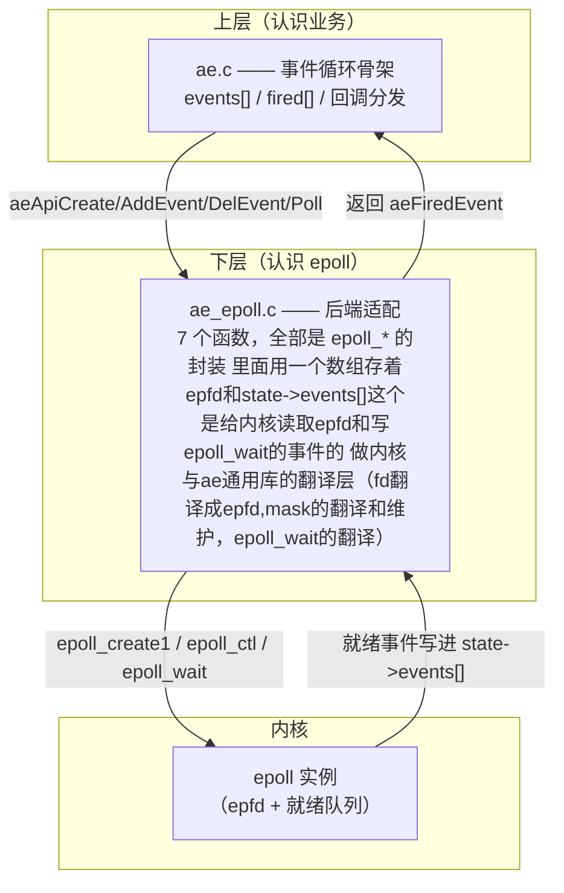
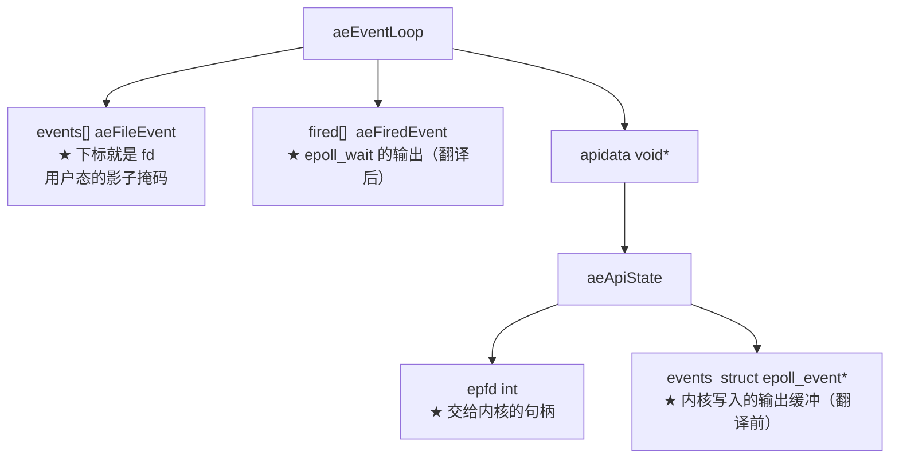
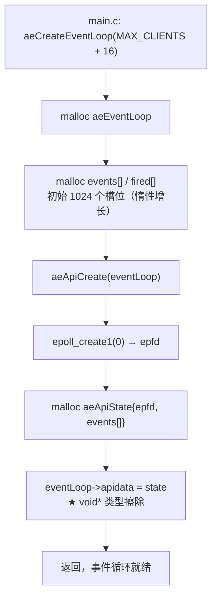
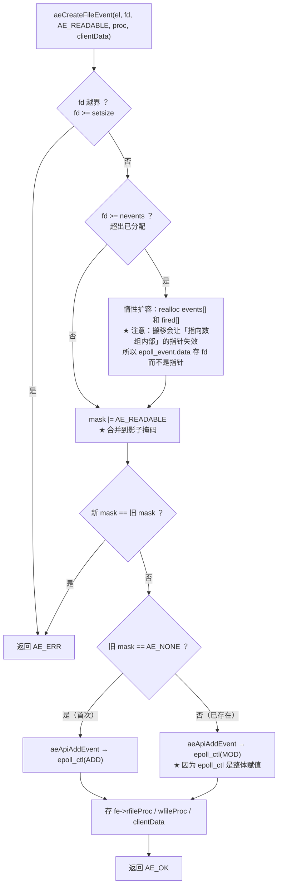
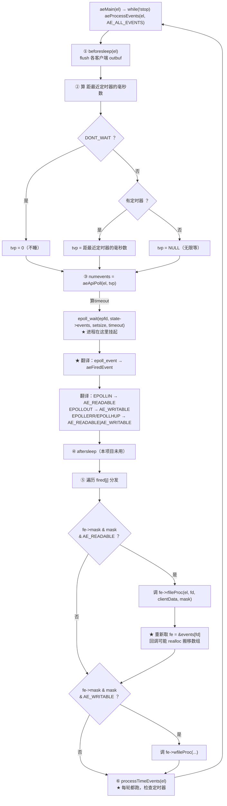
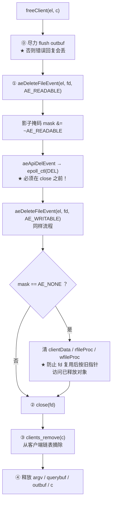

# epoll

> 本文回答一个问题：**一个线程怎么同时等 10000 个连接？**
>
> 答案是把「等」这件事交给内核（epoll），程序只在有事件时被唤醒。
> 本文先讲清 epoll 的四个核心概念，再用本项目的代码画出完整调用链。

---

## 一、epoll 是什么

**epoll 是 Linux 提供的「IO 多路复用」机制：把一批 fd 交给内核，内核在有事件时告诉你哪些 fd 就绪。**

对比三种方案：

| | select / poll | epoll |
|---|---|---|
| 每次调用要传什么 | **整个 fd 集合** | 只需一个 epfd |
| 内核怎么找就绪的 | 逐个检查 | **回调式，只返回就绪的** |
| 复杂度 | O(总 fd 数) | **O(就绪 fd 数)** |
| fd 上限 | 1024（select） | 只受 ulimit 限制 |

> ★ 一句话：**select 是「每次把所有 fd 报一遍」，epoll 是「注册一次，只报变化的」。**

---

## 二、四个核心概念

### 2.1 epfd —— epoll 实例的句柄

```c
int epfd = epoll_create(1024);   /* 返回一个 fd，代表一个 epoll 实例 */
```

它本身也是一个 fd。后面所有操作都靠它。

> 本项目用的是 `epoll_create(1024)`（旧接口，参数是「预期 fd 数量」的提示值，
> 现代内核已忽略它，仅要求 > 0）。
> 新代码更推荐 `epoll_create1(0)` —— 语义更清楚，且支持 `EPOLL_CLOEXEC`。

### 2.2 注册与注销：epoll_ctl

```c
struct epoll_event ev;
ev.events = EPOLLIN;
ev.data.fd = 5;

epoll_ctl(epfd, EPOLL_CTL_ADD, 5, &ev);   /* 关注 5 号的读 */
epoll_ctl(epfd, EPOLL_CTL_MOD, 5, &ev);   /* 改关注内容 */
epoll_ctl(epfd, EPOLL_CTL_DEL, 5, NULL);  /* 不再关注 */
```

> ⚠️ **关键陷阱**：`epoll_ctl` 是**整体赋值**，不是增量。
> 要把「读+写」都关注，必须在 `ev.events` 里一次性写 `EPOLLIN | EPOLLOUT`。
>
> **epoll 没有「我登记过什么」的查询接口** —— 所以用户程序必须自己存一份副本（影子掩码）。

### 2.3 等待：epoll_wait

```c
int n = epoll_wait(epfd, events, maxevents, timeout);
```

- `events`：**输出缓冲**。内核把就绪的事件写进来。
- `maxevents`：这次最多返回几个。
- `timeout`：**最多**睡多少毫秒（不是等满）。
  - `-1` = 无限等，直到有事件
  - `0` = 立刻返回
  - `> 0` = 最多睡这么久，有事件则提前醒
- **返回值**：就绪的个数（0 = 超时，无事件）。

> ★ `timeout` 是**定时器和 IO 复用的结合点**：
> 把它设成「距最近定时器还有多久」，一次 epoll_wait 同时满足「等 IO」和「等时间」。

### 2.4 两种触发模式

| | 水平触发 LT（本项目） | 边缘触发 ET |
|---|---|---|
| 何时通知 | **只要还有数据就一直通知** | 只在状态变化那一刻通知一次 |
| 要不要循环读到 EAGAIN | **不用** —— 没读完下次还会通知 | **必须** —— 否则数据丢失 |
| 编程复杂度 | 低 | 高 |

> ★ 本项目用 LT：`readQueryFromClient` 里只 `read` 一次、没有 while 循环，
> 就是靠 LT 保证「没读完的还会再通知」。

---

## 三、本项目的分层



> ★ **ae.c 完全不认识 epoll**。它只调用 `aeApi*` 这几个名字。
> 换平台只需换下面那个文件（`#include "ae_epoll.c"` → `"ae_kqueue.c"`）。

---

## 四、结构体之间的关系



两个数组、两个 events，容易混：

| | `aeEventLoop.events[]` | `aeApiState.events[]` |
|---|---|---|
| 元素类型 | `aeFileEvent`（回调+mask+clientData） | `struct epoll_event`（内核格式） |
| 谁维护 | **ae 层** | 内核写、epoll 后端读 |
| 扩容时要保留旧数据吗 | **要**（存着回调指针） | **不要**（每轮被完整重写） |

---

## 五、本项目的完整调用链

### 5.1 启动：建立 epoll 实例



### 5.2 注册：把一个 fd 纳入关注



> ★ 三种状态决定发 ADD 还是 MOD：`旧mask == NONE` 说明内核里还没有这个 fd → ADD；
> 已经有 → MOD。这**依赖用户态那份影子掩码**，因为 epoll 没法问。

### 5.3 主循环：等事件并分发（核心）



> ★ **双重与** `fe->mask & mask & AE_READABLE`：
> `fe->mask` 是「现在登记着什么」，`mask` 是「epoll_wait 那一刻报告了什么」。
> 因为 `fired[]` 是快照，本轮回调可能已经关掉了后面的 fd —— 那个判断能自动跳过。

### 5.4 关闭：从关注中摘除



> ⚠️ **为什么必须 DEL 在 close 之前**：
> ① `epoll_ctl` 要求 fd 有效，close 后会 EBADF；
> ② **fd 编号会被内核立即回收** —— 关掉 5 号，下个 accept 可能又拿到 5 号。
> 顺序反了就会把**新连接**的注册误删，那个连接从此静默失效。

---

## 六、五个必须记住的点

### 6.1 影子掩码（mask）为什么必须有

epoll **没有**「我登记过什么」的查询接口。所以用户态必须自己存一份：

```c
fe->mask |= AE_READABLE;
```

它决定三件事：
1. 该发 `EPOLL_CTL_ADD` 还是 `MOD`
2. 合并后的新掩码是什么（因为 ctl 是整体赋值）
3. 分发时该不该调回调

### 6.2 epoll_event.data 存 fd 而不是指针

```c
ev.data.fd = fd;        /* ✅ 整数，永不失效 */
/* ev.data.ptr = &events[fd];   ❌ 数组 realloc 后就悬垂 */
```

`fd` 是**值语义**，拷贝一份就永久有效。而指针会随数组搬移失效。

### 6.3 EPOLLERR / EPOLLHUP 必须处理

内核会**自动**报告这两个（无需登记），但 ae 的位掩码里没有「错误」这一位。
本项目的处理是**翻译成可读+可写** → 上层回调去 `read` → 拿到 -1 或 0 → 走正常关闭路径。

> 用一次多余的系统调用，换掉在事件层引入「错误位」的复杂度。

### 6.4 EAGAIN 是正常情况，不是错误

| 调用 | EAGAIN 的含义 | 处置 |
|---|---|---|
| `accept` | 连接队列空了 | **break**，正常出口 |
| `read` | 现在没数据 | **直接 return**，等下次通知 |
| `write` | 内核发送缓冲满了 | **注册 EPOLLOUT**，等内核通知 |

> ⚠️ 绝不能对 EAGAIN 重试 —— 内核不会因为你重试而腾出空间，只会 100% CPU 空转。

### 6.5 EPOLLOUT 用完必须撤销

```c
if (outbuf 空了) aeDeleteFileEvent(el, fd, AE_WRITABLE);
```

> ⚠️ socket **大多数时候都可写**。留着 EPOLLOUT 会让 `epoll_wait` 立刻返回
> → 回调什么都不做 → **100% CPU 忙转**，而且不报任何错。
> 这是 epoll 编程最经典的性能陷阱。

---

## 七、一分钟速查

| 问题 | 答案 |
|---|---|
| epoll 实例句柄存在哪 | `aeApiState.epfd` |
| 怎么访问它 | `aeApiState *state = eventLoop->apidata;`（void* 取回） |
| 为什么用 void* | 让 ae.h 编译期不认识 epoll，换后端不用改上层 |
| 谁存「登记了什么」 | `aeFileEvent.mask`（用户态影子掩码） |
| epoll_wait 的输出缓冲 | `aeApiState.events[]`（内核格式），翻译进 `fired[]` |
| 谁负责翻译 | `aeApiPoll` 里的 for 循环 |
| 超时参数谁算的 | `aeProcessEvents`，据最近定时器 |
| EPOLLERR/HUP 怎么办 | 翻译成可读+可写，让回调去 read 发现错误 |
| read 要不要循环 | 不用 —— 本项目用 LT，没读完下次还会通知 |
