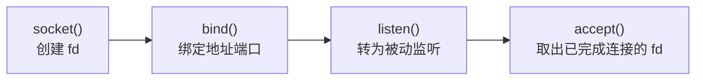
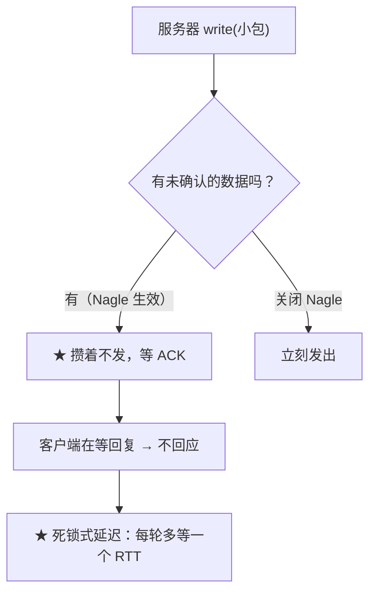
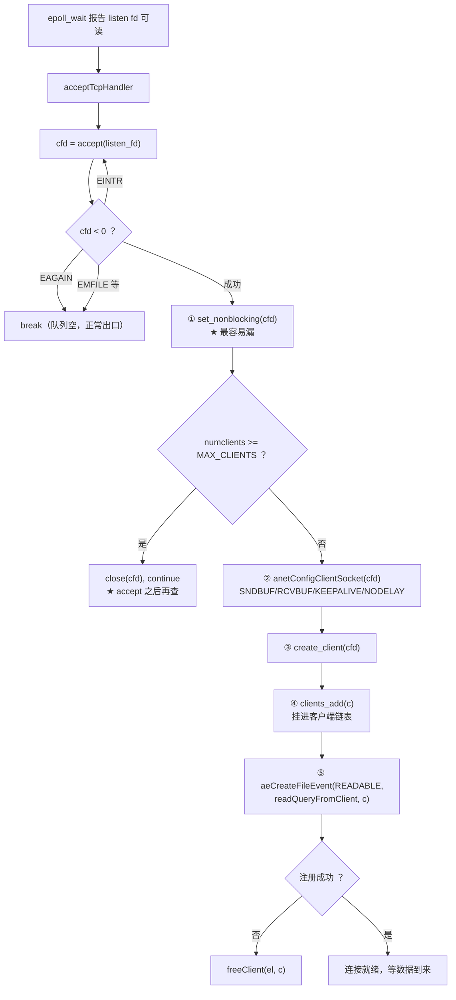
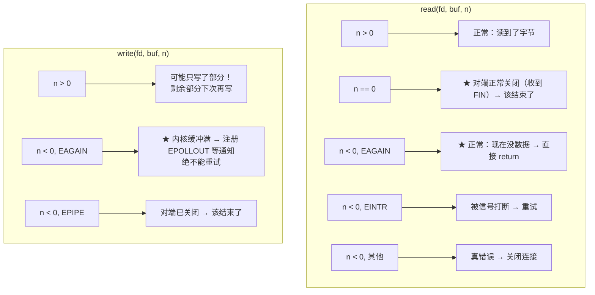

# Socket 网络编程

> 本文回答一个问题：**一个 TCP 服务器，从 `socket()` 到收发数据，要正确设置哪些东西？**
>
> 答案是一串**必须一起做对**的步骤：非阻塞、地址复用、Nagle、缓冲区。
> 本文讲知识点，流程图画在下面。

---

## 一、服务器端的四步



| 调用 | 作用 | 本项目位置 |
|---|---|---|
| `socket(AF_INET, SOCK_STREAM, 0)` | 创建 TCP socket | `create_server_socket` |
| `bind()` | 绑定 `0.0.0.0:port` | 同上 |
| `listen(fd, backlog)` | 转为监听态，`backlog` = 等待队列长度 | 同上（`BACKLOG 10`） |
| `accept()` | **从队列取出**一个已建立的连接 | `acceptTcpHandler` |

> ★ `listen` 之后 `socket` 就**不再表示一条连接**，而是「接受连接的入口」。
> 真正的连接由 `accept` **返回的新 fd** 表示 —— 所以每个客户端一个 fd。

---

## 二、五个必须设置的 socket 选项

### 2.1 `SO_REUSEADDR` —— 解决重启时端口被占用

```c
int opt = 1;
setsockopt(fd, SOL_SOCKET, SO_REUSEADDR, &opt, sizeof(opt));
```

**为什么需要**：服务器关闭后，连接进入 `TIME_WAIT` 状态（默认要等 1~2 分钟）。
不设这个选项，重启时 `bind()` 会失败 ——「端口已被占用」。

> ★ 必须在 `bind()` **之前**设置。本项目在 `create_server_socket` 里紧接着
> `socket()` 就调用它。

### 2.2 非阻塞 —— 否则一个连接卡死整个服务器

```c
int flags = fcntl(fd, F_GETFL);
fcntl(fd, F_SETFL, flags | O_NONBLOCK);
```

**为什么必须**：阻塞模式下 `read()` 会**一直等到有数据**。
一条连接不发数据，服务器就停在那里 —— 整个服务不可用。

> ★ 本项目的 `acceptTcpHandler` 里，注释把这一步标为「**最容易漏的一步**」：
> ```c
> if (set_nonblocking(cfd) == -1) { close(cfd); continue; }
> ```
> 忘了它，后面所有 `read`/`write` 都会退化成阻塞。
> A/B 测试里阻塞版的「1/10 被服务」「静默客户端卡死服务器」就是这个原因。

### 2.3 `TCP_NODELAY` —— 关闭 Nagle 算法

```c
int on = 1;
setsockopt(fd, IPPROTO_TCP, TCP_NODELAY, &on, sizeof(on));
```

**Nagle 算法**的思路是：小包先攒着，等凑够一个 MSS 再发，减少网络上的小包数量。
但对请求-响应型服务是**灾难**：



> ★ 请求-响应模式下每个包都要等回复，攒包只会**白等一个 RTT**。
> Redis 必开 `TCP_NODELAY`，本项目同样。

### 2.4 `SO_SNDBUF` / `SO_RCVBUF` —— 给缓冲区设上限

```c
setsockopt(fd, SOL_SOCKET, SO_SNDBUF, &size, sizeof(size));
setsockopt(fd, SOL_SOCKET, SO_RCVBUF, &size, sizeof(size));
```

**为什么设**：Linux 内核会**自动调优**缓冲区大小。高并发下，
每个连接的缓冲区无限膨胀 → 内存灾难。

本项目设为 4 MB，作为内核自动调优的**天花板**：

```c
#define ANET_SNDBUF  (1024 * 1024 * 4)
#define ANET_RCVBUF  (1024 * 1024 * 4)
```

> ★ 大小要看项目场景定。设太小会让 `write` 频繁 EAGAIN，
> 设太大则高并发时内存吃不消。

### 2.5 `SO_KEEPALIVE` —— 探测死连接

```c
setsockopt(fd, SOL_SOCKET, SO_KEEPALIVE, &on, sizeof(on));
setsockopt(fd, IPPROTO_TCP, TCP_KEEPIDLE,  &idle,     sizeof(idle));     /* 空闲多久开始探测 */
setsockopt(fd, IPPROTO_TCP, TCP_KEEPINTVL, &interval, sizeof(interval)); /* 探测间隔 */
setsockopt(fd, IPPROTO_TCP, TCP_KEEPCNT,   &cnt,      sizeof(cnt));      /* 失败几次算死 */
```

**为什么需要**：如果对端**拔网线 / 断电**（不是正常关闭），
内核不会收到 FIN —— 这条连接在服务器看来「一直活着」，fd 永远不释放。

**本项目的配置**：空闲 60 秒开始探测，间隔 10 秒，3 次失败判定断开。

| 选项 | 平台 | 本项目 |
|---|---|---|
| `SO_KEEPALIVE` | 跨平台 | ✅ 用 |
| `TCP_KEEPIDLE` / `KEEPINTVL` / `KEEPCNT` | **Linux 专有** | ✅ 用（`#ifdef __linux__`） |

> ★ 注意前三个是 Linux 特有的，macOS 上叫 `TCP_KEEPALIVE`（且只有一个），
> 所以本项目用 `#ifdef __linux__` 包起来。

---

## 三、`accept` 的四种返回

```c
while (1) {
    int cfd = accept(fd, &caddr, &clen);
    if (cfd < 0) {
        if (errno == EAGAIN || errno == EWOULDBLOCK) break;  /* 正常出口 */
        if (errno == EINTR) continue;                        /* 重试 */
        perror("accept"); break;                             /* EMFILE 等 */
    }
    ...
}
```

| 返回值 | 含义 | 处置 |
|---|---|---|
| `> 0` | 拿到新连接 | 继续循环（可能还有积压） |
| `EAGAIN` | **队列空了** | **`break`** —— 正常出口，不是错误 |
| `EINTR` | 被信号打断 | `continue` 重试 |
| `EMFILE` | **进程 fd 用尽** | `break`（见下） |

> ★ **`EAGAIN` 是正常情况**：非阻塞 `accept` 在队列空时就这样返回。
> 如果把它当错误，日志会被刷爆；如果 `continue` 重试，就是 100% CPU 空转。
>
> ★ **为什么用 `while(1)` 循环**：一次事件可能积压多个连接
> （水平触发下只通知一次，要把队列抽干）。但**必须靠 `EAGAIN` 退出**。

### EMFILE 为什么要 `break` 而不是 `continue`

`EMFILE` = 进程 fd 用尽了。此时如果 `continue`：

```text
accept 失败(EMFILE) → continue → accept 又失败 → ... 无限循环
★ 而且 listen fd 一直是可读的 → epoll_wait 立刻返回 → 100% CPU 空转
```

正确做法是 `break` 退出循环，等下次事件。

> ★ Redis 的进阶做法是「预留一个 fd，遇到 EMFILE 就关掉它 accept 一个再关连接」，
> 本项目没做，属已知局限。

---

## 四、新连接的全套配置流程



> ★ **「accept 之后再查连接数」是一个有意的取舍**：
> - **accept 之前**：要自己维护「待接受积压数」，且 LT 模式下无法区分
>   真连接和伪唤醒，容易多算漏算
> - **accept 之后（本项目）**：代价是多一次 `accept` + `close` 的系统调用，
>   换来的是判断永远基于真实计数，**绝不误判**

---

## 五、`read` / `write` 的返回语义

这是非阻塞编程最容易出错的地方。



| 关键点 | 说明 |
|---|---|
| **`read` 返回 0 ≠ 没数据** | 0 表示**对端关闭**，要继续处理该返回 0 时挂循环 → 死循环 |
| **`EAGAIN` 不是错误** | 是「现在没有」，正常出口 |
| **`write` 可能只写一部分** | 返回值是**实际写入字节数**，必须用 while 循环 + 记账 |
| **`EAGAIN` 绝不能重试** | 内核不会因为你重试就腾出空间，只会 100% CPU 空转 |

### 本项目怎么处理 write 的部分写入

```c
while (sdslen(c->outbuf) > 0) {
    ssize_t n = write(c->fd, c->outbuf, sdslen(c->outbuf));

    if (n < 0) {
        if (errno == EAGAIN) {
            aeCreateFileEvent(el, fd, AE_WRITABLE, writeToClientHandler, c);
            return 0;                 /* ★ 注册可写，等内核通知 */
        }
        if (errno == EINTR) continue;
        return -1;                    /* EPIPE 等 → 让调用方关闭 */
    }
    if (n == 0) return -1;            /* 防御：POSIX 说 count>0 时不会返回 0 */

    sdsrange(c->outbuf, n, -1);       /* ★ 消费掉已发出的部分 */
}
aeDeleteFileEvent(el, c->fd, AE_WRITABLE);   /* ★ 空了必须撤销 */
```

> ⚠️ **最后一步不能忘**：socket **大多数时候都可写**。
> 留着 `EPOLLOUT` 会让 `epoll_wait` 立刻返回 → 回调什么都不做 → **100% CPU 忙转**，
> 而且不报任何错。这是 epoll 编程最经典的性能陷阱。

---

## 六、TCP 是字节流，不是消息流

这是所有网络编程问题的根源。


| 现象 | 含义 |
|---|---|
| **粘包** | 一次 `read` 收到**多条**完整命令 |
| **半包** | 一条命令**跨多次** `read` |

> ★ TCP **没有消息边界**。应用程序必须自己定协议来划分消息。
> RESP 用 `*N\r\n` + `$L\r\n` 的长度前缀来定边界 —— 于是解析器必须能
> 「**从上次停下的地方继续**」。
>
> **这部分的解法见 `docs/字节流处理.md`。**

---

## 七、一分钟速查

| 问题 | 答案 |
|---|---|
| 服务器四步 | `socket` → `bind` → `listen` → `accept` |
| 每连接一个 fd 吗 | 是。`listen` 的 fd 只是「入口」，`accept` 返回新 fd |
| `SO_REUSEADDR` 解决什么 | 重启时 `TIME_WAIT` 导致的端口占用 |
| 为什么必须非阻塞 | 阻塞 `read` 会被一个不发言的客户端卡死整个服务器 |
| `TCP_NODELAY` 为什么必开 | 关掉 Nagle，否则请求-响应模式每轮白等一个 RTT |
| `SO_SNDBUF`/`SO_RCVBUF` 为什么要设 | 否则内核自动调优会让高并发下内存无限膨胀 |
| `SO_KEEPALIVE` 探测什么 | 对端拔网线/断电这种「收不到 FIN」的死连接 |
| `accept` 返回 `EAGAIN` | **正常** —— 队列空了，`break` |
| `accept` 为什么用 while 循环 | 一次事件可能积压多个连接，要靠 `EAGAIN` 退出 |
| `read` 返回 0 是什么意思 | **对端关闭**，不是「没数据」 |
| `write` 返回 `EAGAIN` 怎么办 | 注册 `EPOLLOUT` 等通知，**绝不能重试** |
| 写完为什么要撤销 `EPOLLOUT` | 否则 `epoll_wait` 忙转，100% CPU |
| 粘包/半包的根本原因 | TCP 是字节流，没有消息边界 |
| 相关代码 | `src/anet.c`、`include/anet.h`、`src/server.c`、`src/networking.c` |
