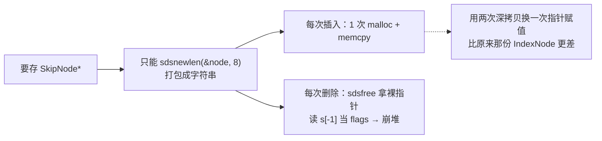
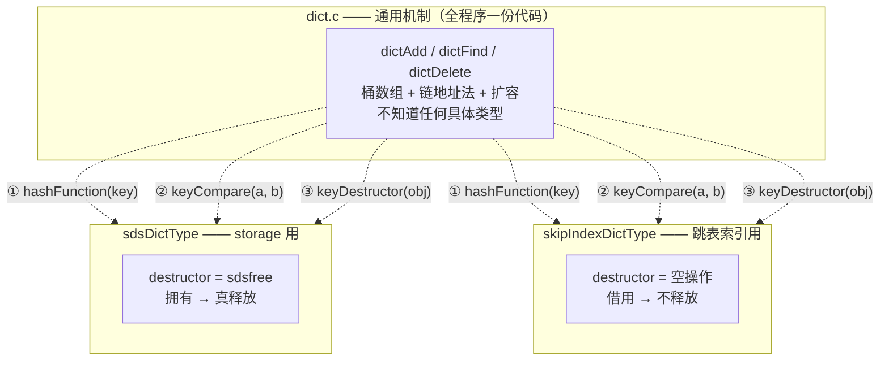
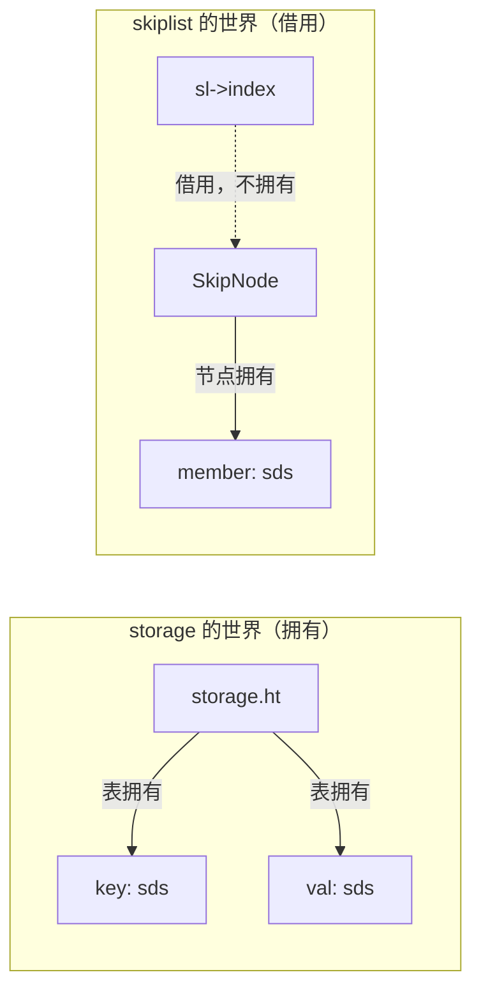
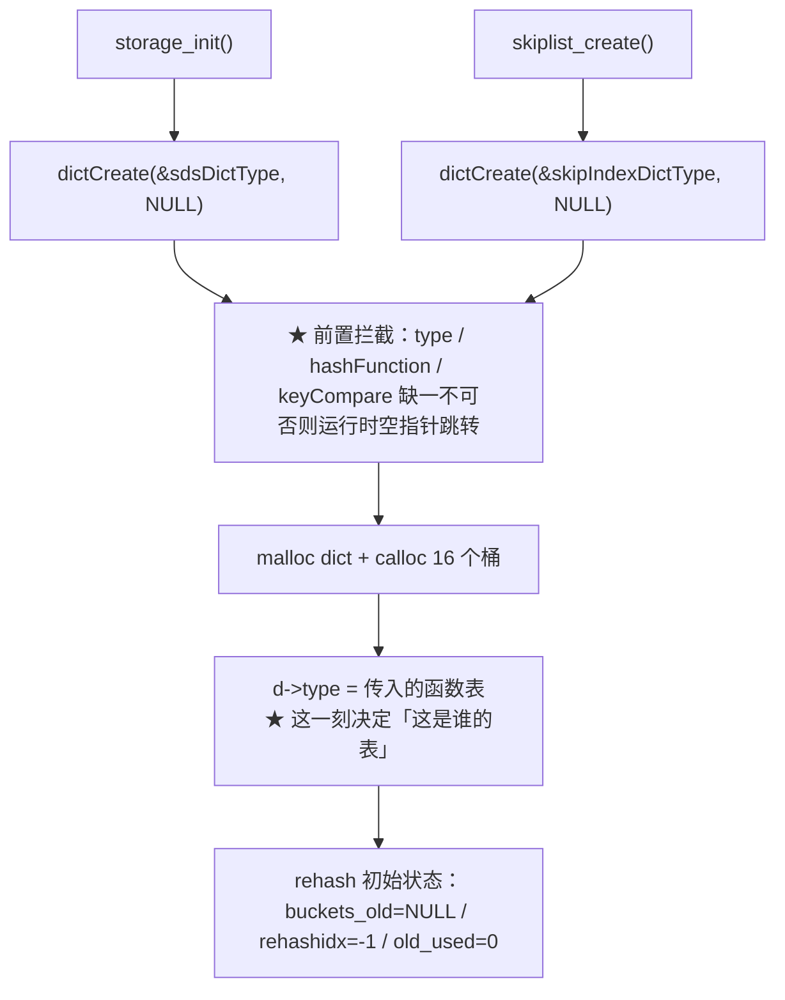
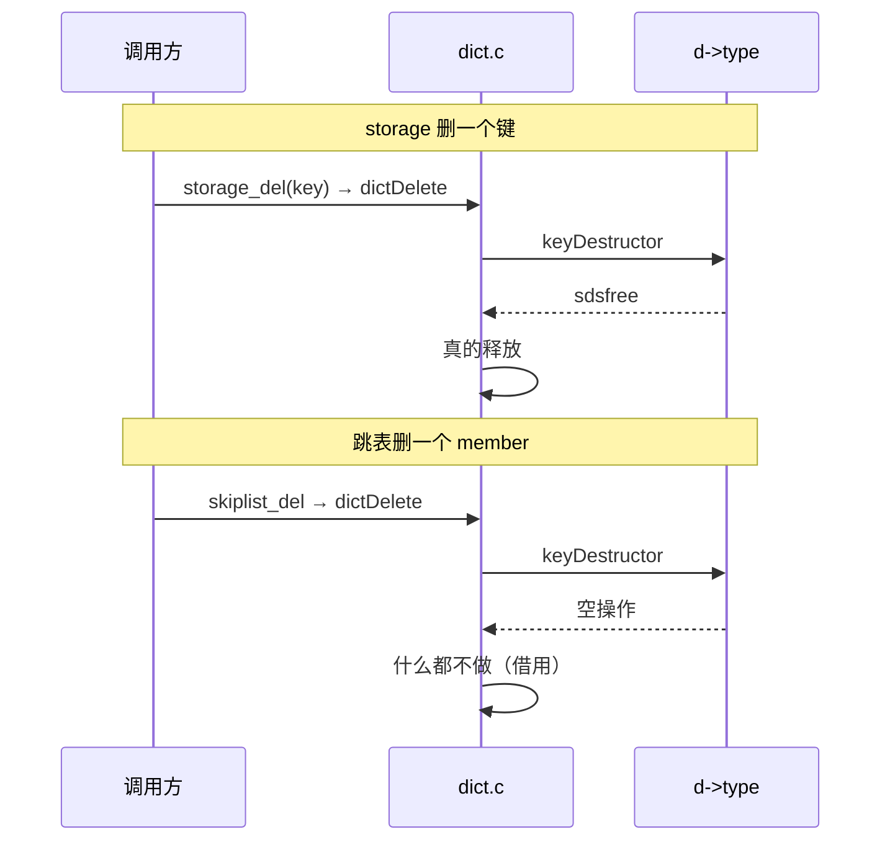
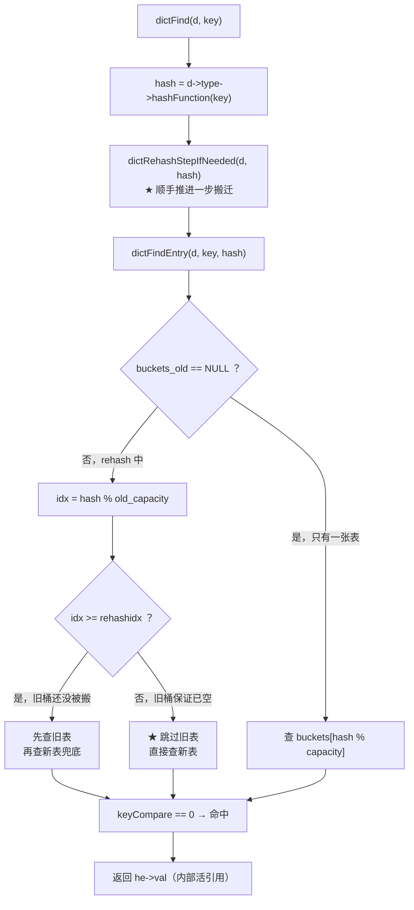
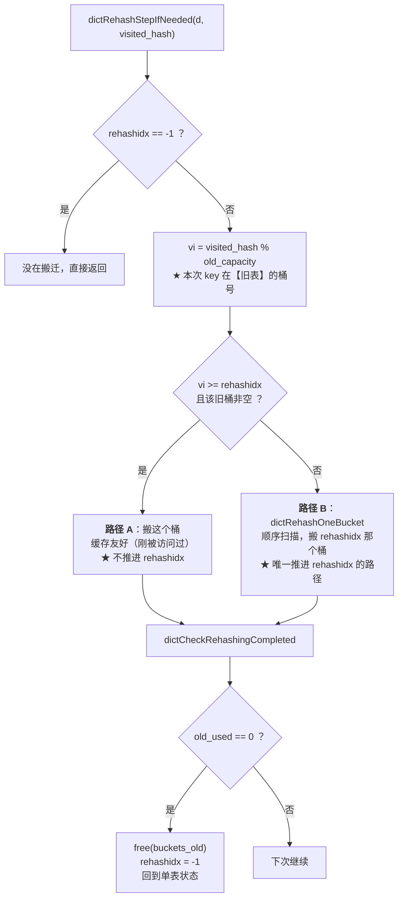
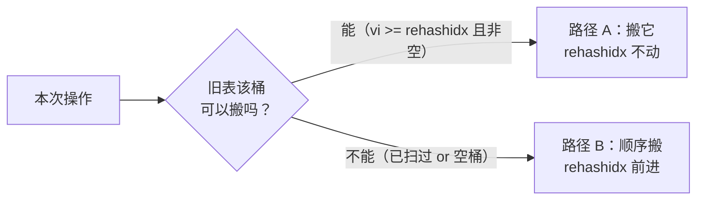

# 字典（zidian）

> 本文回答一个问题：**同一份哈希表代码，怎么同时服务「拥有数据」和「只借用数据」两种调用方？**
>
> 答案是 `void* key/value` + `dictType` 函数指针表（C 版虚函数表）。
> 本文先讲清知识点，再用本项目的代码画出完整调用链。

---

## 一、改造前为什么不能通用

改造前的哈希表是 **storage 专用**的，接口把类型焊死了：

```c
int   hashtable_set(HashTable *ht, sds key, sds value);
char *hashtable_get(HashTable *ht, sds key);
```

跳表为了拿到 O(1) 的 `find`，只好在内部**又抄了一份**哈希表
（`IndexNode` / `buckets` / `index_*`，约 100 行）。想消掉这份重复时发现接不进去：

| 决定 | storage 想要的 | 跳表索引想要的 | |
|---|---|---|---|
| key 类型 | `sds` | `sds` | 一致 |
| value 类型 | `sds` | `SkipNode *` | **冲突** |
| 谁负责销毁 | 归我，`sdsfree` | 借用的，一个都不许 free | **冲突** |

> ★ **后两条是同一件事的两面**：之所以能把 value 声明成 `sds`，正是因为
> 表敢对它调 `sdsfree`（`sdsfree` 靠 `s[-1]` 反推 header，只有 sds 能这么干）。
> 所以「放宽类型」和「交还销毁权」**必须一起做**，不存在只修一半的方案。

### 硬塞类型转换会怎样



> ★ 技术上能跑通，但是**亏本买卖**，所以绕不过去 —— 必须改接口。

---

## 二、解法：把四个问题外包出去

引入 `dictType`（函数指针表），在 `dictCreate` 那一刻由调用方交进来：

> **怎么算哈希、两个 key 怎么算相等、key/value 怎么销毁** —— 答案不在 `dict.c` 里。



> ★ **最关键的一眼**：两张策略表的前两行完全一样（哈希、比较都用 sds 那套），
> 唯一的区别在第三行 —— **谁负责销毁**。这就是跳表能接进来的全部原因。
>
> ★ `dict.c` 全程**没有一次 `if` 判断"这是谁的表"**。判断发生在 `dictCreate`
> 那一刻（`d->type = 哪张表`），之后每次删除都是一次函数指针调用。

### 用 OOP 视角看

| OOP 概念 | 本项目对应物 |
|---|---|
| 抽象基类 | `struct dict` |
| 虚函数表（vtable） | `dictType` |
| 虚函数 | 7 个函数指针字段 |
| 具体子类 | `sdsDictType` / `skipIndexDictType` |
| 对象里的 vptr | `dict.type` |
| 虚调用 `obj->hash(k)` | `d->type->hashFunction(k)` |

> ⚠ **但 vtable 只是多态的三种实现之一**，别把「多态」和「vtable」画等号：

| 机制 | 何时决定调哪个 | 运行时代价 | 代表 |
|---|---|---|---|
| **vtable** | 运行时（查对象里的指针） | 一次间接调用 | C++ `virtual`、**本项目** |
| **消息发送** | 运行时（按**名字**查表） | 更贵 | Objective-C |
| **单态化** | **编译期** | **零**，可内联 | C++ 模板、Rust trait |

> ★ C 的 `qsort` 收一个比较函数指针（1970s）就是多态 —— 比 C++ 早十几年。
> 多态不依赖 `class`。

---

## 三、会崩的三条契约

### (1) `NULL` 表示"不拷贝"和"不销毁"是两件事

- `keyDup == NULL` → 直接存调用方给的指针（所有权移交）
- `keyDestructor == NULL` → 删除/销毁时什么都不做（借用）

本项目两个调用方都传 `NULL`，所以 dict **从不复制、也从不主动释放** key/value。

### (2) `keyCompare` 的语义是「相等返回 0」（同 `strcmp`）

- 返回非 0 却被当成相等 → 更新会覆盖别人的槽位
- 返回 0 却当成不等 → 同一个 key 存进两条

> ★ `dictAdd` 判"key 已存在"用的是 `keyCompare`，**不是 `memcmp`** ——
> key 的相等语义完全由调用方定义（这正是 `void* key` 的价值）。

### (3) `hashFunction` 必须与 `keyCompare` 口径一致

比较判定相等的两个 key，必须得到同一个哈希值，否则落到不同桶查不到。

> ★ `destructor` 传 `NULL` 还是传空操作函数？**本实现两者都支持**
> （`dictFreeEntry` 会判空）。跳表侧显式传空操作函数，是为了让"借用"
> 在代码里**看得见**，而不是靠一个 `NULL` 去猜。

---

## 四、两个设计细节

### 4.1 `hash` 值缓存进节点

```c
struct dictEntry { void *key; void *val; unsigned long hash; struct dictEntry *next; };
```

- 把 N 次哈希计算降为 1 次
- 更重要的是：扩容搬迁时用 `he->hash` 重算下标，保证"搬到的桶"与
  "当初插入的桶"**口径绝对一致**（即使将来 `hashFunction` 带了随机种子也不会错位）

代价：每节点多 8 字节。

### 4.2 谁拥有谁 —— 一张表看懂



> ★ 粗箭头 = 拥有（删除时释放），虚线 = 借用（删除时什么都不做）。
> 跳表索引里的 key 和 value 都指向**别人拥有的东西** —— 这就是它必须
> 挂"空操作 destructor"的原因。

---

## 五、完整调用链

### 5.1 建表：策略在这里被绑定



### 5.2 删除：同一个函数，两条路径



> ★ 两次调用走的是**同一个 `dictDelete`**，区别只在传进去的 `d` 不同
> → `d->type` 不同 → 调到的函数不同。

### 5.3 查找：一条路径统一三种调用方



> ★ `dictAdd` 查重 / `dictFind` / `dictDelete` 定位**全都走 `dictFindEntry`** ——
> 渐进式 rehash 的读取逻辑只有一处实现，不会被漏掉。

---

## 六、渐进式 rehash

### 6.1 为什么做

一次性搬迁在扩容那一次操作里搬完全部元素，耗时 O(n)，期间服务端**无法处理任何请求**。

实测（`make benchrehash RUN=<N>`，逐次记录插入耗时）：

| N | 一次性搬迁最大停顿 | 渐进式 rehash | 改善 |
|---|---|---|---|
| 100,000 | 3.4 ~ 3.7 ms | 0.041 ~ 0.047 ms | ~78x |
| 1,000,000 | 23.9 ~ 29.4 ms | 0.198 ~ 0.224 ms | ~120x |
| 2,000,000 | 54.7 ~ 58.0 ms | 0.414 ~ 0.523 ms | ~115x |

> ★ 区间为多次运行的波动（VM 环境噪声大，看量级与趋势，不看单次值）。
> **关键不是倍数，而是曲线形状**：一次性搬迁随 N 线性增长（3.4→58ms，N 涨 20 倍
> 停顿涨约 17 倍）—— 这是 O(n) 的签名；渐进式维持在亚毫秒，不随 N 量级跃升。

### 6.2 怎么实现

`dictExpand` 只做 O(1) 的准备（建新表、旧表挂到 `buckets_old`、`rehashidx = 0`），
真正的搬运交给每次增删查。



新增字段：

| 字段 | 作用 |
|---|---|
| `buckets_old` | 旧表（只减不增），非 NULL = 正在搬迁 |
| `rehashidx` | 顺序扫描进度；-1 = 未在搬迁 |
| `old_capacity` | 旧表桶数 |
| `old_used` | ★ 旧表**还剩多少个键值对** —— 完成判定用它 |

两条不变量：**① 新增只进新表**（否则旧表永远搬不完）；
**② 查/删要按 `rehashidx` 判断查哪张表**。

### 6.3 ★ 路径 A / B 是「二选一」，不是叠加

本节纠正一个我**误判了三次**的设计。Redis `unstable` 的
`_dictRehashStepIfNeeded` 原文（已核对上游源码）：

```c
if ((long)visitedIdx >= d->rehashidx && d->ht_table[0][visitedIdx]) {
    _dictBucketRehash(d, visitedIdx);   /* 更 CPU cache 友好 */
} else {
    dictRehash(d, 1);                   /* 不太 cache 友好 */
}
```

**就是 `if/else`，互斥。**

#### 为什么「二选一」也能收敛 —— 这是最容易搞错的一点

一个看似合理的推理是：

> 路径 A 搬桶**不动 `rehashidx`**，而 `rehashidx` 是唯一能结束 rehash 的计数器
> → 走了路径 A 就白丢一次推进机会 → **rehash 永不结束**。

**这个推理错了。** 错在把 `else` 分支漏掉了：



`elif` 的语义是「**路径 A 的条件不成立时**才走 B」，而不是「走了 A 就永不走 B」。
只要操作序列里存在**任何一次**让路径 A 条件不成立的操作
（旧桶已被扫过、或是空桶），路径 B 就会被执行、`rehashidx` 就会前进。

这不只是推理 —— **实测过**（构造 30 万 key，统计每个分支被走到多少次）：

```text
插入风暴 300,000 次：走路径 A = 65,301   走路径 B = 163,846   未搬迁 = 70,853
结束时 rehashidx = 121,765 / 262,144（旧表桶数）

之后转为纯读负载：54,200 次查找后旧表完全搬空（buckets_old = NULL）
```

> ★ 路径 B 实际执行了 **16 万多次**，`rehashidx` 从 0 推进到 121,765。
> **收敛是成立的，二选一不是 bug。**

#### 二选一 vs 叠加：真正的取舍

两种写法**功能都正确**，区别只在"一次操作做几件事"：

| 写法 | 单次操作搬几个桶 | 单次延迟上限 | 收敛速度 | 旧表残余 |
|---|---|---|---|---|
| **二选一**（Redis / 本项目） | ≤ 1 | 低（一个桶的成本） | 慢 | 多 |
| 叠加 | ≤ 2 | 高（可能翻倍） | 快 | 少 |

实测（30 万 key）：叠加版旧表残余 **11,692**，二选一版 **61,906**。
叠加版确实搬得快、更早退出双表状态，所以**吞吐会更好**。

但**服务端更在意单次操作的最坏延迟**（那个值决定会不会有请求超时）。
叠加版把最坏延迟上限抬高了 —— 这正是 Redis 用 `if/else` 要避免的。
**本项目按 Redis 的选择取"二选一"。**

> ⚠ **方法论**：我当初拿"叠加版吞吐更高"这个局部数字去否定 Redis 的 `if/else`，
> 归因错了。**当测量结果与上游成熟实现的做法冲突时，先假设是自己错了。**
> 转折点是去读 `unstable` 分支的真实源码，发现人家就是 `if/else`。

### 6.4 用 `rehashidx` 决定查哪张表（正确，但收益在噪声内）

"二选一"结构**保护了一条不变量**：旧表中 `[0, rehashidx)` 区间恒为空
（只有路径 B 推进 `rehashidx`，而它推进前必然已把该桶搬空；
路径 A 只搬 `idx >= rehashidx` 的桶，不碰这个区间）。

有了它，查找可以省一次：

```
idx = hash % old_capacity
  idx <  rehashidx → 旧桶已搬空 → 跳过旧表，直接查新表
  idx >= rehashidx → 旧桶还没搬 → 先查旧表，再查新表兜底
```

> ⚠ **关键陷阱**：`idx < rehashidx` 时**仍然必须查新表** ——
> rehash 期间**新插入的 key 只进新表**，而它的 idx 完全可能 `< rehashidx`。
> 写成"跳过旧表就返回"会漏查所有新键。

**正确性**：`tests/test_lookup_order.c` 做白盒对拍
（oracle 用"两张表都查"的最笨写法）：

```
① idx < rehashidx 的位置检查 8.2 亿次，旧表非空次数 = 0   ← 不变量成立
② 30 万 key 全量对拍，不一致 = 0
③ rehash 中 add/find/delete 混合，失败 = 0
④ 20 万 key 混合负载压力对拍，不一致 = 0
```

**性能：收益在噪声内，如实报告。**

| 版本 | find 中位数（30 万 key，交叉 7 轮） |
|---|---|
| 新版（idx 判定） | 44.0 ns/op |
| 旧版（两张表都查） | 45.6 ns/op |
| 差异 | **−3.5%（在噪声内）** |

**为什么省了 81% 的旧表访问却没换来速度**：被省掉的那些访问**本身几乎不花钱** ——
实测旧版查旧表时 **81.3% 落在空槽**（空槽 = 一次取模 + 一次访存 + 一次判空，
无链表遍历）。真正贵的是"命中非空槽后的链表遍历"，而那部分省不掉。

> ★ **因此保留它的理由是「结构清晰 + 与上游语义对齐」，不是性能。**

### 6.5 坑 1：路径 A 必须用 hash，不能拿"新表下标"

新旧两表**桶数不同**（新表 = 旧表 × 2），同一个 key 在两张表里的下标不同，
指向两个不相干的桶。所以绝不能拿"新表下标"去索引旧表：

- 新表下标可能 `>= old_capacity` → **越界读写 `buckets_old`**（本实现真的中了）
- 即使没越界，那个位置也与本次 key 无关，"缓存友好"无从谈起

正确做法：路径 A 用 **`hash % old_capacity`**。
所以参数是 **`visited_hash`（哈希值）**，不是下标。

### 6.6 坑 2：完成判定必须用 `old_used`

若用 `rehashidx >= old_capacity` 判定"搬完了"，会错：

- 路径 A 会**插队**搬走 `rehashidx` 之后的桶 → 下标还没扫到末尾，但旧表已空
  → 白白多查很多次旧表
- 反过来只看下标就释放旧表 → 可能**丢掉还没搬的数据**

所以单独维护 `old_used`（Redis 的 `ht_used[0]`），每搬走一个减 1，
`dictDelete` 删旧表节点时也减 1，归零才释放。收口在 `dictCheckRehashingCompleted`。

### 6.7 坑 3：残余尖刺是 `free()`，不是搬桶

用探针逐次打印定位到：最大停顿**精确发生在释放旧表那一次操作** ——
`free(buckets_old)`。实测 `free` 一张桶数组的耗时（纯内存操作，与元素内容无关）：

```
cap=131072  ( 1 MB) → 0.049 ms
cap=1048576 ( 8 MB) → 0.389 ms   ← 100 万键场景
cap=4194304 (32 MB) → 1.975 ms
```

这是内核释放页表的成本，**与搬运多少元素无关**。
要连它一起消掉，得把旧表切块分次释放 —— 更激进的做法，本项目与 Redis 都没做。

### 6.8 步长上限的取舍

上限不是随手定的，是实测调出来的（200 万键）：

| `dictRehashOneBucket` 上限 | 收敛性 | 最大停顿 |
|---|---|---|
| 无上限 | 快 | 大（退化成一次性搬迁） |
| 128 | 完整收敛 | 0.91 ms |
| **16（当前）** | 良好 | 0.83 ms |
| 1 | 收敛很慢 | 0.42 ms 但 find 退化约 12x |

`1` 那一行是"看起来延迟最低、实际最差"的典型 —— 它把成本转移到了
**每一次查找**上（rehash 长期结束不了 → 长期要查两张表）。

> ★ 注意「上限 16」指的是路径 B 的调用次数；路径 A 是另一次搬运，不计入。
> 而 `dictRehashStepIfNeeded` 每次操作**最多**走一条路径，所以单次操作
> 搬的桶数有界。

---

## 七、诚实记录的边界

### 7.1 渐进式有固有债务

每次操作只搬一个桶，而旧表桶数 ≈ 2×size，表越大相对进度越慢，
搬迁会长期滞后于插入。实测 30 万 key，插入全部结束时旧表仍剩
**61,906 个元素**（`rehashidx` 只扫到 121,765 / 262,144）。

这是"把长停顿摊成小步"的必然代价：**搬迁由操作次数驱动，而插入本身在制造
新的搬迁需求**。缓解手段是提高每次操作的搬迁步长（见 6.8）。

### 7.2 渐进式消除的是什么

**它消除的是「O(n) 的搬运停顿」，不是「O(表大小的)内存管理停顿」。**
残余尖刺 = `free(buckets_old)` + `calloc(新表)`，是内核页表管理成本。
诚实讲清这一点，比宣称"消灭了所有尖刺"有价值。

### 7.3 本轮有意没做的取舍

**`union` 内联存储 —— 没做。** Redis 的 `dictEntry` 用
`union { void *val; uint64_t u64; int64_t s64; double d; }`，
收益是**小值（整数/double）免除额外 malloc**。本项目不做，因为：

- 跳表索引要存的本就是 `SkipNode*`（指针），天然住在 `union` 的 `val` 格子里，
  **收益为 0**；storage 的 value 是 `sds`（也是指针），收益同样为 0
- 通用性的来源是 `void*` + `dictType`，**与 `union` 无关**
- `union` 是**布局**改动，泛型化是**接口契约**改动。两者一起改，
  测试挂了你分不清是哪一层错了

**哈希种子 / SipHash —— 没做。** Redis 用随机种子防哈希碰撞攻击（DoS）。
本项目单机学习用途。key 已是 `void*`，加种子只需改 `hashFunction`，接口不动。

### 7.4 与 Redis 的差距

| 差异点 | 本项目状态 |
|---|---|
| `void *key` + `dictType` 多态 | ★ 已对齐 |
| `void *val`（union 内联存储） | 部分：val 已是 `void*`，union 留作第二步 |
| 渐进式 rehash（双表 + rehashidx） | ★ 已对齐 |
| 8.0 特有：`ht_size_exp` 指数存大小 | 未做 |
| 极致省内存：空桶直存 / `dictEntryNoValue` | 未做 |
| 哈希种子 / SipHash | 未做 |

> Redis 的省内存策略用指针低 3 位标记桶里存的是哪种：
> `000` 普通 entry / `001` 奇数地址 key 指针 / `010` 偶数地址 key 指针 /
> `100` `dictEntryNoValue`。策略选择由 `dictType` 里的位域标志控制（只占 1 bit），
> 成千上万个同类字典共享同一个 `dictType` —— 这是**类级别的内存优化**：
> 把元数据从"每个实例存一份"提升到"每种类型存一份"。

---

## 八、一分钟速查

| 问题 | 答案 |
|---|---|
| 通用性靠什么 | `void* key/value` + `dictType` 函数指针表 |
| "这是谁的表"在哪决定 | `dictCreate` 那一刻（`d->type = 传入的函数表`） |
| 核心代码里有判断类型的 `if` 吗 | **没有** |
| `NULL` destructor 什么意思 | 借用，不释放（跳表索引） |
| `keyCompare` 语义 | 相等返回 0（同 `strcmp`） |
| `hash` 为什么要缓存 | 省 N 次计算 + 保证搬迁下标口径一致 |
| 新增插哪张表 | **只插新表**（否则旧表永远搬不完） |
| 查/删看几张表 | 两张（数据可能还在旧表） |
| 查表顺序靠什么判断 | `idx = hash % old_capacity` 与 `rehashidx` 比较 |
| `idx < rehashidx` 时能返回吗 | **不能**，仍要查新表（新键只进新表） |
| 路径 A / B 什么关系 | **二选一**（与 Redis `unstable` 一致） |
| 谁推进 `rehashidx` | 只有路径 B |
| 完成判定用什么 | `old_used == 0`，不是下标 |
| 路径 A 的参数 | `visited_hash`（哈希值），不是下标 |
| 残余尖刺是什么 | `free(buckets_old)`，内核页表成本 |
| 相关测试 | `tests/test_lookup_order.c`、`make benchrehash RUN=N` |
