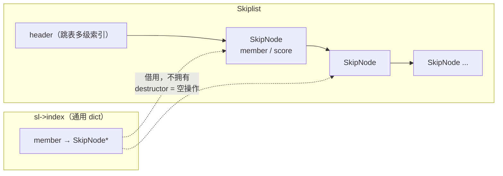
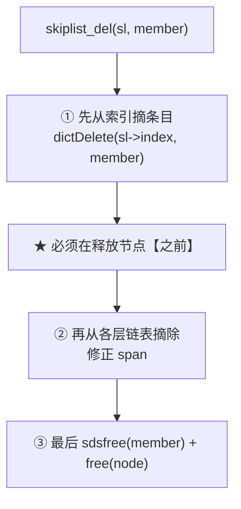
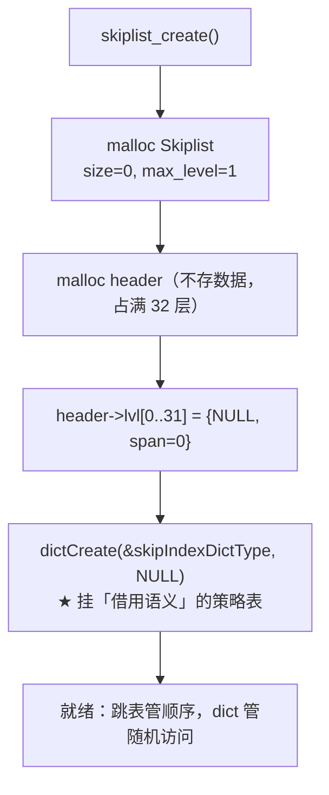
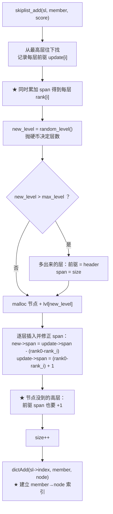
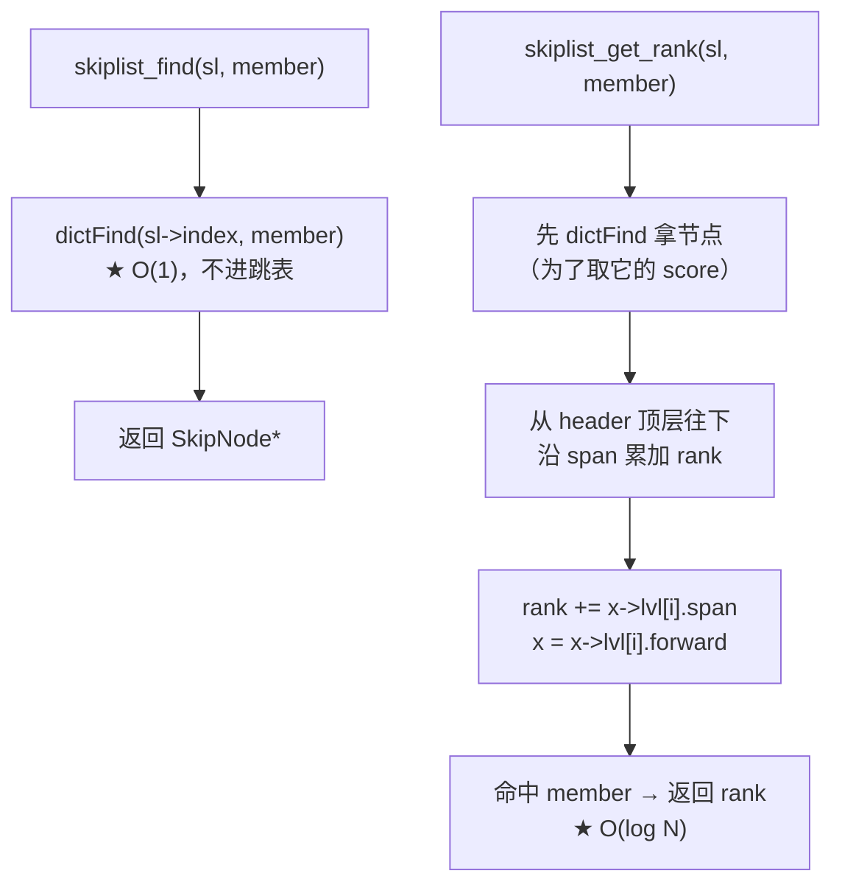
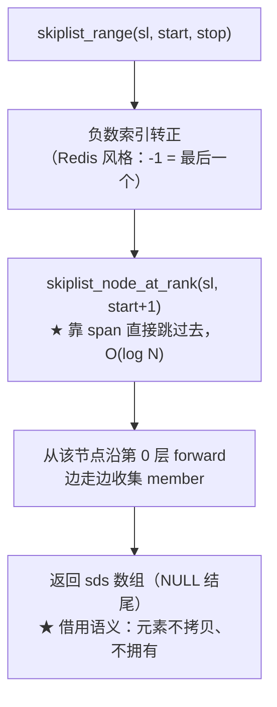

# 跳表（tiaobiao）

> 本文回答一个问题：**有序数据既要「按分数排序」，又要「按成员名 O(1) 查到」，
> 一个结构怎么同时做到？**
>
> 答案是**跳表 + 哈希索引**——跳表负责顺序，哈希表负责随机访问。
> 本文先讲清知识点，再用本项目的代码画出完整调用链。

---

## 一、跳表是什么

**跳表 = 在有序链表上加「多级快速通道」，用随机化换 O(log N) 查找。**

```
第2层  header ──────────────────► [30] ──────────► NULL
第1层  header ──────► [10] ─────► [30] ──────► [50] ──► NULL
第0层  header ─► [5] ─► [10] ─► [20] ─► [30] ─► [50] ─► NULL   ← 全量有序链表
```

查找 30：从第 2 层直接跳过去，只走 1 步；不用在第 0 层走 4 步。

| | 有序数组 | 平衡树 | **跳表** |
|---|---|---|---|
| 查找 | O(log N) | O(log N) | O(log N) |
| 插入/删除 | **O(N)**（要搬移） | O(log N) | **O(log N)** |
| 实现难度 | 低 | **高**（旋转/染色） | **低**（就是链表） |
| 范围查询 | 好 | 中（要中序遍历） | **好**（第 0 层就是有序链表） |

> ★ 跳表的价值在于：**用「多层链表 + 随机层数」换来平衡树的复杂度，
> 但代码只有链表的复杂度。** Redis 选它做 zset 就是这个理由。

---

## 二、两个核心机制

### 2.1 随机层数

```c
static int random_level(void){
    int level = 1;
    while ((rand() & 1) && level < SKIPLIST_MAX_LEVEL) level++;
    return level;
}
```

不停地抛硬币，正面就升一层。于是：

- **第 1 层的节点占 1/2，第 2 层占 1/4，第 k 层占 1/(2^k)**
- 期望层数是 O(log N)，**不需要任何再平衡操作**

> ★ 这是跳表最聪明的地方：**平衡树要「维持平衡」，跳表靠概率「天然近似平衡」。**
> 代价是层数有随机性（最坏可能不均衡），但概率极低。

### 2.2 span —— 让「第几名」也能 O(log N)

只有 `forward` 时，跳表只能回答「**有没有**这个值」；回答不了「**它排第几**」。

```c
typedef struct SkipListLevel{
    struct SkipNode *forward;   // 该层下一个节点
    unsigned long span;         // ★ 这一跳跨过几个节点（含目标）
} SkipListLevel;
```

`span` 就是「这一跳的步长」。跳转时把它累加起来：

```c
while (能往右跳) {
    rank += x->lvl[i].span;    // ★ 累加步长 = 累加排名
    x = x->lvl[i].forward;
}
```

于是 `ZRANK`（求排名）和 `ZRANGE`（按位置取）都变成 **O(log N)**。

> ★ **没有 span 会怎样**（本项目改造前的真实情况）：
> 范围查询只能「从 header 沿第 0 层 for 循环走 start 步」——
> 明明跳表能跳，却退化成了 O(N) 遍历。加 span 后从这个陷阱里出来了。

---

## 三、为什么还需要哈希表

跳表能 O(log N) 找到某个 member 的**位置**，但 `ZSCORE member` 想拿的是 **score**。

- **只有跳表**：从 header 逐层比较，O(log N)（本项目加的索引之前是 O(N) 遍历第 0 层）
- **加哈希索引**：`dictFind` 一次命中，**O(1)**

```c
SkipNode *skiplist_find(Skiplist *sl, sds member) {
    return (SkipNode *)dictFind(sl->index, member);   // ★ 一行
}
```

所以跳表里同时存在两个容器，它们的分工是：

| | 跳表（`header` / `lvl[]`） | 哈希索引（`index`） |
|---|---|---|
| 存什么 | 全部节点，按 score 有序 | member → `SkipNode*` |
| 回答什么 | 范围、排名、有序遍历 | **这个 member 存在吗 / 在哪** |
| 复杂度 | O(log N) | **O(1)** |
| 谁拥有数据 | **拥有**（节点归它） | **借用**（指向跳表节点） |



> ★ **注意箭头是虚线**：索引只是「指向」跳表节点，**不拥有**它们。
> 这就是 `skipIndexDictType` 的 destructor 必须是空操作的原因 ——
> 否则删索引时会连带释放节点，而节点还挂在跳表上 → 双重释放。

---

## 四、所有权：两个容器不能都负责释放

这是本项目最容易出 bug 的地方。

```c
static dictType skipIndexDictType = {
    dictSdsHash,              // hash   : 复用 sds 那套
    dictSdsKeyCompare,        // compare: 复用 sdscmp
    NULL, NULL,               // keyFromU64 / keyDup
    NULL, NULL,               // valDup
    skipIndexKeyDestructor,   // ★ 借用 → 空操作
    skipIndexValDestructor,   // ★ 借用 → 空操作
};
```

**规则：节点归跳表拥有，索引只借用。**

于是删除时必须注意顺序：



> ⚠️ **为什么顺序不能反**：`dictDelete` 内部要调 `hashFunction` / `keyCompare`，
> 两者都会解引用 `member`。先释放节点 → 读悬垂指针。
> 已在代码里标注为「硬要求」。

---

## 五、完整调用链

### 5.1 建表



### 5.2 插入（最复杂的一步）



> ★ **`span` 修正公式的三个分支**（对应上图 H 和 I）：
> - 新节点**所在**的层：把它插进去，两侧 span 按排名差拆开
> - 新节点**不在**的层：整条第 0 层多了一个节点 → 前驱 span **+1**
>
> 少写 I 这一步，高层 span 就全错，排名和范围查询一起偏。

### 5.3 查找与排名



> ★ 两个函数分工明确：**找得到靠 dict（O(1)），排第几靠 span（O(log N)）**。

### 5.4 范围查询



> ⚠️ **返回的是借用引用**：调用方（`zset_range`）不得 `sdsfree` 这些元素，
> 需要可拥有的副本时自己 `sdsdup`。数组本身可 free。

---

## 六、与 Redis 跳表的差距

| 差异点 | 本项目 | Redis | 影响 |
|---|---|---|---|
| `span`（排名/范围） | ★ 已对齐 | 有 | 都是 O(log N) |
| member→node 索引 | ★ 已对齐（用通用 dict） | 有（自己的 dict） | 都是 O(1) |
| **`backward` 后退指针** | **无** | 有（第 0 层双向） | 本项目的 `ZREVRANGE` 要另想 |
| 删除时内存所有权移交 | 无 | 有 | 本项目靠调用方约定 |

> ★ **backward 是唯一还没补的**。本项目第 0 层是单向的 ——
> 因为 member 查询走的是 dict（不需要反向遍历），
> 排名的获取走的是 span（也不需要），所以暂时没暴露问题。
> 但真要做「按分数从大到小遍历」，单向链表就得每次从 header 重走。

---

## 七、一分钟速查

| 问题 | 答案 |
|---|---|
| 跳表为什么能 O(log N) | 多层快速通道 + 随机层数，不需要再平衡 |
| 层数怎么定 | 抛硬币，`random_level()`，期望 O(log N) |
| `span` 是干什么的 | 记录「这一跳跨几步」→ 累加即得排名 |
| 没有 span 会怎样 | 范围查询/求排名退化成 O(N) 遍历第 0 层 |
| member→score 为什么用 dict | 跳表 O(log N) vs 哈希 O(1)，且改造前是 O(N) |
| 索引拥有节点吗 | **不拥有**，destructor 是空操作（借用） |
| 删除的顺序 | 先 `dictDelete` 摘索引，**再**释放节点 |
| 删除为什么要遍历所有层 | 节点不在的高层，前驱 span 也要 −1 |
| 与 Redis 还差什么 | `backward` 后退指针 |
| 相关代码 | `include/skiplist.h`、`src/skiplist.c`、`tests/test_skipspan.c` |
