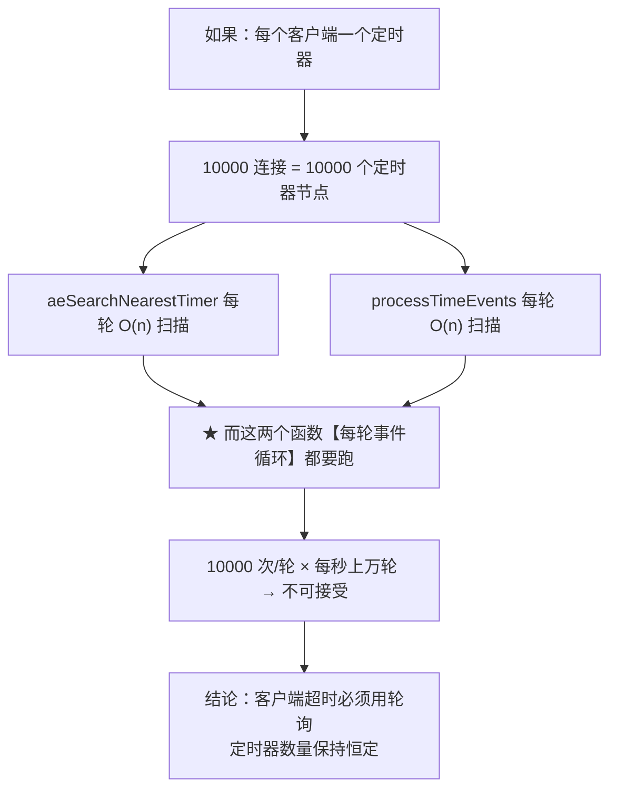
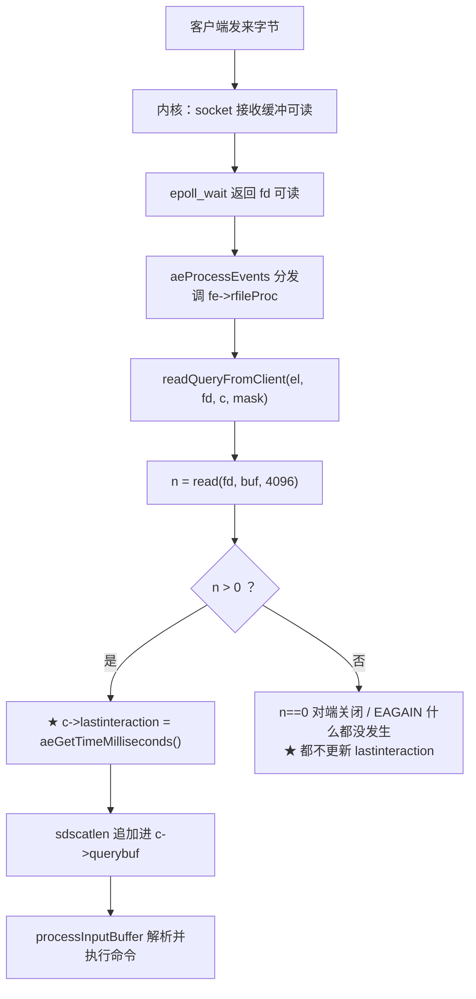
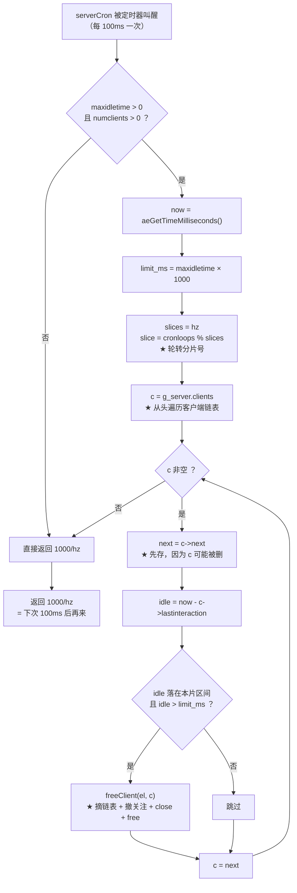
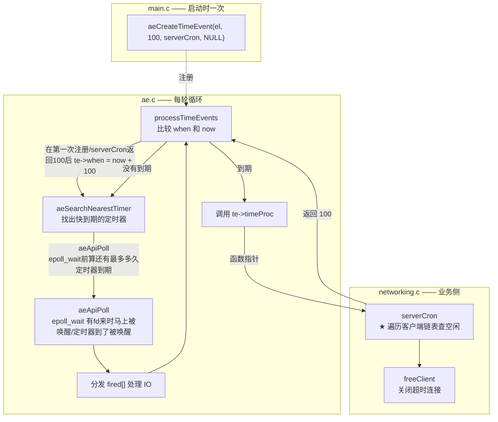

# 轮询（lunxun）

> 本文回答一个问题：**服务器怎么发现「某个客户端已经太久没说话了」？**
>
> 答案不是定时器，而是**轮询** —— 每隔一段时间主动去查一遍。
> 本文先讲清轮询这个概念本身，再用本项目的代码画出完整调用链。

---

## 一、轮询是什么

**轮询 = 主动地、周期性地去问「状态变了吗」，而不是等别人通知。**

| | 轮询 | 事件驱动 |
|---|---|---|
| 谁来发现变化 | **我自己定期去查** | 别人在变化时通知我 |
| 典型问法 | 「到了吗？」 | 「到了我叫你」 |
| 代价 | 查得太勤浪费，查得太疏发现得晚 | 需要一套通知机制 |
| 本项目用在哪 | **客户端空闲超时** | 文件事件（epoll）、定时器到点 |

> ★ 一句话区分：**定时器是「闹钟响了才醒」，轮询是「自己隔一会儿看一眼」。**

---

## 二、为什么客户端超时不能用定时器

直觉上「每个连接一个超时定时器」很自然，但在本项目里行不通：



更根本的原因是：**每条连接的超时时刻是会变的**。

- 收到数据 → 超时时刻推后 → 要删掉旧定时器、建新的
- 10000 个连接就是每收一条命令做一次「删+建」，成本极高

而轮询只需要**每连接存一个时间戳**，增删成本为零。

---

## 三、轮询的三个设计点

### 3.1 存什么：一个时间戳就够

```c
/* include/server.h —— Client 结构体 */
long long lastinteraction;   /* 最后一次读到数据的时刻（毫秒） */
```

- **更新点**：`readQueryFromClient` 里 `n > 0` 分支（确实读到了数据）
- **读取点**：`serverCron` 里做减法
- **成本**：每连接 8 字节

### 3.2 怎么判断超时

```c
long long idle = now - c->lastinteraction;   /* ★ now 在前 */
if (idle > limit_ms) { /* 超时 */ }
```


### 3.3 分批：把一次大停顿摊成多次小停顿

```
iterations = numclients / hz      /* hz=10 → 每轮查 1/10 */
```

| 做法 | 每轮成本 | 一次扫完一圈 |
|---|---|---|
| 不分批 | O(10000) 一次 | 100 ms |
| **分批（本实现）** | O(1000) | 约 1 秒 |

> ★ 这是「把 O(n) 摊成 O(n/hz)」的思路，和**渐进式 rehash 是同一个思想**。
> 代价：某个连接最多晚 1 秒被发现 —— 对「空闲几百秒才踢」完全无所谓。

---

## 四、本项目的完整调用链

### 4.1 时间戳怎么被写入



> ★ **只在真正读到数据时更新**。这正好实现了想要的效果：
> 「连上但一直不说话」的连接会被踢掉。

### 4.2 时间戳怎么被读取（轮询本体）



### 4.3 谁调用谁（不看代码也能懂）



---

## 五、两个「链表」别混

轮询这件事同时涉及两个链表，它们**完全不同**：

| | 定时器链表 | 客户端链表 |
|---|---|---|
| 头指针 | `eventLoop->timeEventHead` | `g_server.clients` |
| 节点数 | **1**（只有 serverCron） | 等于连接数（0~10000） |
| 谁往里加 | main.c（启动时一次） | acceptTcpHandler |
| 轮询时遍历的是 | ❌ 不是它 | ✅ **就是它** |

> ★ 常见误解：「每个 fd 都会记自己的时间加到定时器链表里」。
> **不会。** `lastinteraction` 只是 Client 的普通字段，从不进定时器链表。

---

## 六、这个设计踩过的坑（真实 bug）

第一版用 `static Client *cursor` 记住「上次扫到哪个节点」来实现分批：

```c
static Client *cursor = NULL;      /* ★ 悬垂指针 */
Client *c = cursor ? cursor : g_server.clients;
```

那个节点可能在下一次 `serverCron` 之前被 `freeClient` 释放（对端断开、协议错误）→
游标成了野指针 → 下一轮解引用即 **heap-use-after-free**。

ASan 抓到的现场：

```
ERROR: AddressSanitizer: heap-use-after-free
    #0 serverCron          src/networking.c:486
    #1 processTimeEvents   src/ae.c:339
  freed by: freeClient
```

**修复**：改用**时间分片** —— 只检查「空闲时长落在本片区间」的客户端，
轮转状态是一个整数（`cronloops % slices`），不持有任何对象地址。

> ★ 教训：**分批游标要存「可重算的标量」（下标/时间），不要存「对象地址」。**
> 地址的生命周期不受你控制。

---

## 七、一分钟速查

| 问题 | 答案 |
|---|---|
| 轮询在哪 | `serverCron`（`src/networking.c`） |
| 多久一次 | `1000/hz` = 100 ms |
| 存什么 | `Client.lastinteraction`（毫秒时间戳） |
| 谁写它 | `readQueryFromClient`，仅 `n > 0` 时 |
| 怎么判超时 | `now - lastinteraction > maxidletime × 1000` |
| 怎么分批 | 时间分片，`slice = cronloops % slices` |
| 为什么不用定时器 | 10000 连接 = 10000 个节点，而 ae 每轮 O(n) 扫 |
| 开关 | 环境变量 `CLIENT_TIMEOUT`（默认 0 = 不超时） |
